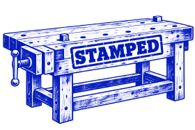

# Improving STAMPED research skills

This repository is a workshop for improving STAMPED research skills.
It compares four ways of assisting agents with scientific studies, evaluates the resulting research objects using a versioned assessment, and uses that evidence to revise the skills.
The question is whether the guidance helps agents do sound science with more thorough, efficient and consistent reproducibility.

Each iteration tests a pinned skill revision on selected studies: run matched agents, assess their work independently, compare outcomes and effort, then improve and compress the reusable guidance.
Study inputs and scientific outputs belong to study submodules; iteration subdatasets connect that work to changes in the skills.

The broader hypothesis concerns both humans and agents; this experiment tests agents.
Repeated baseline runs help distinguish improvements from ordinary variability.
Results from one study do not establish transfer to other studies.

| Condition | Added assistance |
| --- | --- |
| Baseline | No supplied research skills or discovery instruction |
| General discovery | Find, install and use skills useful for the task |
| Reproducible-science discovery | Find, install and use skills for scientific quality and reproducibility |
| Explicit pinned STAMPED | Invoke the supplied, versioned STAMPED workflows |

All conditions receive the same scientific task and common resources.
We record assigned assistance separately from what agents actually discover, install and use, including unsuccessful attempts.
These comparisons measure assistance strategies: wording can affect behavior even without skill use.
The explicit STAMPED condition directly tests the guidance we are improving.

During preparation, the assessor and its runtime can improve alongside the other skills.
Formal runs begin from a fresh clone with shallow history.
Comparable assessment series keep their assessor and runtime fixed; necessary repairs define a separate series.

To start or resume a coordinator, give it this repository and a request such as:

> Follow `prompt.md` using `studies/narps`.
> First read the selected iteration's pinned `STATUS.md` and reconcile any active runs.
> Continue its registered next step; select and seal a new registration only when no existing one applies.

| Location | Purpose |
| --- | --- |
| `prompt.md` | The research, assessment and skill-improvement loop |
| `AGENTS.md` | Instructions for the coordinator |
| `iterations/<iteration>/` | An iteration subdataset with revisions, linked trials, assessments, comparisons and reasons for changes |
| `studies/<study>/` | A versioned study submodule |
| `studies/<study>/input/` | The scientific prompt and verified data supplied to research workers |
| `studies/<study>/coordinator-guidance/` | Evaluation guidance and reference material for the coordinator and judges |
| `studies/<study>/results/<run>/` | An experiment submodule containing the worker's research object, assessments and execution records |
| `skills/` | Evolving `con/skills`; each iteration records the exact tested revision and development branch |
| `assessment/` | The selected assessor version, identified by `assessment-version.json` |

Keep iteration, study and experiment submodules uninitialized until needed.
Open selected paths and retrieve their required annex content; the coordinator tree retains their exact commits without expanding every experiment.
The [retrieval guide](RETRIEVAL.md) gives the current NARPS payload route and commands for a selected experiment.

The intended result is transferable guidance: an independent agent can use these skills with a researcher's own data and hypothesis to produce scientifically useful, rigorous and convenient research.
The products are improved shareable skills, evidence about their impact, and a STAMPED research object documenting the whole workshop.
Figures summarize scientific outcomes, reproducibility, effort and variability.

NARPS is the first formal study.
The tested source and preparation evidence are linked in [`source-version.json`](source-version.json); formal trials and skill iterations are recorded here.

The [completed NARPS development comparison](https://github.com/leej3/stamped-in-practice/blob/851f3905ab26d0a9ac6deb7c52f85bd085cc54ff/DATASET.md) contains twelve research workers, sixteen assigned judgments, figures and the resulting skill reflection.
Its workflow mandates and assessment changes are disclosed.
The [sealed tool-neutral comparison](https://github.com/leej3/stamped-in-practice/blob/5056bebf6eb33c2b9b02262efc39d084259424ce/registration.md) fixes 72 new workers and 96 judgments.
The [completed round-one reassessment](https://github.com/leej3/stamped-in-practice/blob/17ac9ab3eb33d0d9974737116c6a97de3e0dc579/assessment-series/narps-neutral-r1-operational-v4/synthesis/README.md) retains 32 scientific judgments of 24 research deliveries and 30 valid checklists, with figures and links to the unchanged original assessment.
Duplicate judges disagreed on 67 of 248 checklist decisions and on scientific adequacy in five of eight duplicate pairs; these results do not establish a skill benefit.
The supplied assessment procedure also exposed treatment assignments; that limitation remains disclosed.
The user has directed rounds two and three to continue with the existing Luna/high procedure and its known limitations, without an extra round-one series or adoption of prospective assessment changes. Round two adopts the [revised research skills and trials](https://github.com/leej3/stamped-in-practice/blob/17ac9ab3eb33d0d9974737116c6a97de3e0dc579/skill-reflection/research-skill-revision-01/README.md) for environment reconstruction, complete deliveries and reference routing, at exact revision `d83d7d66`.
Execution uses research source `9068886f` and frozen operational judging source `4f72ef49`; prospective changes retained on main do not replace those execution sources.
The [prospective assessment helper revision and trials](https://github.com/leej3/stamped-in-practice/blob/17ac9ab3eb33d0d9974737116c6a97de3e0dc579/skill-reflection/assessment-capture-skill-01/README.md) protect capture identities and isolate remote checks; the formal assessor remains frozen at `9852d836`.
Follow the [status at this checkout's pinned iteration](https://github.com/leej3/stamped-in-practice/blob/17ac9ab3eb33d0d9974737116c6a97de3e0dc579/STATUS.md), which links the separate runtime and scientific-wording preparation evidence, before continuing.
