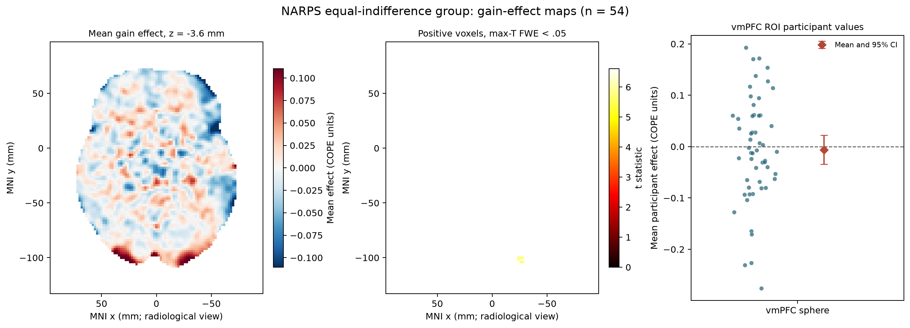
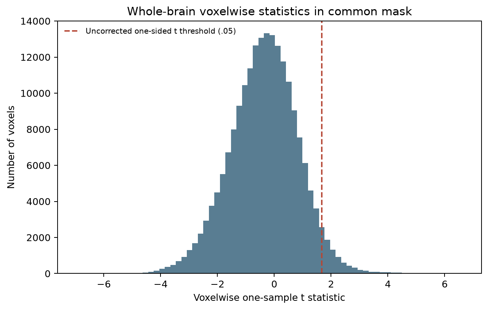

# NARPS research delivery: run 20

This experiment contains the worker's [scientific report](report.md), [analysis code](analysis/analyze.py), [results](results/) and original figures.
The coordinator copied these files unchanged from the stopped delivery; this publication does not establish scientific validity or earn worker-practice credit.

Small readable files are in Git; numerical image outputs are in annex at their original paths.
Retrieve required annex files from the experiment's configured remote before using them.
The [copy manifest](coordinator/browsable-copy-01/manifest.json) records each original path, byte count, SHA256 and storage choice.
The [complete original archive and execution records](coordinator/README.md) remain authoritative, including uncommitted files and the original Git and environment state.
This README is coordinator-written; the linked report and figures are unchanged worker outputs.
