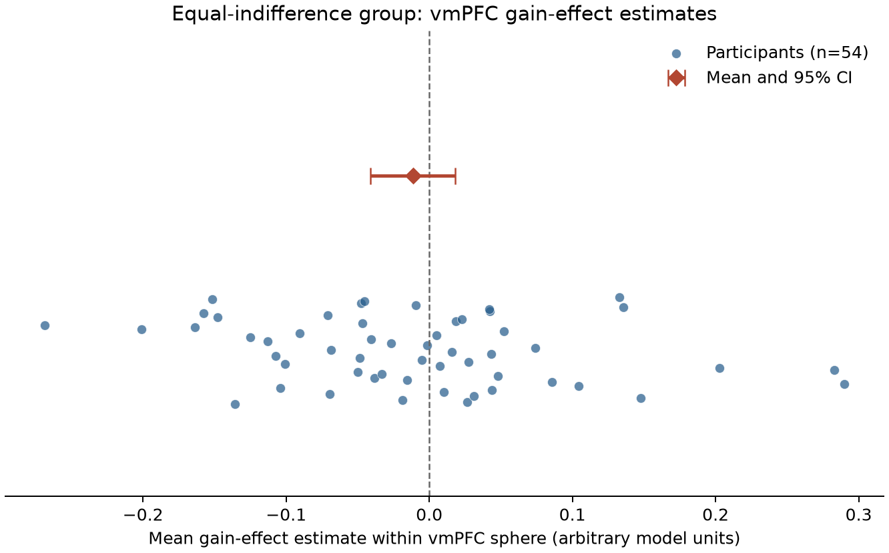

# Potential gains and brain activity

## Finding

The supplied gain-effect maps do **not support a positive vmPFC response to increasing potential gain** in the equal-indifference group under the required whole-brain corrected test. The largest statistic in the independently defined vmPFC region was small (t = 1.30; whole-brain max-t FWE p = 1.00). The average vmPFC effect estimate was slightly negative, and its 95% confidence interval included zero. Positive whole-brain corrected effects occurred in small posterior/inferior clusters outside vmPFC; those findings do not support the stated vmPFC hypothesis.

## Analysis

We analyzed all 54 supplied AO86 participant gain-effect maps in the equal-indifference group. Input file size and SHA-256 checksums were verified against `input/sources.json`. All maps had matching 97 × 115 × 81 grids, 2 × 2 × 2.4 mm voxels, and finite values. No participant was excluded. The group mask was the intersection of nonzero voxels in all 54 maps (198,029 voxels), so background zeros outside any participant's modeled coverage were not treated as observations.

In this group, the possible-gain range was twice the possible-loss range. The analysis is restricted to the supplied gain-effect maps and does not re-estimate either trial-level regressor.

The primary model was an intercept-only one-sample group model of participant effect estimates, testing the positive direction. We used 10,000 permutations (seed 20261015) and voxelwise maximum-t family-wise error correction across the full common brain mask (alpha = .05). This provides whole-brain rather than ROI-only correction, consistent with the [NARPS analysis instructions](https://www.narps.info/files/narps_instructions_for_analysis_teams.pdf). The permutation one-sample test assumes effects are symmetrically distributed about zero under the null; the correction uses the maximum t statistic across the analysis mask ([Nilearn documentation](https://nilearn.github.io/0.14.0/modules/generated/nilearn.glm.second_level.non_parametric_inference.html)).

We defined vmPFC independently as a 10 mm radius sphere centered at MNI [0, 46, -6], a commonly used value-related vmPFC location informed by meta-analysis ([Bartra et al., 2013](https://pmc.ncbi.nlm.nih.gov/articles/PMC3756836/); see also [Dore et al., 2016](https://brucedore.github.io/Dore_et_al_JOCN_2016.pdf)). The sphere included 413 voxels in the shared mask. It was used to localize the target region; the inferential support criterion remained voxelwise whole-brain FWE p < .05.

## Results

The vmPFC sphere's mean participant effect was -0.011 (between-participant SD = 0.108; 95% t interval for the mean [-0.041, 0.018]). Its maximum statistic was t = 1.30 at [0, 42, -8.4] MNI, with whole-brain max-t FWE p = 1.00. No voxel in the vmPFC sphere passed whole-brain correction.

Across the full brain, 24 voxels in three 26-connected clusters passed positive-direction max-t FWE correction. The global maximum was t = 6.62 at [-26, -102, -3.6] MNI (FWE p = .0009). All corrected foci were outside the vmPFC sphere. The anatomical label and biological interpretation of these small posterior/inferior foci are not central to the vmPFC hypothesis and should be treated cautiously.

| Cluster | Voxels | Peak t | Peak whole-brain FWE p | MNI x, y, z (mm) |
|---|---:|---:|---:|---:|
| 1 | 17 | 6.62 | .0009 | -26, -102, -3.6 |
| 2 | 2 | 5.76 | .0127 | 26, -98, -1.2 |
| 3 | 5 | 6.19 | .0029 | 30, -94, -8.4 |

## Interpretation and limitations

This is a lack of corrected support for the predicted positive gain effect in vmPFC under the supplied participant model and this group analysis. It is not evidence that the true effect is exactly zero, nor does it rule out vmPFC value responses under other task contrasts or modeling choices. The confidence interval is compatible with small negative and positive average effects, while the voxelwise corrected test has limited power for modest spatially localized effects.

The maps are participant contrast parameter estimates, not standardized statistics or group-level results. The gain regressor was mean-centered and variance-normalized before HRF convolution, so its coefficient is not a change per currency unit. The response regressor used response-time durations; gain and loss were fit in separate models. Consequently, the estimate is conditional on those fixed upstream choices. No participant variance maps or complete executable upstream pipeline were supplied, so we could not perform precision-weighted group inference or re-estimate the first-level model. The group model gives participants equal weight. The subject-level permutation inference relies on a symmetric null distribution, and its p-values should be interpreted within the defined mask and tested positive direction.

## Reproducibility

Run from the repository root with `pixi run duct ... pixi run python analysis/run_group_analysis.py`. The exact command, stdout, stderr, resource samples, and duct run summary are retained in `logs/`. `results/run_summary.json` records model settings, checks, estimates, coordinates, and software versions. `results/participant_qc.tsv` and `results/vmPFC_subject_effects.tsv` preserve participant-level checks and ROI estimates. NIfTI outputs include the common mask, mean effect, t statistic, max-t FWE map, and vmPFC sphere. The analysis code is in [analysis/run_group_analysis.py](analysis/run_group_analysis.py).
