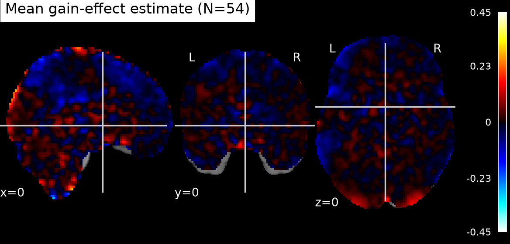
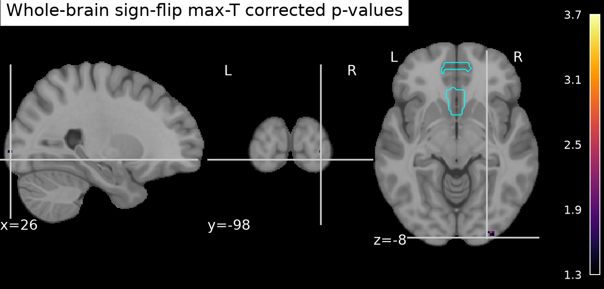
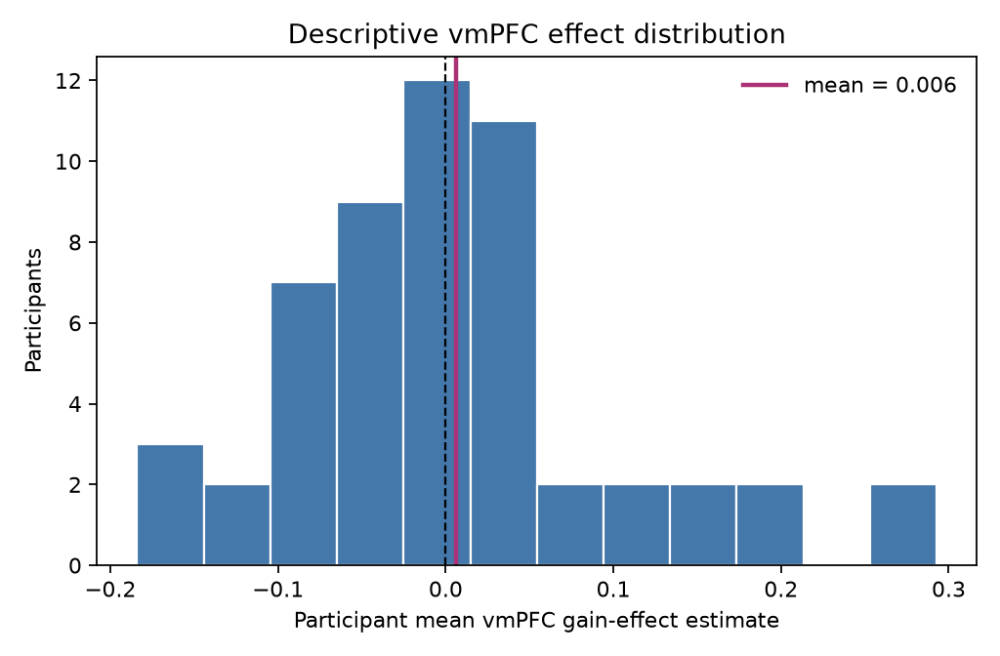

# Potential gains and brain activity in the NARPS equal-indifference group

## Question and conclusion

We tested whether the supplied participant gain-effect estimates show a positive group response in ventromedial prefrontal cortex (vmPFC). **The analysis does not support a positive vmPFC effect after whole-brain correction.** The vmPFC mean was close to zero, its confidence interval included positive and negative values, and no vmPFC voxel survived the whole-brain family-wise error (FWE) correction. A small set of corrected positive voxels occurred in posterior occipital cortex, outside the hypothesis region; those findings do not support the vmPFC hypothesis.

This is a failure to find corrected evidence for the predicted vmPFC response in these data. It does not establish that the true vmPFC effect is zero or rule out effects too small or variable to detect.

## Data and methods

The analysis used all 54 supplied equal-indifference participant maps and the matching metadata. These are unthresholded AO86 participant-level gain COPEs averaged over four runs, in MNI152NLin2009cAsym space. The fixed upstream model used a mean-centered, variance-normalized gain modulator convolved with the HRF, response-time-duration response trials, and separate gain and loss models. A COPE is an estimated coefficient for that regressor; it is not a test statistic, is not a currency-unit slope, and does not isolate gain from all modeling choices. The group model cannot be variance-weighted because participant variance maps were not supplied.

We fit a one-sample random-effects group model to the participant estimates at each voxel, testing the directional positive effect. The confirmatory statistic was a one-sided participant sign-flip permutation test with a maximum-t statistic over the full analysis mask. This controls voxelwise whole-brain FWE at .05 and matches the original NARPS instruction to base decisions on whole-brain-corrected results ([Hypothesis 1 instructions](https://www.narps.info/files/narps_instructions_for_analysis_teams.pdf)). We used 4,999 random sign assignments (seed 20261016), giving a corrected-p Monte Carlo resolution of .0002. The sign-flip test assumes exchangeable, approximately symmetric participant-level effects under the null.

The vmPFC localization was specified from Harvard–Oxford cortical atlas labels “Frontal Medial Cortex” and “Subcallosal Cortex,” restricted to the anterior ventral midline (|x| ≤ 20, y > 0, z ≤ 20 mm in MNI space). It is an anatomical localization mask for interpreting the whole-brain map; inference was not restricted to this mask. This operational definition is not exhaustive of every vmPFC convention and omits more lateral orbitofrontal cortex.

Quality checks confirmed 54 maps for 54 metadata rows, matching geometry (97 × 115 × 81; 2 × 2 × 2.4 mm), and finite data. The analysis mask included 210,968 voxels with a nonzero estimate in at least 90% of participants (median coverage 100%). No participants were excluded. We retained all maps; the supplied COPEs are effect estimates, and no exclusion threshold based on their magnitude was specified. Participants’ mean age was 26.1 years (SD 3.0); the supplied gender counts were 30 F and 24 M.

## Results

The largest positive group statistic was t(53) = 6.62. Twenty-four voxels in three small posterior clusters passed whole-brain FWE correction. All peaks were outside the vmPFC mask.

| Peak MNI (x, y, z), mm | Voxels | Peak t(53) | Peak whole-brain pFWE |
|---|---:|---:|---:|
| (−26, −102, −3.6) | 17 | 6.62 | .0010 |
| (26, −98, −1.2) | 2 | 5.76 | .0122 |
| (30, −94, −8.4) | 5 | 6.19 | .0036 |

The strongest corrected permutation p was .0010 (with Monte Carlo resolution .0002). These posterior findings are not evidence for the hypothesized vmPFC effect and are not interpreted as a new task effect.

Across the vmPFC localization mask, the average group effect estimate was 0.006 (between-participant SD 0.263; 95% t interval −0.066 to 0.078; 54 participants; descriptive t(53) = 0.17, one-sided uncorrected p = .432). No vmPFC voxel survived whole-brain correction. The interval is descriptive and uses the supplied COPE scale; it should not be interpreted in monetary units. The positive whole-brain test found no corrected vmPFC support, even though a few corrected voxels appeared elsewhere.

*Figure 1. Mean gain-effect COPE across participants. These estimates are unthresholded and the color scale is in the upstream coefficient units.*

*Figure 2. One-sided max-T permutation results, shown as −log10(FWE-corrected p); only values passing pFWE < .05 are colored. Cyan outlines the vmPFC localization mask. Corrected voxels are posterior and outside that mask.*

*Figure 3. Each bar represents one participant’s mean COPE over the vmPFC localization mask; dashed line denotes zero and solid line the sample mean.*

## Limits

The result depends on the supplied first-level specification, including the normalized gain regressor, the separate gain and loss models, and the handling of response-time durations and motion. No time-series data or participant variance maps were provided, so we could not refit first-level models or use a precision-weighted second-level model. The vmPFC atlas mask is one defensible operational definition, not a uniquely agreed boundary. Sign-flip inference relies on participant-level exchangeability under the null; the Monte Carlo correction has finite resolution. Finally, a null corrected finding is not evidence of equivalence or proof of no vmPFC response.

## Reproducibility

- Executable analysis: [`analysis/group_analysis.py`](analysis/group_analysis.py)
- Notebook walkthrough: [`analysis/narps_group_analysis.ipynb`](analysis/narps_group_analysis.ipynb)
- Machine-readable summary and checks: [`results/analysis_summary.json`](results/analysis_summary.json), [`results/quality_checks.json`](results/quality_checks.json)
- Corrected maps and analysis mask: `results/group_*.nii.gz`, `results/analysis_mask.nii.gz`
- Corrected cluster table: [`results/significant_clusters.csv`](results/significant_clusters.csv)

The analysis used Python 3.13.16, NumPy 2.5.4, SciPy 1.18.1, NiBabel 5.4.2, and Nilearn 0.14.1. The task and upstream methods supplied with the data are documented in [`input/study-task.md`](input/study-task.md) and [`input/upstream-methods.md`](input/upstream-methods.md). For the broader context of variability across NARPS teams, see the original study ([Botvinik-Nezer et al., 2020](https://www.nature.com/articles/s41586-020-2314-9)).
