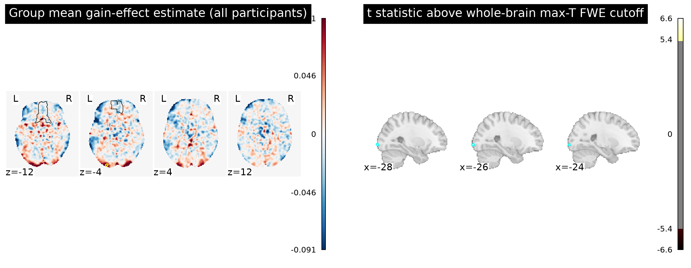
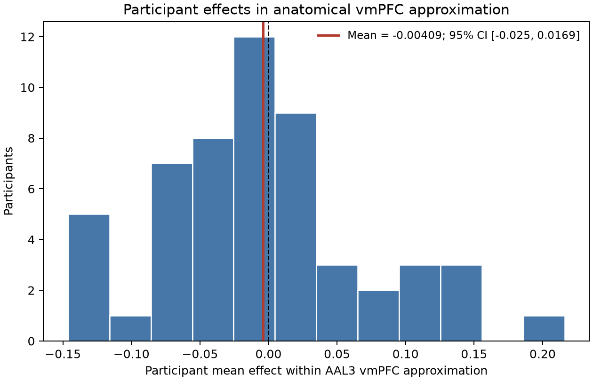

# Potential gains and brain activity

## Question and conclusion

In the NARPS equal-indifference group, the gain-effect maps do **not** support a positive vmPFC response to increasing potential gain under a whole-brain corrected test. The group mean in an anatomically defined vmPFC approximation was slightly negative (mean = −0.0041, 95% t interval [−0.0250, 0.0169]). A positive whole-brain corrected effect was detected in posterior visual cortex, but it does not support the vmPFC hypothesis.

The vmPFC interval includes both small negative and small positive values. Thus, this is a lack of evidence for the predicted positive effect at this precision and with this analysis, not evidence that the true effect is exactly zero.

## Data and group analysis

We analyzed the 54 supplied AO86 participant gain-effect maps for the complete equal-indifference cohort. Participants made accept/reject decisions on mixed gambles; in this group, the potential gain range was twice the loss range. The maps were 3D NIfTI images on a common 2 × 2 × 2.4 mm MNI152NLin2009cAsym grid. Each image was finite and geometrically aligned; all 54 participants matched the metadata and source byte-size/SHA-256 manifest. We excluded none. The whole-brain search mask included voxels with nonzero finite estimates in at least 90% of participants (210,968 voxels), accommodating small variation in participant map coverage.

The primary estimand was the group mean of participant gain-effect coefficients. We tested whether it exceeded zero with a one-sample, positive-direction sign-flip permutation test. For each of 10,000 seeded random sign flips, we recorded the maximum t statistic across the complete search mask; this provides voxelwise whole-brain family-wise error control at α = .05. Sign flipping assumes the participant-level null effects are exchangeable under sign reversal (approximately symmetric around zero). No covariates were added because age and gender were not part of the stated hypothesis and no precision maps were supplied for a weighted mixed-effects model.

The original NARPS hypothesis specifies a positive parametric gain effect in vmPFC and calls for whole-brain corrected inference ([NARPS analysis instructions, Hypothesis 1](https://www.narps.info/files/narps_instructions_for_analysis_teams.pdf)). To identify vmPFC independently of the observed results, we used AAL3v2 bilateral `Frontal_Med_Orb`, `Rectus`, and `OFCmed` labels as a broad anatomical approximation ([AAL3 atlas](https://doi.org/10.1016/j.neuroimage.2019.116189)). We resampled these labels to the effect-map grid using nearest-neighbor interpolation. This region was used to localize and summarize effects; it did not restrict the primary whole-brain search.

## Results

The vmPFC approximation contained 3,382 search-mask voxels. The average participant effect within it was −0.0041 (SD across participants = 0.0767), with a 95% t interval [−0.0250, 0.0169]; a descriptive one-sided t test gave *t*(53) = −0.39, *p* = .651. This uncorrected ROI summary is not the confirmatory test.

Across the whole brain, 24 voxels exceeded the positive max-T family-wise threshold. The largest statistic was *t*(53) = 6.62 at MNI [−26, −102, −3.6], with permutation whole-brain *p*<sub>FWE</sub> = .00060. The three connected components were all in posterior occipital cortex; none overlapped the vmPFC approximation. The strongest whole-brain effect therefore does not answer the vmPFC hypothesis affirmatively.



*Figure 1. Left: group mean coefficient map; black contours show the independent AAL3v2 vmPFC approximation, and yellow marks voxelwise max-T significant locations. Right: t statistics above the empirical 95th percentile of the whole-brain max-T null distribution. Significance is voxelwise FWE corrected; connected components are shown descriptively.*



*Figure 2. Distribution of participant-average gain-effect coefficients in the anatomical vmPFC approximation. The black dashed line is zero; the red line is the sample mean and its 95% t interval.*

## Interpretation and limitations

These maps are participant-level effect estimates, not standardized z/t maps or group statistics. Under the fixed upstream model, the gain regressor was mean-centered and variance-normalized before HRF convolution, so the coefficient is **not** a response change per currency unit. It reflects the fitted response-time-duration gain modulation conditional on the upstream response, choice, nuisance, motion, censoring, drift, run-combination, and separate gain/loss modeling decisions. The group test therefore evaluates whether these supplied coefficients average above zero; it cannot validate or revise the first-level model or isolate a causal effect of money independent of that model.

No participant-level variance maps or executable upstream pipeline were provided. The group analysis consequently treats participant effects equally and estimates between-participant uncertainty from their dispersion. The sign-flip test also relies on approximate symmetry of participant-level effects under the null. The vmPFC anatomical approximation is broad, and atlas registration/resampling adds localization uncertainty. Failure to find a positive corrected vmPFC effect does not rule out a smaller effect, a more focal effect missed by this anatomical approximation, or an effect under another valid first-level model; it means this analysis does not provide the required corrected evidence for the stated vmPFC claim.

## Reproducibility

Run from the workspace root with the supplied interpreter:

```bash
OPENBLAS_NUM_THREADS=1 OMP_NUM_THREADS=1 \
  /Users/johnlee/.local/state/stamped-in-practice/narps-neutral-v1/common-environment/.pixi/envs/default/bin/python analysis.py
```

The script records the permutation seed, map checksums, cohort/map QC, group maps, null distribution, participant ROI summaries, and component table. Main numerical output is in `results/group_results.json`. The installed workspace-local `jupyter-notebook` skill was selected as a reproducibility aid; the analysis is delivered as a standalone executable script and report rather than a notebook because the permutation run is a single end-to-end workflow.
