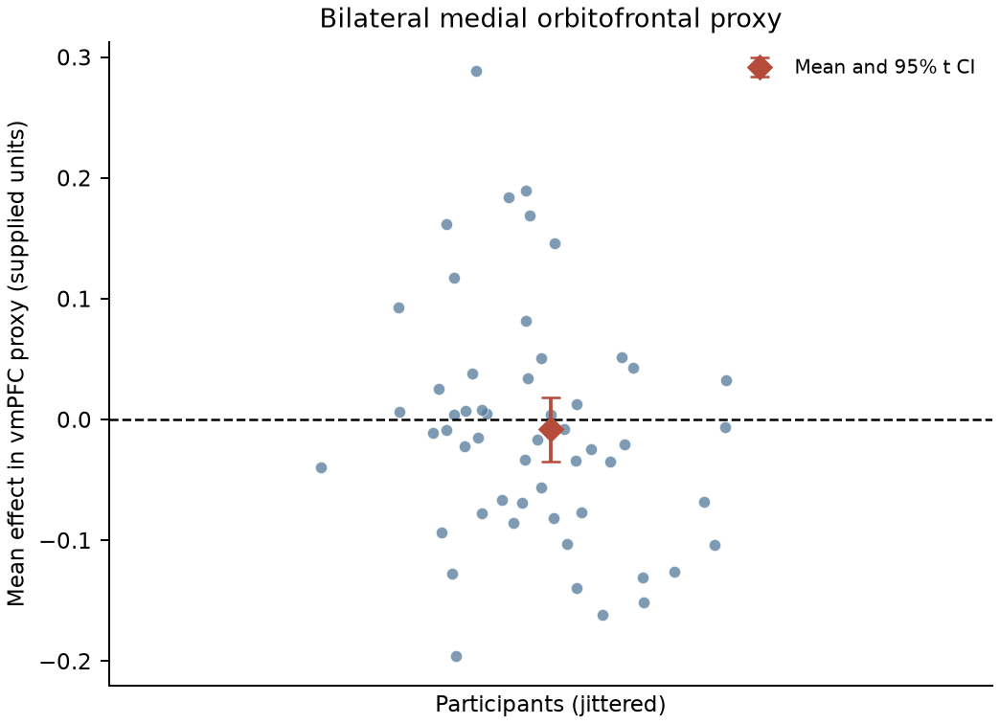
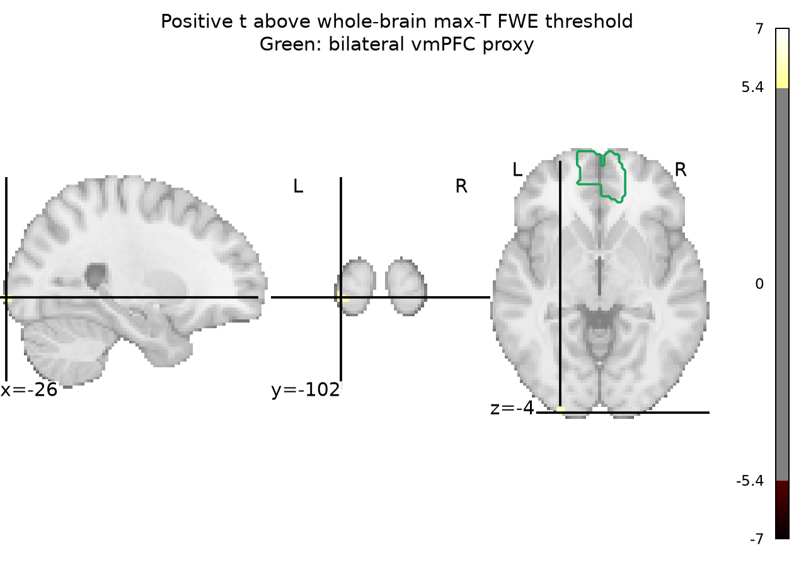

# Potential gains and vmPFC activity

## Question and conclusion

In the 54-person NARPS equal-indifference group, the supplied gain-effect maps do **not** support a positive gain association in vmPFC under whole-brain family-wise error (FWE) correction. In a bilateral medial orbitofrontal anatomical proxy for vmPFC, the mean participant effect was −0.008 supplied units (95% t interval −0.035 to 0.019); no voxel in that proxy survived whole-brain correction. This is absence of evidence for the predicted positive effect in these maps, not evidence that the true effect is exactly zero.

The whole-brain test did identify 23 positive FWE-significant voxels in three small posterior-inferior foci (peak t=6.62 at MNI [−26, −102, −3.6]; two other peaks are listed in `results/fwe_clusters.tsv`). These do not overlap the vmPFC proxy. They lie near the posterior-inferior edge of the analyzed brain; one peak is outside AAL3-labeled tissue. I therefore do not interpret them as evidence about gain coding or as a vmPFC finding.

## Group model and inference

I tested whether the unweighted mean of the 54 participant gain-effect estimates was greater than zero at each voxel. The maps are participant contrast parameter estimates, not t/z statistics. Because participant variance maps were not supplied, I used an unweighted one-sample group t statistic rather than precision-weighted second-level inference. A one-sided sign-flip randomization test (5,000 random sign patterns; fixed seed 20261016) evaluated the positive-direction hypothesis. For each randomization, I recorded the maximum t over the analysis mask; voxel p-values are adjusted against that maximum distribution, controlling whole-brain voxelwise FWE at 0.05. The 95th percentile maximum-t threshold was 5.39. Sign flipping assumes independent participants and a symmetric null distribution of participant effects. The original NARPS instructions posed a positive, region-specific hypothesis and required support decisions from whole-brain-corrected analyses; this analysis keeps that whole-brain correction rather than treating an uncorrected ROI result as support ([NARPS analysis instructions](https://www.narps.info/files/narps_instructions_for_analysis_teams.pdf); [permutation inference background](https://pmc.ncbi.nlm.nih.gov/articles/PMC6871862/)).

The analysis mask intersected an MNI152 standard brain mask with voxels nonzero in at least 49 of 54 maps and finite in every map (192,339 voxels). The vmPFC anatomical proxy was the bilateral `Frontal_Med_Orb` parcel in AAL3v2, mapped to the input grid using nearest-neighbor resampling. This is an explicit reproducible anatomical proxy, not a claim that one atlas parcel exhaustively defines functional vmPFC ([AAL3 atlas paper](https://pubmed.ncbi.nlm.nih.gov/31521825/)). The ROI summary is descriptive; it does not replace or relax whole-brain correction.

## Data checks and limitations

All 54 supplied maps matched the equal-indifference participant IDs, shared the same MNI grid, loaded with finite data, and passed the SHA256 values in the supplied manifest. No participant was excluded. The task’s potential-gain range was twice its potential-loss range, as described in the supplied methods. However, the upstream gain regressor was mean-centered and variance-normalized before HRF convolution, so these coefficients are not change per currency unit. The estimates are conditional on the upstream choice to model gain separately from loss and on its other fixed first-level terms. This group analysis cannot revisit those modeling decisions.

The lack of participant variance maps prevents a precision-weighted mixed-effects analysis and limits uncertainty modeling to variation across the supplied participant estimates. The permutation result relies on sign-flip symmetry. AAL3 medial orbitofrontal cortex is an imperfect vmPFC proxy, and the maps’ MNI152NLin2009cAsym space and the standard mask/atlas are not identical templates. The interval around the proxy mean includes zero and is not an equivalence interval: modest positive or spatially heterogeneous effects remain possible. A non-significant whole-brain-corrected result therefore means this group analysis did not establish a positive vmPFC effect at the chosen error rate; it does not show that increasing gains have no neural correlate. More broadly, the parametric map association does not establish that potential gain causally produces a response.

## Figures

**Figure 1.** Participant-average effect within bilateral medial orbitofrontal vmPFC proxy. Each dot is one participant; the diamond and interval show the mean and descriptive 95% t interval across participants.



**Figure 2.** Positive t statistics exceeding the 95th percentile of the whole-brain maximum-t null distribution; green outline is the vmPFC proxy. Small corrected foci occur posterior-inferior to the proxy and are not interpreted anatomically.



## Reproducibility files

- `analyze.py` — complete group-analysis and figure-generation script (Python with NumPy, pandas, SciPy, NiBabel, Nilearn, and Matplotlib).
- `results/summary.json` — numeric analysis summary and QC decisions.
- `results/fwe_clusters.tsv` — descriptive extents and peak coordinates for corrected voxels; cluster extent itself was not the inferential correction.
- `results/participant_qc.tsv` — per-participant coverage and effect summaries.
- `results/group_mask.nii.gz`, `results/mean_effect.nii.gz`, `results/t_statistic.nii.gz`, `results/p_fwe_maxT.nii.gz` — analysis mask, mean, t, and max-T adjusted p maps.
- `results/vmPFC_proxy_aal3.nii.gz` — resampled anatomical proxy used for localization.

Reproduce from the workspace root with:

```bash
/Users/johnlee/.local/state/stamped-in-practice/narps-neutral-v1/common-environment/.pixi/envs/default/bin/python analyze.py
```
