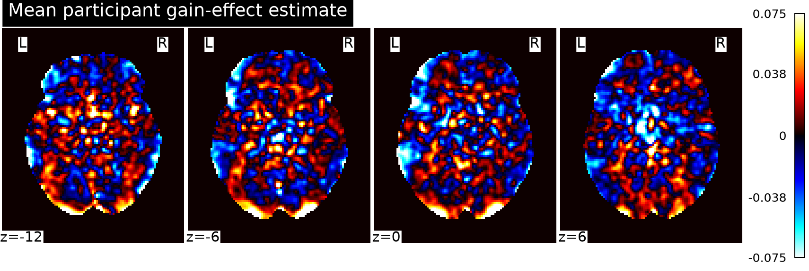
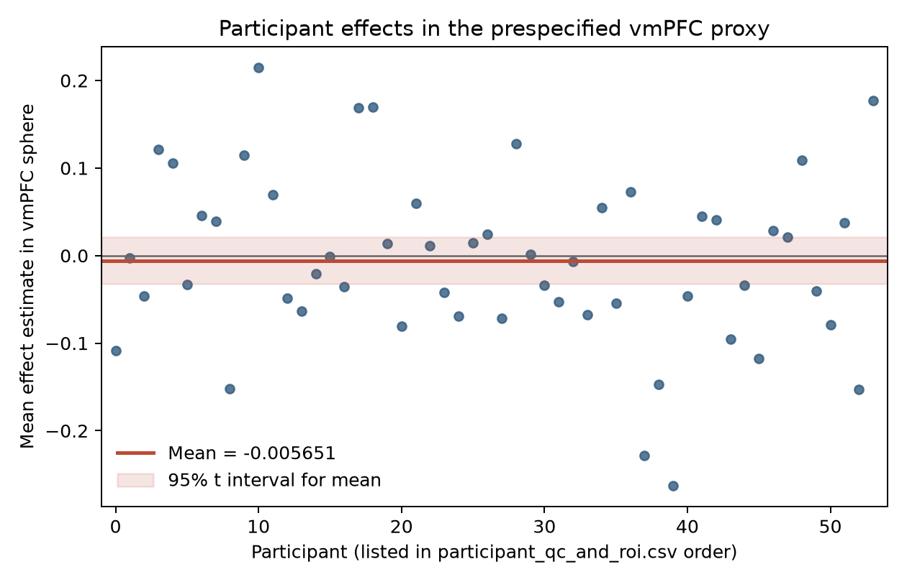

# Potential gain and brain activity in the NARPS equal-indifference group

## Question and result

We tested whether the participant-level gain effect was positive in the equal-indifference group (54 participants). The whole-brain one-sided test found 23 voxels significant by family-wise-error (FWE) corrected max-T permutation inference (peak *t*(53) = 6.62, MNI [−26, −102, −3.6], FWE *p* = .00090). This peak is far posterior and outside vmPFC. In the prespecified vmPFC proxy, the average effect was −0.0057 (95% *t* interval [−0.0323, 0.0210]); the directional one-sample test gave *t*(53) = −0.43, *p* = .664. No voxel in the proxy survived whole-brain FWE correction; the proxy's largest positive *t* was 2.12 (whole-brain FWE *p* = 1.00). Thus, these maps do not support the predicted positive vmPFC response, despite evidence for positive effects elsewhere in the brain.

## Methods

All 54 supplied unthresholded AO86 participant contrast estimates were included; no participants were excluded. We verified map count, participant IDs, dimensions, affine, and finite values. The input grid is MNI152NLin2009cAsym, 97 × 115 × 81, with 2 × 2 × 2.4 mm voxels. The analysis mask was the standard MNI152 2-mm brain mask resampled to that grid, restricted to voxels nonzero in at least 95% of participants (190,657 voxels). The supplied maps had 97.4–99.8% nonzero coverage within the standard brain mask.

At each voxel, we fit an equal-weight one-sample group model to the 54 participant effects and used the positive direction specified by the hypothesis. Whole-brain FWE was controlled with the permutation distribution of the maximum positive *t* statistic across the analysis mask from 10,000 random participant-level sign flips (seed 8601; plus-one *p* estimate). This provides a whole-brain correction while preserving the spatial dependence among voxels. Its validity assumes participant effects are exchangeable and approximately symmetric under the null. This is a random-effects style group test based on between-participant dispersion; participant-specific first-level variance maps were unavailable, so precision-weighted mixed-effects inference was not possible.

Because vmPFC is not a single sharply bounded anatomical label, we defined an explicit, independent anatomical proxy as a 12-mm-radius sphere centered at MNI [0, 40, −12], a conventional medial valuation-region coordinate near vmPFC peaks in coordinate-based valuation meta-analysis ([Bartra et al., 2013](https://pmc.ncbi.nlm.nih.gov/articles/PMC3756836/)). The sphere was intersected with the whole-brain analysis mask (762 voxels). The region-average effect and its *t*-based 95% confidence interval summarize the group estimate. The ROI is descriptive; the confirmatory decision is based on whole-brain corrected inference, as in the original NARPS instructions. The original instructions specify the positive vmPFC gain hypothesis and whole-brain corrected evaluation ([NARPS analysis instructions, Hypothesis 1](https://www.narps.info/files/narps_instructions_for_analysis_teams.pdf)).

## Interpretation and limitations

The maps are participant contrast parameter estimates, not standardized *t* or *z* statistics. Per the fixed upstream model, the gain modulator was mean-centered and variance-normalized before HRF convolution; therefore the coefficient is not an effect per monetary unit. It estimates the modeled gain-related response conditional on the upstream choices, including response-time event durations and a separate gain model rather than a joint gain-and-loss model. The group's potential-gain range was twice its potential-loss range. We did not rerun preprocessing or participant models.

The null vmPFC result means this group-level test did not provide evidence for a positive vmPFC gain effect at the chosen inferential resolution. The interval still includes modest positive and negative mean effects; this is not evidence that the true effect is exactly zero or that vmPFC is insensitive to gain. The anatomical proxy is an operational choice and other vmPFC definitions could yield different estimates. The whole-brain corrected posterior finding does not establish a vmPFC effect and should not be substituted for the hypothesized location. Finally, unmodeled first-level uncertainty, upstream model misspecification, and the modest sample size limit sensitivity and interpretation; these observational task coefficients do not establish that monetary gains causally produce neural activity.

## Reproducibility files

- `analysis.py`: complete group workflow; run with the supplied Python environment from the workspace root.
- `results/summary.json`: analysis settings and main numerical results.
- `results/participant_qc_and_roi.csv`: per-participant brain-mask and ROI summaries.
- `results/group_mean_effect.nii.gz`, `results/t_statistic.nii.gz`, `results/p_uncorrected_one_sided.nii.gz`, `results/p_fwe_maxT.nii.gz`: unthresholded group statistical maps; voxels outside the analysis mask are NaN.
- `figures/`: generated figures.

The original instructions PDF was intermittently unavailable to direct retrieval during this run; the linked source and the supplied task brief both identify whole-brain correction as the required standard.
