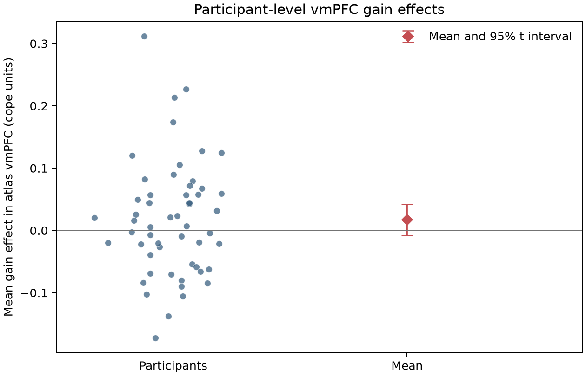
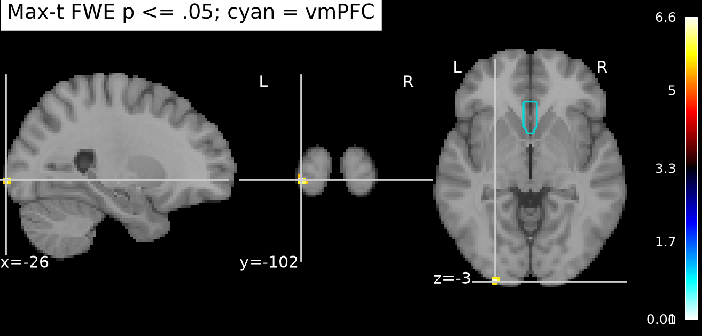

# Potential gains and vmPFC activity

## Result

**This analysis does not support a positive gain effect in vmPFC after whole-brain correction.** The complete equal-indifference cohort (54 participants) was analyzed with a one-sided, one-sample group test on the supplied participant gain-effect maps. No voxel in the anatomically defined vmPFC region survived whole-brain family-wise error correction. The highest-t vmPFC voxel was at MNI (−2, 24, −18), t(53)=4.19, but its whole-brain max-t adjusted p was .782.

The descriptive mean across the vmPFC ROI was 0.012 cope units (95% t interval −0.008 to 0.033; one-sided unadjusted p=.115). Participants varied around that mean. This interval is compatible with small negative and positive average effects; it is not an equivalence test and does not establish a zero effect.

The whole-brain test found 24 voxels with positive effects at max-t FWE p≤.05. The maximum was posterior cerebellar (MNI −26, −102, −3.6; t(53)=6.62; FWE p=.0007), outside vmPFC. This corrected result does not support the vmPFC-specific hypothesis.

## Methods and interpretation

The primary test was a one-sided, voxelwise one-sample t statistic calibrated by 9,999 random participant sign flips. Each permutation’s maximum positive t over the common coverage mask formed the null distribution, controlling family-wise error at α=.05 across voxels supported in every participant. The seed was 20261015. The union support included 251,063 voxels, but exact-zero support differed across maps at 53,034 voxels. The final mask uses the all-participant nonzero intersection (198,029 voxels), avoiding treating unsupported zeros as observed effects. Because no separate participant brain masks were supplied, this may also omit valid exact-zero estimates near coverage edges. No participants were excluded. Input image geometry matched, all 54 map identities matched the pinned cohort table, and the analysis verified input SHA256 checksums.

To interpret vmPFC anatomically without restricting the primary whole-brain search, we used the union of Harvard–Oxford cortical `Frontal Orbital Cortex` and `Subcallosal Cortex` probability values ≥25%, limited to |x|≤15 mm, y≥0, and z≤0 in MNI coordinates. The ROI contains 797 voxels in common participant support. This is a transparent operational definition of orbitomedial/subcallosal vmPFC; boundaries vary across atlases. The supplied maps use MNI152NLin2009cAsym, while Harvard–Oxford and the display template use standard MNI152, so ROI boundaries and coordinates are approximate. Atlas and template files are locally pinned with checksums. [Harvard–Oxford atlas documentation](https://nilearn.github.io/stable/modules/generated/nilearn.datasets.fetch_atlas_harvard_oxford.html).

The original NARPS instructions asked teams to judge their hypotheses from whole-brain corrected results rather than an ROI-only test; the NARPS paper describes that reporting requirement and the cross-team variability it produced. This analysis therefore treats a corrected voxel within vmPFC as the relevant evidence, and reports the ROI average only as a descriptive estimate. [Original NARPS analysis instructions](https://www.narps.info/files/narps_instructions_for_analysis_teams.pdf); [NARPS analysis-variability paper](https://www.nature.com/articles/s41586-020-2314-9).

## Limits

The maps are AO86 participant contrast parameter estimates averaged over four runs, not standardized statistics or group estimates. The upstream gain modulator was mean-centered and variance-normalized before HRF convolution, so these coefficients are not BOLD change per dollar. Gain and loss were modeled separately, making this effect conditional on that upstream specification. No participant variance maps or complete executable participant pipeline were supplied; the group analysis could not model first-level precision and gives each participant equal weight. Sign-flip inference assumes independent participant effects and a symmetric null distribution. Failure to detect corrected vmPFC support means this analysis did not establish the predicted effect; it does not show that vmPFC has no gain response.

## Reproduction

Run `pixi run group-analysis -- --permutations 9999` from the repository root. The fixed protocol is in [`analysis/PROTOCOL.md`](analysis/PROTOCOL.md), implementation in [`analysis/group_analysis.py`](analysis/group_analysis.py), environment in `pixi.toml` plus the exact lock snapshot on the `codex/env-narps-r1-12-20261015` branch, and fixed input provenance in [`input/sources.json`](input/sources.json) and [`input/atlas/sources.json`](input/atlas/sources.json). The exact lock, code, inputs, and replay linkage are recorded in [`provenance.json`](results/group-analysis/provenance.json). Final maps, tables, figures, and the numerical audit are under [`results/group-analysis/`](results/group-analysis/); run metadata, standard output/error, resource samples, and duct summaries are under `logs/`. `pixi run validate-results` independently recomputes the ROI confidence interval and max-t adjusted peak p-value and verifies the corrected-voxel count. A fresh checkout of the committed environment snapshot reproduced all maps, tables, summary values, and figures exactly; the comparison is saved in [`replay-validation.json`](results/group-analysis/replay-validation.json), with execution records under `logs/replay-*final*`.
