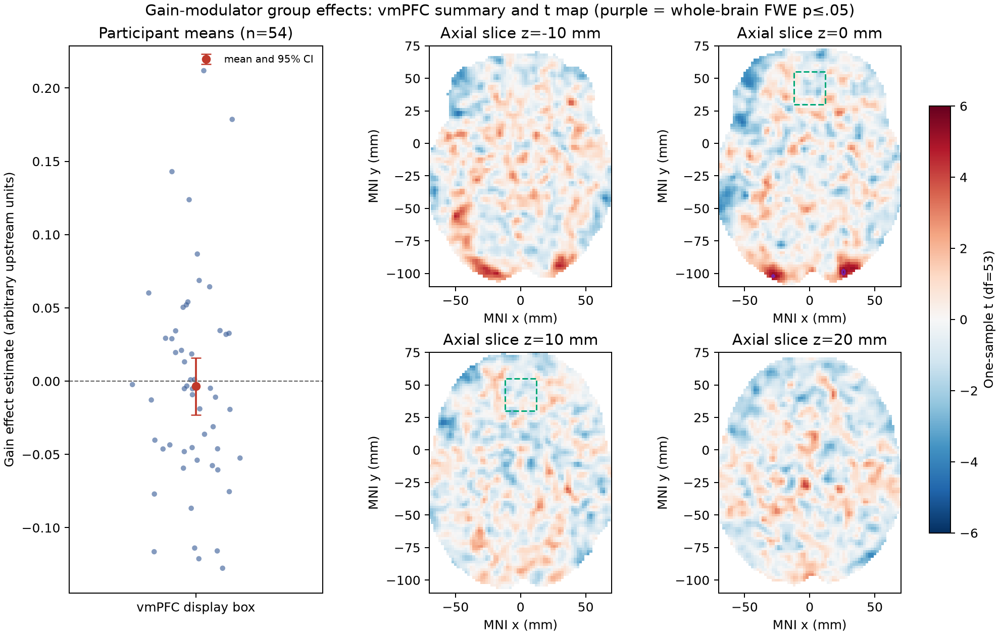

# Potential monetary gain and brain activity

## Result

**The supplied maps do not support a positive vmPFC gain effect in the NARPS equal-indifference group.** In a coordinate-defined vmPFC display box (MNI x = −12 to 12, y = 30 to 55, z = −15 to 10 mm), the across-participant mean contrast was −0.0035 (95% CI −0.0229 to 0.0160; arbitrary upstream units). No voxel in this box survived the one-sided whole-brain family-wise error (FWE) test. The interval includes zero and is not evidence that the true effect is exactly zero.

The whole-brain analysis did identify 24 positive voxels in three small posterior islands after maximum-t FWE correction (54 participants, 198,029 voxels, 9,999 sign flips, pFWE ≤ .05). The strongest voxel was at MNI (−26, −102, −3.6) mm (mean contrast 0.1121, t(53)=6.62, pFWE=.0006). This location is far posterior to vmPFC and does not support the stated regional hypothesis. Parametric voxelwise Bonferroni, a conservative reference analysis, retained 11 positive voxels, also outside the vmPFC box.

## Methods and interpretation

The sample was the complete supplied set of 54 equal-indifference participants (age 21–37 years; 30 F, 24 M); no participants were excluded. The unit of analysis was the participant. We fit a voxelwise one-sample t model to the unthresholded participant gain-effect maps, testing the directional alternative that the population mean is greater than zero. The common analysis mask contained voxels with nonzero image support in every map. Positive one-sided maximum-t permutation inference used participant-level sign flips and controls voxelwise whole-brain FWE without a spatial-smoothness model. Its null assumes participant effects are symmetric around zero. The permutation p-value used the plus-one estimate. A coordinate box was used only to describe vmPFC; it did not constrain the whole-brain search or determine the corrected inference. vmPFC has multiple anatomical definitions, so the box is an explicit display approximation rather than a universal atlas boundary.

These are participant contrast parameter estimates for a mean-centered, variance-normalized gain modulator, averaged across four runs by the fixed upstream AO86 model. They are neither z/t statistics nor a response change per currency unit. In particular, the task’s gain range being twice its loss range does not make this coefficient a per-dollar sensitivity. The gain and loss modulators were fit in separate models; inference is conditional on that modeling decision.

## Uncertainty and limits

The group analysis is unweighted because participant variance maps and the complete executable upstream pipeline are unavailable. Thus the test measures between-participant variation in supplied point estimates and does not propagate each participant’s first-level uncertainty. Sign-flip inference also relies on symmetry under the null. No significant vmPFC voxel means this analysis did not establish a positive vmPFC effect under its whole-brain-corrected criterion; it does not show the effect is absent, and it does not rule out a smaller effect, an effect defined by another anatomical boundary, or uncertainty induced upstream. The vmPFC box interval is relatively broad and should not be read as an equivalence test.

## Reproduction and supporting files

Run `bash run_analysis.sh` from this directory. It retrieves only the 54 manifest-listed NeuroVault participant maps, checks each byte count and SHA-256 against `input/sources.json`, and runs the group model. The provided common Python environment is used by default.

- [Protocol and method revision record](protocol.md)
- [Group analysis code](scripts/group_analysis.py), [input retrieval and checksum verification](scripts/retrieve_maps.py), [runner](run_analysis.sh)
- [Machine-readable results](results/summary.json), [whole-brain corrected clusters](results/fwe_clusters.csv), [participant QC](results/participant_qc.csv), [retrieval checksums](results/retrieval-manifest.txt)
- [Analysis and input SHA-256 records](results/code-input-sha256.txt)
- [Mean, t and max-t corrected p maps](results/group_mean.nii.gz), [t map](results/group_t.nii.gz), [corrected p map](results/group_p_fwe_max_t.nii.gz)
- [Figure source and rendering](figures/group_results.svg), [PNG](figures/group_results.png)
- [Fixed upstream methods](input/upstream-methods.md), [data/source manifest](input/sources.json), [cohort metadata](input/participants.tsv)

Numerical checks matched SciPy’s independent one-sample t test at the three strongest voxels and for a complete independent sign-flip t-map/max-stat calculation (maximum absolute t difference recorded in `results/summary.json`). Inputs were checked against all manifest hashes before analysis. The [original NARPS analysis instructions (Hypothesis 1)](https://www.narps.info/files/narps_instructions_for_analysis_teams.pdf) were provided as the study source; retrieval through the reference browser timed out during this run, so its full text was not independently inspected here.
