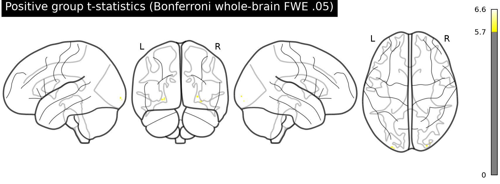
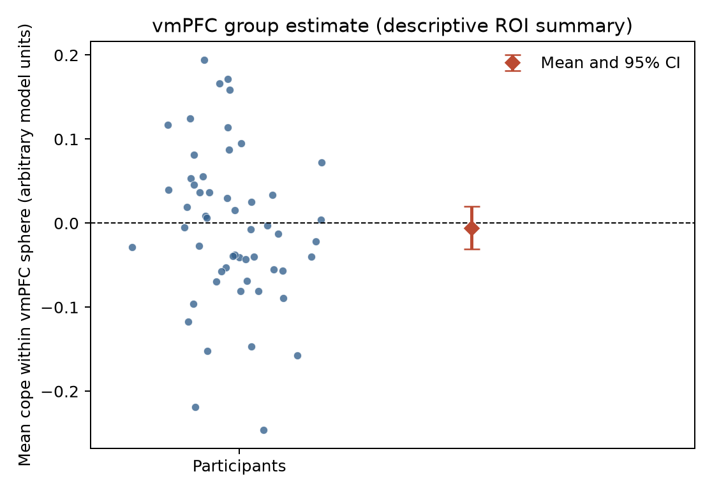

# Potential gains and vmPFC activity

This group analysis tests whether the gain-related BOLD effect is positive in the 54 equal-indifference participants who made accept/reject decisions on mixed gambles; in this condition, potential gains spanned twice the loss range.

## Result

In the 54-person NARPS equal-indifference group, these gain-effect estimates did **not support a positive vmPFC response to increasing potential gain**. In an independently specified 12-mm-radius sphere centered at MNI (0, 40, -10), the mean participant effect was −0.0055 cope units (95% CI −0.0309 to 0.0199; one-sided *t*(53) = −0.44, *p* = .667). No voxel in that sphere survived the whole-brain correction.

The whole-brain positive one-sample *t* analysis found 11 voxels surviving Bonferroni familywise-error correction across 198,029 common-support voxels (*t* threshold 5.72; smallest adjusted *p* = .00184). The strongest voxel was posterior to the hypothesized vmPFC (MNI −26, −102, −3.6); this does not support the vmPFC prediction. The unthresholded group *t* map and corrected map are supplied for inspection.

The ROI estimate is close to zero, and its interval includes both small negative and positive effects. Failure to detect the predicted response is not evidence that the true response is exactly zero; it means these inputs do not provide corrected support for the stated positive vmPFC hypothesis.





## Group model and target definition

I treated each supplied map as one participant's unthresholded gain-modulator coefficient estimate and fit a one-sample group *t* test against zero at each voxel, with equal participant weights. The stated direction is positive, so the primary voxelwise test was one-sided. The analysis mask was the intersection of nonzero voxels across all 54 maps (198,029 voxels); this avoids treating out-of-coverage zeros as observations. The maps had matching shape, affine and voxel size, all values were finite, and participant IDs matched the equal-indifference metadata. All 54 participants were retained.

The original instructions request a binary decision based on whole-brain corrected results. I controlled familywise error at .05 using Bonferroni adjustment across every voxel in the common-support mask. This is valid under arbitrary spatial dependence, though conservative. I identified the vmPFC transparently as a symmetric 12-mm sphere centered at (0, 40, −10) mm in MNI space, a ventral midline prefrontal location. This is an operational anatomical summary rather than a boundary supplied by a vmPFC atlas. The sphere was not used to replace whole-brain correction: support for the hypothesis required positive whole-brain-corrected evidence in that location. See the [original NARPS analysis instructions](https://www.narps.info/files/narps_instructions_for_analysis_teams.pdf).

## What these effects mean and limits

The estimates are not *t* or *z* statistics and are not group results. AO86 normalized the gain modulator before HRF convolution, so these values do not measure BOLD change per currency unit. They represent gain-related modulation conditional on the supplied upstream model: response trials used response-time durations, response choice and gain modulators were included, and gain and loss were modeled separately. The task design's wider range of gains than losses therefore does not make this a direct estimate of gain-versus-loss sensitivity or range adaptation.

Group uncertainty here comes from between-participant variation in cope estimates. Participant variance maps are unavailable, so the analysis cannot account for differences in first-level estimation precision or reconstruct a fully weighted mixed-effects group model. Upstream preprocessing and individual modeling were treated as fixed inputs and were not repeated; no time-series scans were downloaded. Inference is limited to this participant sample and the supplied upstream model.

The voxelwise *t* model assumes independent participants and an adequately behaved group sampling distribution. Bonferroni protects familywise error across voxels but does not correct misspecification of that group model.

## Reproducibility

Run from the workspace root with the prepared Python environment:

```bash
/Users/johnlee/.local/state/stamped-in-practice/narps-neutral-v1/common-environment/.pixi/envs/default/bin/python analysis/group_analysis.py
```

The script writes the summary JSON, participant QC table, group mean and *t* maps, Bonferroni-adjusted *p* map, and figures under `results/`. Inputs and fixed upstream details are documented in [`../input/upstream-methods.md`](../input/upstream-methods.md) and [`../input/sources.json`](../input/sources.json).

The prepared environment provides NumPy 2.5.4, SciPy 1.18.1, pandas 3.0.6, Matplotlib 3.11.2, NiBabel 5.4.2 and Nilearn 0.14.1.
