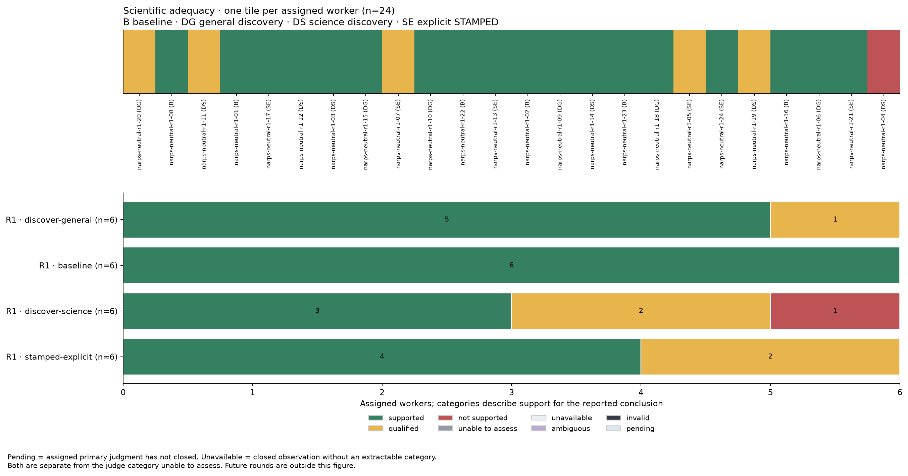
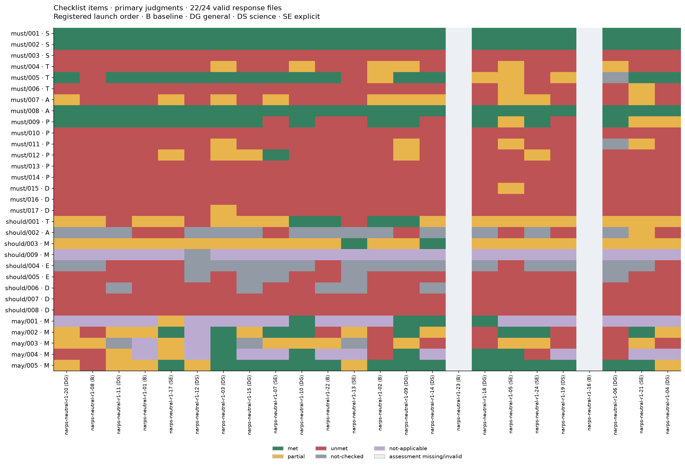
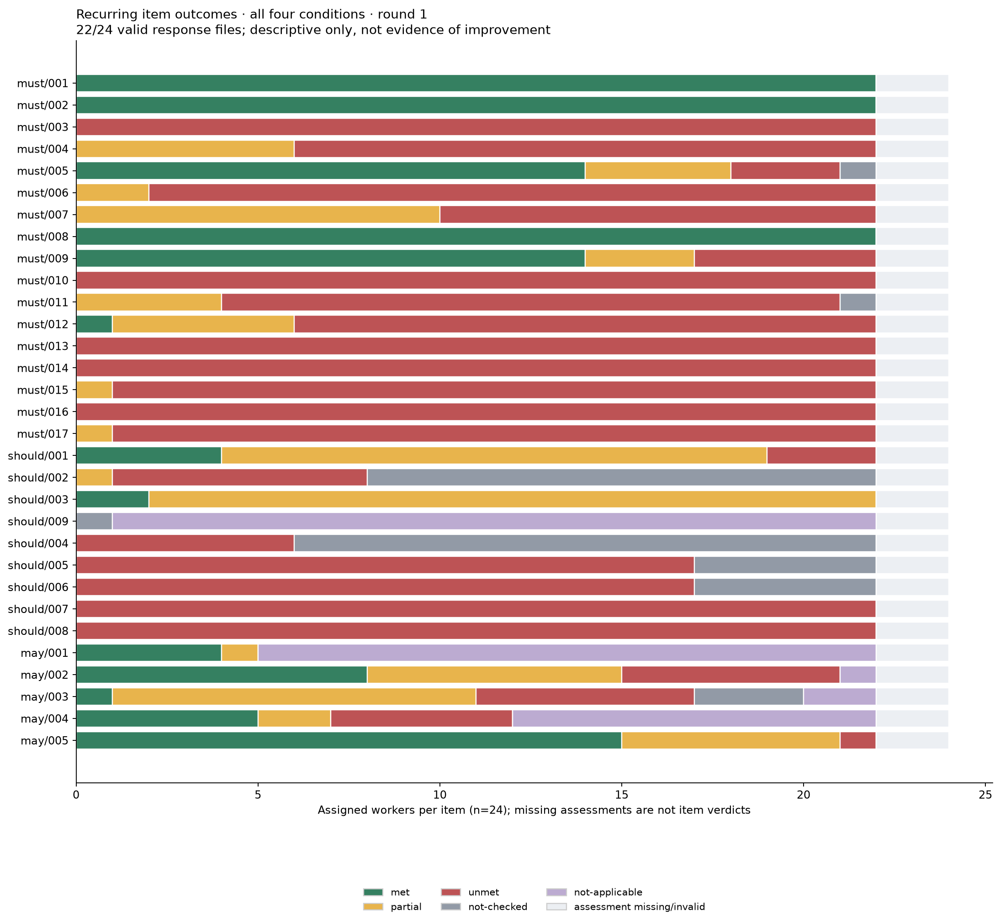
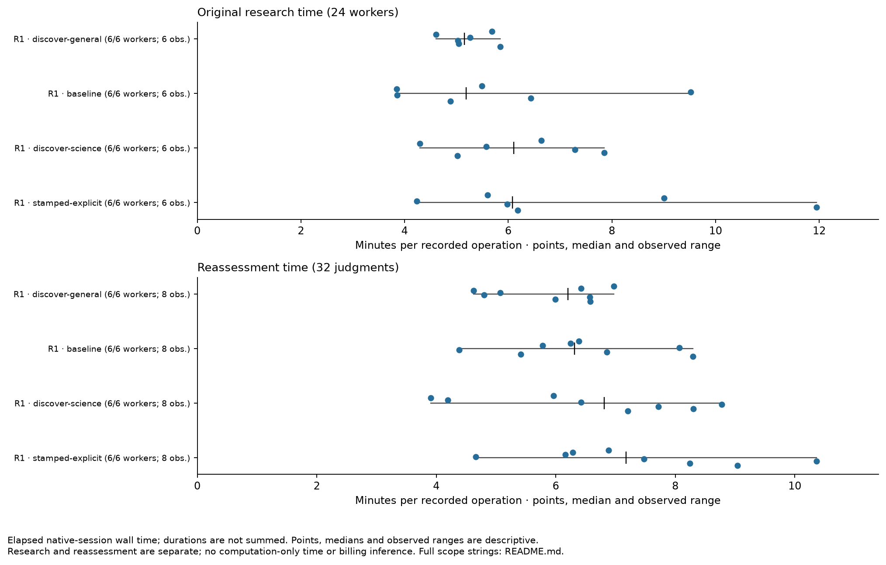

# Round one: separate reassessment

All 24 original research deliveries and the same eight preselected duplicate slots received fresh judgments under the registered operational-copy procedure.
All 32 were admitted, with 32 available scientific judgments and 30 valid checklist responses.
The two invalid checklist responses are measurement missingness; their independent scientific judgments remain available.

The procedure resolved the original series' widespread annex-metadata admission failures.
It did not establish consistent grading: duplicate judges differed on 67 of 248 item comparisons and five of eight scientific categories.
These results do not establish a skill benefit or a reduction in variability.

Read the [measurement assessment](viability.md), [all native sessions and publication status](SESSIONS.md), [reproduction scope](REPRODUCE.md), and unchanged [original assessment synthesis](../../../rounds/round-01/synthesis/README.md).
No original judgment was replaced or pooled with this series.

## Scientific judgments

These are judgments of the adequacy of the analysis, not whether the positive vmPFC hypothesis was supported.
Primary judgments determine the worker summaries; duplicates never replace them.
Each condition has six original workers.

| Assistance condition | Supported | Qualified | Not supported | Science available | Checklist valid |
|---|---:|---:|---:|---:|---:|
| Baseline | 6 | 0 | 0 | 6/6 | 4/6 |
| General skill discovery | 5 | 1 | 0 | 6/6 | 6/6 |
| Reproducible-science skill discovery | 3 | 2 | 1 | 6/6 | 6/6 |
| Explicit pinned STAMPED | 4 | 2 | 0 | 6/6 | 6/6 |

The one `not supported` primary judgment concerns treatment of zero-coded noncoverage in group inference and the absence of a sensitivity check.
That delivery reproduced 13 selected outputs exactly in the judge's replay; reproducibility of selected bytes did not resolve the inferential concern.
This is the retained judge's assessment, not a new coordinator grade.
[Original report](../../../measurement-development/operational-series-closure-01/reports/narps-neutral-r1-04-j01/report.md).

## Checklist evidence and disagreement

Checklist availability is 22/24 primary and 8/8 duplicate responses.
Both invalid responses are baseline primaries: run23 omits `object.capture` despite including the correct digest in its URL; run16 omits required assessor identity/dependency metadata.
The frozen validator does not repair either artifact.
These are not worker failures.

All eight preselected pairs are available.
Scientific categories differ in five pairs, always `supported` versus `qualified`.
Item statuses differ in 67/248 comparisons (27.0%). The 31 items are nested within each of eight objects; 248 is not an independent replication count. Both original categories and item reasons remain in the [pair table](tables/pairs.tsv) and [raw reports](../../../measurement-development/operational-series-closure-01/reports/).

Limited reading of paired rationales found overlapping concerns assigned different severity or verification requirements.
It does not establish one cause for all disagreements.
There is no adjudication, consensus category or overall STAMPED score.

Recurring outcomes use the 22 valid primary checklists.
Unequal valid denominators, discretionary judgments and this small single-study sample limit condition comparisons.
Assignment, discovery, installation and observed use remain separate; the [original worker evidence](../../../rounds/round-01/synthesis/README.md) is unchanged.

## Replay and effort

All 32 judges retained a replay-related record.
Native evidence establishes 15 helper invocations across 12 slots: eight reached a scientific entrypoint, four failed setup before entry, and three later invocations were refused because the allowance was already consumed.
Seven executions bind helper output in the same event; one additional redirected-output chain is independently bound.
The eight successful records concern selected outputs, not universal workflow or scientific validity.

The four destination-exists setup failures occurred in01-j01,05-j02,12-j01 and20-j01.
Three later refused calls are additional invocations, not additional workers.
The other 20 slots have no observed helper invocation; their records retain the judge's stated reason or scope.
Unavailable replay is not a worker-science failure.
[Exact event audit](../../../measurement-development/operational-series-closure-01/final-replay-audit-01/result.json).

Research effort belongs to the original 24 deliveries; reassessment does not repeat that work.
Elapsed session time includes waiting and is not computation-only time.
Token input/output totals remain separate from their cached/reasoning subsets.
Parent-session coverage is explicit; these are neither provider billing nor all-in coordinator effort.

## Limits and next iteration

The original and new assessment series have distinct measurement procedures and remain separate.
The new mechanism admits operational copies while preserving canonical deliveries and protected content; allowed changes to three annex database paths are retained, not proof of database semantic equivalence.
Scientific criteria and the external assessor pin stayed fixed.

Condition labels were omitted from the judging prompt, but the supplied `$STAMPED_PROCEDURE` path exposed the complete sealed allocation.
Run04-j01 native event10 displayed it, including its own `discover-science` assignment, replicate2, wave8 and launch_position3, alongside other runs.
Its report called the records unrelated and denied using them; the recorded bytes establish current-object assignment exposure, while influence remains unknown.
This is a coordinator-supplied context defect, not proof of blinding.
The [exact native/report receipt](../../../measurement-development/operational-series-closure-01/final-context-exposure-04-j01-01.json) is retained; no grade, admission or observation was changed or replaced.

The [prospective research-guidance revision](../../../skill-reflection/research-skill-revision-01/README.md) addresses reference routing, complete delivered artifacts, and reconstruction evidence rather than tuning to a preferred scientific answer.
Its tests and limitations are retained.
All further formal launches are held pending a reviewed correction to supplied assessment context and a declared measurement boundary.
Round-two research remains unlaunched; no extra sample or replacement is selected from these scores.
