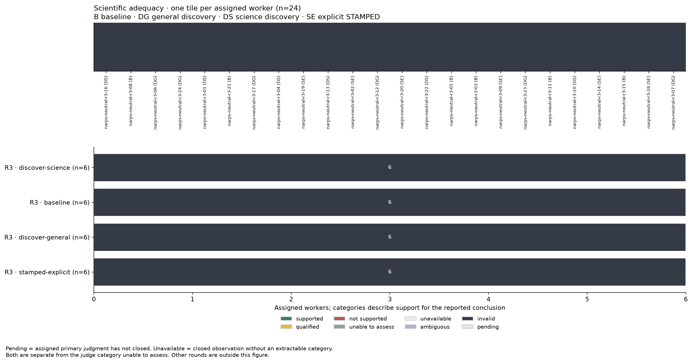
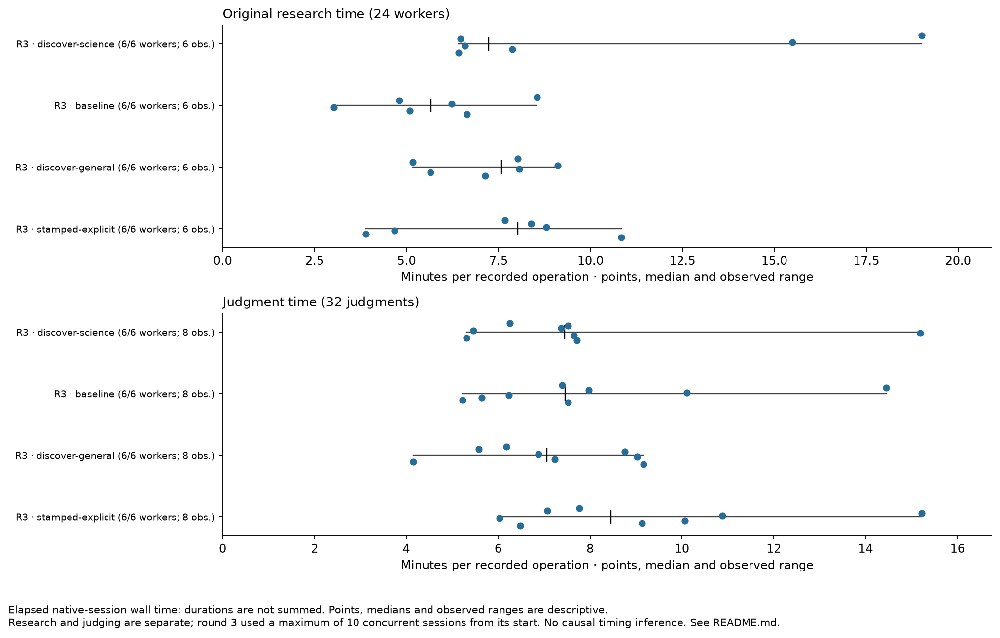

# Round-three frozen findings

All 32 judgments failed the same frozen worker-input coordinator_commit provenance gate; no admissible science or checklist outcomes.

All 24 workers and 32 judgments closed naturally and remain retained. All native judge exit codes were zero, which is separate from admission. The unchanged aggregator returned 2 for the 32 retained provenance issues; the evidence review, summary and figures completed. No gate or source was changed.

| Condition | Assigned primaries | Science available | Checklist items available / assigned | must/005 available / assigned | must/005 attainment |
|---|---:|---:|---:|---:|---|
| baseline | 6 | 0 | 0 / 186 | 0 / 6 | Unavailable |
| discover-general | 6 | 0 | 0 / 186 | 0 / 6 | Unavailable |
| discover-science | 6 | 0 | 0 / 186 | 0 / 6 | Unavailable |
| stamped-explicit | 6 | 0 | 0 / 186 | 0 / 6 | Unavailable |

Missing admissible verdicts are not zero attainment, scientific failure, or the judge category 'unable to assess'. No primary science categories or checklist status distribution can be reported. All 744 assigned primary item slots remain unavailable (24 × 31); the specific environment setup/reconstruction item must/005 remains unavailable for all 24 primaries.

The frozen procedure expects coordinator_commit `cfeccf4fd14c1f1ef2fe6e27500c3ea139df986e`. The 24 retained worker inputs contain: `36acf2400f2e7eac4c21ea2c0fb44441a6ca7fad` (24/24). The unchanged checker compares these fields at lines 424–429. This is the first rejection reached; it does not establish that later gates would pass.

All eight preselected duplicate pairs remain in the table below. No pair has admissible checklist or science comparisons. Their disagreement and agreement rates are unavailable, not zero.

| Object | Condition | Checklist comparable / assigned items | Science comparison |
|---|---|---:|---|
| narps-neutral-r3-16 | discover-science | 0 / 31 | Unavailable |
| narps-neutral-r3-24 | discover-general | 0 / 31 | Unavailable |
| narps-neutral-r3-04 | discover-science | 0 / 31 | Unavailable |
| narps-neutral-r3-05 | baseline | 0 / 31 | Unavailable |
| narps-neutral-r3-03 | baseline | 0 / 31 | Unavailable |
| narps-neutral-r3-09 | stamped-explicit | 0 / 31 | Unavailable |
| narps-neutral-r3-23 | discover-general | 0 / 31 | Unavailable |
| narps-neutral-r3-18 | stamped-explicit | 0 / 31 | Unavailable |

Worker actions and timing are separate descriptive observations from closed native sessions. All six explicit-arm workers read supplied workflow instructions. Reading or installation does not establish application or benefit.

| Condition | Discovery / 6 | Worker installation / 6 | Instruction read / 6 | Median native minutes (range; n=6) |
|---|---:|---:|---:|---:|
| baseline | 0 | 0 | 0 | 5.66 (3.02–8.55) |
| discover-general | 6 | 6 | 6 | 7.58 (5.17–9.11) |
| discover-science | 6 | 6 | 6 | 7.23 (6.42–19.01) |
| stamped-explicit | 0 | 0 | 6 | 8.03 (3.90–10.84) |

Round three used the user-authorized maximum of 10 concurrent sessions from its start; maximum observed native interval overlap was 10. Round two changed from 3 to 10 during its execution. These session times include work and waiting. Scheduling is a covariate, and no causal timing or skill effect is inferred.

The retained action records distinguish installation from application. All 12 discovery-arm workers installed a skill; notebook scaffolds were observed for r3-24, r3-13, r3-17, r3-22, r3-16, r3-23 and r3-10. r3-24 completed notebook execution through nbconvert. r3-10 first failed to locate the Jupyter executable, then sequentially executed notebook code cells after removing IPython display references; this is separate from a Jupyter-kernel run or a saved executed notebook. Other scaffold observations do not establish execution. Local PDF attempts remained failed or unavailable. Broad adjacent-path searches are retained without inferring content use or influence. Full event citations, failed attempts and instruction-read distinctions remain in skill-observations/.

The existing same-event replay evidence check is retained in the final review and machine findings. It cannot override failed admission and is not a scientific-success count. Optional replay unavailability is separate from scientific failure.

Explicit-arm primary evidence locations are retained below. These are unadmitted raw records, not substitute grades.

- narps-neutral-r3-02: must/005 unavailable; [report](evidence/narps-neutral-r3-02-j01/report.md); [response](evidence/narps-neutral-r3-02-j01/response.json); [structured_scientific](evidence/narps-neutral-r3-02-j01/scientific-judgment.json); [scientific_report](evidence/narps-neutral-r3-02-j01/scientific-report.md); [output_binding](evidence/narps-neutral-r3-02-j01/output-binding.json).
- narps-neutral-r3-09: must/005 unavailable; [report](evidence/narps-neutral-r3-09-j01/report.md); [response](evidence/narps-neutral-r3-09-j01/response.json); [structured_scientific](evidence/narps-neutral-r3-09-j01/scientific-judgment.json); [scientific_report](evidence/narps-neutral-r3-09-j01/scientific-report.md); [output_binding](evidence/narps-neutral-r3-09-j01/output-binding.json).
- narps-neutral-r3-14: must/005 unavailable; [report](evidence/narps-neutral-r3-14-j01/report.md); [response](evidence/narps-neutral-r3-14-j01/response.json); [structured_scientific](evidence/narps-neutral-r3-14-j01/scientific-judgment.json); [scientific_report](evidence/narps-neutral-r3-14-j01/scientific-report.md); [output_binding](evidence/narps-neutral-r3-14-j01/output-binding.json).
- narps-neutral-r3-18: must/005 unavailable; [report](evidence/narps-neutral-r3-18-j01/report.md); [response](evidence/narps-neutral-r3-18-j01/response.json); [structured_scientific](evidence/narps-neutral-r3-18-j01/scientific-judgment.json); [scientific_report](evidence/narps-neutral-r3-18-j01/scientific-report.md); [output_binding](evidence/narps-neutral-r3-18-j01/output-binding.json).
- narps-neutral-r3-19: must/005 unavailable; [structured_scientific](evidence/narps-neutral-r3-19-j01/scientific-judgment.json); [scientific_report](evidence/narps-neutral-r3-19-j01/scientific-report.md); [output_binding](evidence/narps-neutral-r3-19-j01/output-binding.json).
- narps-neutral-r3-20: must/005 unavailable; [report](evidence/narps-neutral-r3-20-j01/report.md); [response](evidence/narps-neutral-r3-20-j01/response.json); [structured_scientific](evidence/narps-neutral-r3-20-j01/scientific-judgment.json); [scientific_report](evidence/narps-neutral-r3-20-j01/scientific-report.md); [output_binding](evidence/narps-neutral-r3-20-j01/output-binding.json).

All seven existing-method figures are in figures/. Figures keep unavailable observations visible. The legend ‘invalid’ means provenance admission rejected, not scientifically invalid research; 0/8 complete duplicate pairs means no agreement estimate. Machine findings and source hashes are in findings.json; the full frozen normalized tables are in snapshot-final-02/analysis/. Exact source/adaptation provenance is in reporting-bindings-final-01.json and reporting-source-binding-correction.json, with original code retained separately. Duct logs and per-command receipts remain under ../duct/ and ../commands/.

The retained recurring-outcomes figure has an inherited title saying ‘round 2’; its scoped input and all 24 unavailable item observations are round three. It is preserved unchanged, disclosed in figure-caption-notes.md and omitted from the concise inline overview.

The first reporting attempt stopped before aggregation because the adapter retained the round-two receipt hash for the round-three original-object-sources path. Only that source hash and the additive snapshot path were corrected. The failed snapshot-final-01 and command logs remain preserved; snapshot-final-02 is the completed extraction. This reporting-preparation failure is separate from the frozen provenance admission result. No source evidence, judgment, admission rule or rubric changed.

The retention helper reported 24/24 worker native and skill-availability captures and 32/32 judge capture/integrity audits, with no retention failures or retries. This establishes local preservation, not scientific validity, skill use or hosted publication. Exact final retention receipts are copied into final-findings-01/retention-closure/.

## Figures and complete evidence

“Invalid” in these figures means provenance admission rejected, not scientific failure.

The [complete reporting archive](../reporting-package-01/reporting.tar.gz), [member manifest](../reporting-package-01/manifest.json) and [local verification](../reporting-package-01/verification.json) preserve the original report, all failed preparation, source copies and command logs. The readable copy changes navigation and spacing only; copied evidence hashes are in [copy-manifest.json](copy-manifest.json).

Complete stopped attempts, raw native logs and operational copies are retained separately in the [native package](../native-package-01/README.md). See the [publication states](../../../final-synthesis/PUBLICATION.md) for local, Git, hosted Entire and annex availability.
