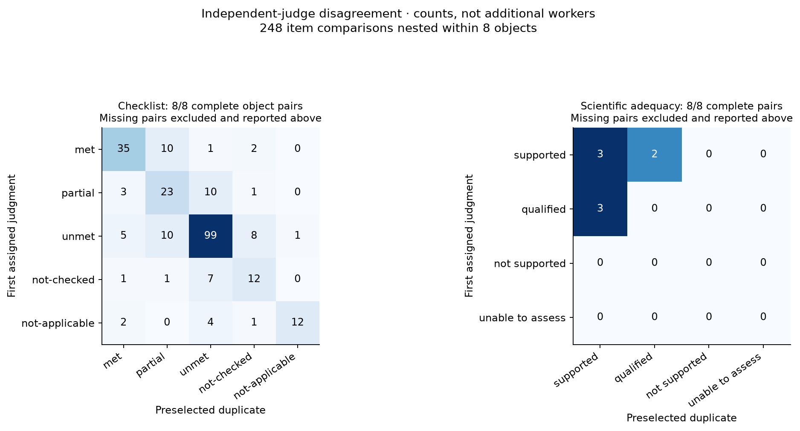
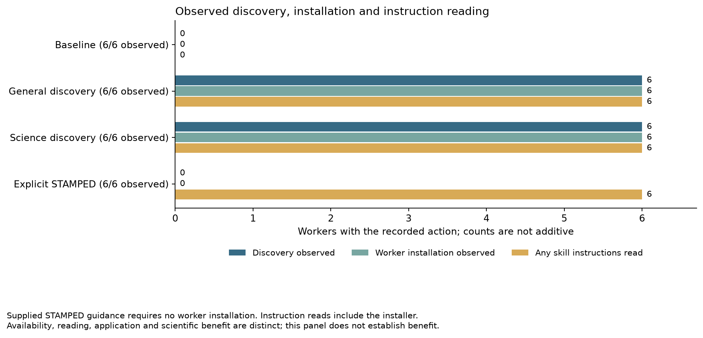

# Three-round retained readout

The three rounds completed 72 research workers and 96 operational judgments.
Round one below is the separate operational reassessment; its [earlier original assessment](../rounds/round-01/synthesis/README.md) remains unchanged and separate.
This is an adaptive measurement history, not an untouched preregistration.
Formal measurement availability differs by round; completion alone does not make an outcome admissible.

The tables and figures below preserve the **original frozen extraction**.
A [subsequent authorized reporting correction](REPORTING-CORRECTION.md) admits 23 of 24 primary science records and checklists in each later round, while retaining all individual failures.
The original zero-availability rows below remain unchanged; they are not the availability counts for that separate corrected readout.

| Round | Workers closed / assigned | Judges closed / assigned | Admitted judges / 32 | Primary science available / 24 | Primary checklist valid / 24 |
|---|---:|---:|---:|---:|---:|
| 1 | 24 / 24 | 32 / 32 | 32 / 32 | 24 / 24 | 22 / 24 |
| 2 | 24 / 24 | 32 / 32 | 0 / 32 | 0 / 24 | 0 / 24 |
| 3 | 24 / 24 | 32 / 32 | 0 / 32 | 0 / 24 | 0 / 24 |

Each round retains 24 fixed primary judgments and eight preselected duplicates.
Round one has two invalid primary checklist responses, while its independently bound scientific records remain available.
Later admission rejection is a provenance measurement failure, not a scientific verdict.
Missing categories and attainment rates remain unavailable.

Supported describes support for the worker’s reported conclusion; it does not necessarily mean a positive answer to the scientific hypothesis.

| Condition | Round-one primary scientific categories (n=6) | Round-two science availability | Round-three science availability |
|---|---|---:|---:|
| baseline | 6 supported | 0 / 6 available | 0 / 6 available |
| discover-general | 1 qualified, 5 supported | 0 / 6 available | 0 / 6 available |
| discover-science | 2 qualified, 3 supported, 1 not supported | 0 / 6 available | 0 / 6 available |
| stamped-explicit | 4 supported, 2 qualified | 0 / 6 available | 0 / 6 available |

Round one has eight complete duplicate pairs: five disagree on scientific category, and 67 of 248 nested checklist decisions differ.
These are the retained fixed-primary comparisons.
Rounds without complete pairs have no agreement or disagreement estimate; an empty comparison is not agreement.

The operational assessment used frozen assessor [`9852d8360f9519d21d11099b45f5deb8ba80cb28`](https://github.com/con/skills/commit/9852d8360f9519d21d11099b45f5deb8ba80cb28), source `4f72ef49` and Luna/high.
Prospective changes retained on main were not adopted.

The explicit-arm research guidance used these exact revisions, distinct from the fixed assessment source:

- Round 1: [f2e74ea3ed372f966c95692cb0826d56ad5e6a6c](https://github.com/con/skills/commit/f2e74ea3ed372f966c95692cb0826d56ad5e6a6c).
- Round 2: [d83d7d66a9060be6afae57336124afdcfc1743e9](https://github.com/con/skills/commit/d83d7d66a9060be6afae57336124afdcfc1743e9).
- Round 3: [326606610af6c261876c92032ca1f89f6d3ad1f1](https://github.com/con/skills/commit/326606610af6c261876c92032ca1f89f6d3ad1f1).

The single round-three wording clarification was informed by direct closed-delivery observations, not round-two formal grades.
The accompanying [lessons](LESSONS.md) retain that distinction.

| Condition | Round-one discovery / install / read | Round-two discovery / install / read | Round-three discovery / install / read |
|---|---:|---:|---:|
| baseline | 0 / 0 / 0 | 0 / 0 / 0 | 0 / 0 / 0 |
| discover-general | 6 / 5 / 6 | 6 / 6 / 6 | 6 / 6 / 6 |
| discover-science | 6 / 6 / 6 | 6 / 5 / 6 | 6 / 6 / 6 |
| stamped-explicit | 0 / 0 / 6 | 0 / 0 / 6 | 0 / 0 / 6 |

Every action column has six assigned workers per condition.
Instruction reads include installer instructions.
Supplied guidance does not require worker installation.
Reading instructions or invoking a helper does not establish scientific benefit; failed and partial actions remain in the per-round records.

| Condition | Round-one median minutes | Round-two median minutes | Round-three median minutes |
|---|---:|---:|---:|
| baseline | 5.19 (n=6) | 6.80 (n=6) | 5.66 (n=6) |
| discover-general | 5.15 (n=6) | 8.04 (n=6) | 7.58 (n=6) |
| discover-science | 6.11 (n=6) | 7.51 (n=6) | 7.23 (n=6) |
| stamped-explicit | 6.08 (n=6) | 12.15 (n=6) | 8.03 (n=6) |

These are native session wall times, including waiting.
Round two’s authorized concurrency limit rose from 3 to 10; round three used 10 from its start.
Full ranges remain in readout.json.
Scheduling, shared-host exposure and unavailable outcomes prevent a causal timing or skill-effect interpretation.

These three existing figures show the available round-one scientific categories, their duplicate disagreement, and round-three observed actions.
They do not imply improvement across rounds.

The retained [round-two rejected-science figure](figures/round-02-scientific-availability.png) and [round-three rejected-science figure](figures/round-03-scientific-availability.png) show their full assigned denominators.
In those legends, ‘invalid’ means provenance admission rejected, not scientifically invalid research.
No score is imputed.
Their zero complete duplicate pairs supply no agreement estimate.

The full existing figure sets and detailed evidence remain available:

- [Round 1 report](../assessment-series/narps-neutral-r1-operational-v4/synthesis/README.md); figures: `../assessment-series/narps-neutral-r1-operational-v4/synthesis/figures`.
- [Round 2 report](../assessment-series/narps-neutral-r2-operational-v4/synthesis/README.md); figures: `../assessment-series/narps-neutral-r2-operational-v4/synthesis/figures`.
- [Round 3 report](../assessment-series/narps-neutral-r3-operational-v4/synthesis/README.md); figures: `../assessment-series/narps-neutral-r3-operational-v4/synthesis/figures`.

This composition does not establish improved scientific performance, reduced variability, or transfer to another study.
It applies no new admission rule and does not pool incompatible series.
Local retention, published Git references and verified remote payload retrieval are separate publication states, reported by the executor.
Exact source hashes and unrounded retained fields are in readout.json.

The supplied assessment procedure exposed the current assignment in documented round-one judgment `04-j01`; successful blinding is not established.
The [lessons](LESSONS.md) retain this and the measurement failure without changing grades.

See [publication states](PUBLICATION.md) for the separate status of local complete captures, published Git references, hosted Entire verification and pending annex payload retrieval.
All assigned execution is complete; historical controllers must not be restarted.
