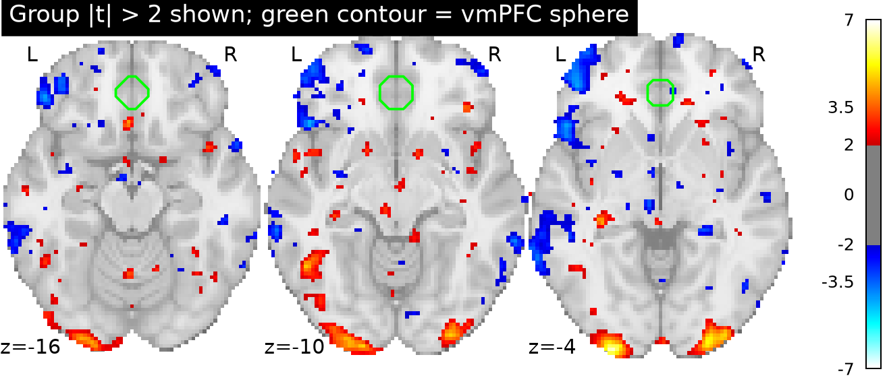
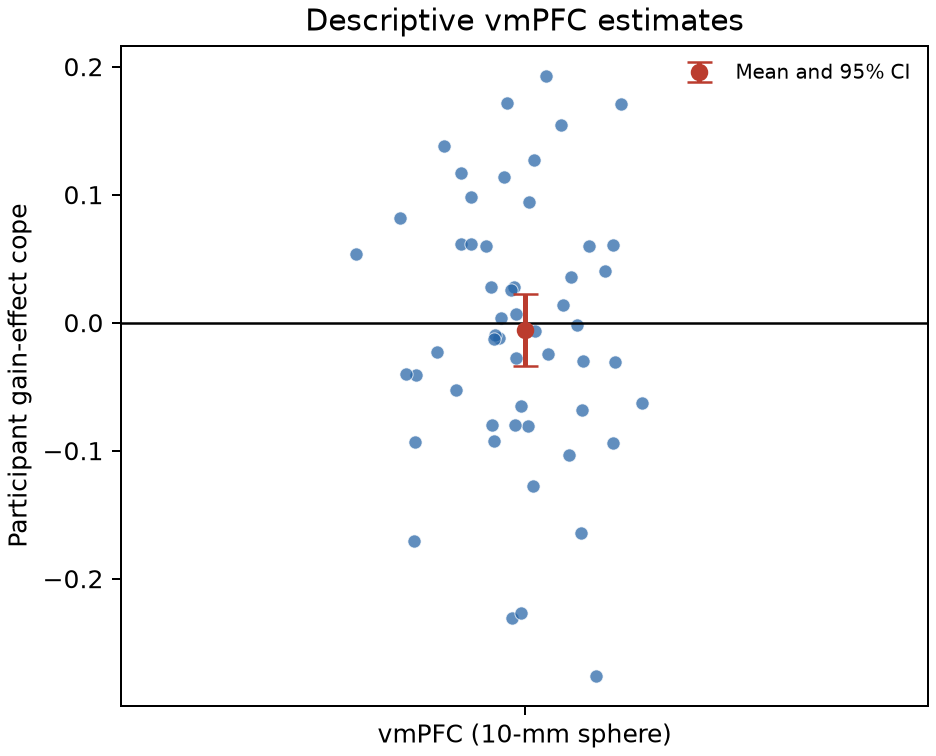
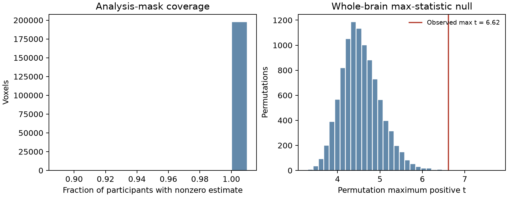

# Potential gains and brain activity: equal-indifference group

## Conclusion

**This group analysis does not support a greater vmPFC response with increasing potential gain.** None of the positive whole-brain family-wise-error (FWE) significant voxels overlaps the prespecified vmPFC sphere. The sphere’s mean participant gain-effect estimate is −0.0061 (95% CI −0.0342 to 0.0221, on the supplied contrast-estimate scale). This interval spans zero and both signs; it is not evidence that the true vmPFC effect is exactly zero.

The whole-brain test did identify 24 positive voxels in three small posterior clusters (largest 17 voxels), with the strongest peak at MNI (−26, −102, −3.6), *t*(53) = 6.62, max-statistic FWE *p* = .0006. These posterior findings are anatomically remote from vmPFC and do not support the stated anatomical hypothesis. Their location is reported without a more specific anatomical label because of their small extent and proximity to the posterior brain boundary.

## Analysis

The original NARPS instructions specify a positive parametric gain effect in vmPFC for the equal-indifference group and call for whole-brain analysis ([Hypothesis 1 instructions](https://www.narps.info/files/narps_instructions_for_analysis_teams.pdf)). I analyzed the 54 supplied AO86 participant gain-effect maps with an equal-weight one-sample group model. The tested effect is the population mean of these participant contrast estimates against zero, in the positive direction. At each voxel I calculated the one-sample *t* statistic and controlled whole-brain FWE at α = .05 using 9,999 random participant-level sign flips and the maximum positive *t* over the analysis mask (seed 20261016). This retains the one-sided hypothesis and corrects across 198,029 tested voxels. The Monte Carlo *p* resolution is 0.0001.

I operationalized vmPFC independently as a 10-mm-radius sphere centered at MNI (0, 40, −10) mm. A priori anatomical definitions vary; this coordinate sphere gives a reproducible midline ventral frontal target. I evaluated support by asking whether any positive voxelwise FWE-significant voxel fell inside that sphere. The sphere contained 428 analysis voxels. Its subject-level average and conventional *t*-based confidence interval are descriptive, not a second uncorrected route to a positive claim.

## Inputs, checks, and exclusions

The source workspace included the participant table and manifest, but not the NIfTI files. I retrieved only the 54 exact participant effect maps listed in `input/sources.json` (no time-series scans), saved them under `data/`, and verified every downloaded byte count and SHA-256 against that manifest before analysis. All maps had matching 97 × 115 × 81 grids and affines, finite values, and unique participant IDs matching the 54-person equal-indifference cohort. The analysis mask was the strict intersection of voxels nonzero in every participant; it retained 198,029 voxels, each with 100% map coverage. This avoids treating absent/out-of-mask estimates as zero-valued effects. No participant was excluded.

The supplied values are participant contrast parameter estimates, not *t* or *z* statistics. Per-participant variance maps were unavailable, so the group model weights participants equally and cannot use a variance-weighted second-level model. The one-sample *t* model assumes independent participants; sign-flip inference additionally assumes errors are symmetric under the null. The supplied estimates average four upstream runs, but the complete upstream executable pipeline is unavailable for rerunning or sensitivity analyses.

## Interpretation limits

The upstream gain modulator was mean-centered and variance-normalized before HRF convolution. The effect estimates therefore do **not** measure BOLD change per dollar or per currency unit. The upstream response-time-duration model included choice and gain modulators, nonresponse trials, motion, flagged volumes and drift terms; gain and loss were fit in separate models. Thus, this group result is conditional on those fixed modeling decisions and is not an independently re-estimated or isolated causal effect of monetary gain. The fact that the potential-gain range was twice the loss range does not convert these coefficients into a common currency slope.

The lack of corrected overlap means this analysis did not establish the predicted positive vmPFC response at the chosen anatomical target. It does not establish no vmPFC effect: the confidence interval is compatible with a small negative or positive mean, and upstream modeling, spatial localization, sample size and the operational ROI definition limit precision. The corrected posterior clusters are a separate whole-brain observation, not confirmation of the vmPFC prediction.

## Figures

**Figure 1.** Positive voxelwise-FWE-significant group results (maximum-statistic correction, *p* < .05), centered on the strongest posterior peak.


**Figure 2.** Display of group *t* values with |*t*| > 2 for visualization only; green outline marks the vmPFC sphere. Statistical inference uses the full, unthresholded mask and max-statistic correction.



**Figure 3.** Participant vmPFC sphere averages with the group mean and 95% confidence interval.



## Reproduce

Run from the workspace root with the prepared Python environment:

```bash
/Users/johnlee/.local/state/stamped-in-practice/narps-neutral-v1/common-environment/.pixi/envs/default/bin/python analysis/run_analysis.py
```

Primary code is `analysis/run_analysis.py`; an executable walkthrough is `analysis/narps_group_analysis.ipynb`. Software versions are recorded in `analysis/software.txt` (Python 3.13.16; NumPy, SciPy, pandas, Matplotlib, NiBabel and Nilearn). Supporting outputs include `results/summary.json`, `results/fwe_clusters.csv`, `results/map_qc.csv`, participant ROI values, permutation maxima, and unthresholded/corrected NIfTI maps. Figure generation and map validation are part of the same script.

**Supplementary diagnostic.** The left panel confirms the strict common-mask coverage; the right panel shows the permutation maximum-statistic null and observed maximum.


