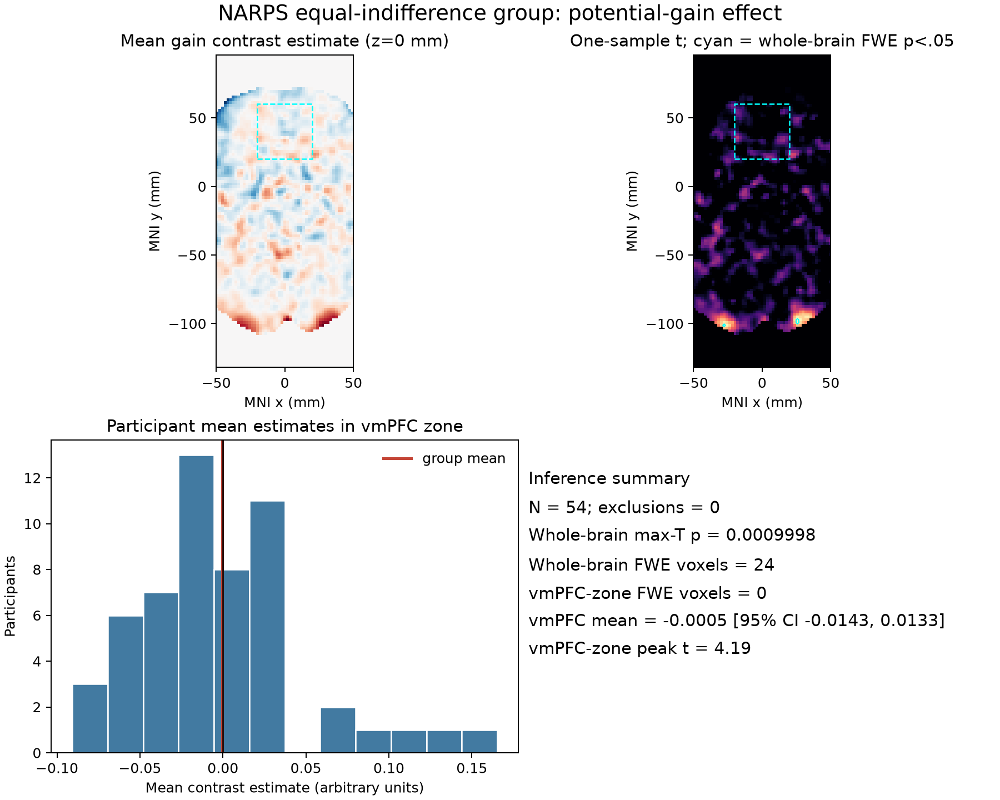

# Potential gain and brain activity in the NARPS equal-indifference group

## Question and result

We tested the original NARPS Hypothesis 1: whether greater potential gains are associated with a positive fMRI response in ventromedial prefrontal cortex (vmPFC) in the equal-indifference group. A whole-brain, one-sided max-statistic permutation test found corrected positive effects somewhere in the brain (peak *t*(53) = 6.62, MNI [−26, −102, −4], max-T FWE *p* = .0010; 24 voxels exceeded the corrected threshold). However, no whole-brain FWE-significant voxels fell in the prespecified vmPFC territory. The vmPFC-zone peak was *t*(53) = 4.19, below the whole-brain critical *t* = 5.40. Thus, this analysis does **not** support the specific vmPFC hypothesis, although it detects a positive effect elsewhere.

## Data and model

We analyzed all 54 equal-indifference participants listed in the supplied cohort table. In this mixed-gambles group, the potential-gain range was twice the potential-loss range. Their maps are unthresholded participant-level gain contrast parameter estimates from AO86, averaged across four runs and reported in MNI152NLin2009cAsym space. All 54 files matched the supplied SHA-256 checksums, had finite values, and shared the same 97 × 115 × 81 voxel grid (2 × 2 × 2.4 mm). No participants were excluded. Because zero-valued voxels denote locations outside a participant’s estimation support, the group test used only the intersection of nonzero map support (198,029 voxels; 1,901 ml); this avoids interpreting absent estimates as observed zero effects. The masks are saved in `results/`. We did not reprocess scans or download time-series data.

At each voxel, we estimated the group mean and a one-sample random-effects *t* statistic across participant contrast estimates, testing the prespecified positive direction. Whole-brain familywise error was controlled with 5,000 participant-level sign-flip permutations of the maximum voxelwise *t* statistic (seed 20261016). The 95th percentile of the permutation maximum distribution was *t* = 5.397. This makes the brain-wide test primary and uses a directional test consistent with the original hypothesis. A finite permutation sample gives a minimum reportable *p* of 1/5,001.

We labeled vmPFC in advance as a medial anterior ventral prefrontal coordinate zone in MNI space (x −20 to 20, y 20 to 60, z −20 to 20 mm). This transparent anatomical approximation only labels the corrected whole-brain result; it does not reduce the number of tested voxels or provide a separate uncorrected ROI claim. The zone contained 7,043 tested voxels. Its mean estimate was −0.00048 (95% *t* interval −0.0143 to 0.0133, in arbitrary contrast-estimate units); its largest voxelwise *t* was 4.19 and none of its voxels passed whole-brain FWE correction.

## Interpretation and limits

The direction of evidence in the vmPFC zone is not sufficient to establish a positive gain response. Failure to pass whole-brain correction is not evidence that the true effect is exactly zero: it means this sample and fixed analysis do not provide sufficiently strong spatially specific evidence under the required whole-brain criterion. The near-zero zone average is descriptive and can conceal spatially heterogeneous effects.

These inputs are contrast estimates, not standardized statistics; upstream gain values were mean-centered and variance-normalized before HRF convolution, so coefficients cannot be read as signal change per currency unit. The individual models used response-time durations and separate gain and loss models, making the estimate conditional on that model and not a direct causal effect of currency value. Individual variance maps and the full upstream executable pipeline are unavailable, so we could not propagate first-level uncertainty through a summary-statistics model or re-evaluate upstream modeling choices. Group inference treats the participant maps as estimates with between-participant variation. The sign-flip max-T method relies on exchangeability/symmetry under the null. The common-support mask is conservative at varying edges and may affect sensitivity. Finally, vmPFC boundaries are not uniquely defined; the coordinate-zone rule is a reproducible approximation, while the primary correction appropriately covers the full brain.

## Reproducibility

Run `python analysis.py --permutations 5000 --seed 20261016` from the workspace root using the supplied Python environment. The script verifies input checksums and writes maps, masks, numerical output, and the figure into `results/`. `analysis_notebook.ipynb` documents and reruns the workflow. `results/results.json` contains the full machine-readable summary and input checksums.

The one-sided, whole-brain inference requirement follows the [NARPS original analysis instructions, Hypothesis 1](https://www.narps.info/files/narps_instructions_for_analysis_teams.pdf), which predicts a positive vmPFC effect for the equal-indifference group and asks teams for whole-brain corrected results. The original NARPS paper likewise states that the hypotheses should be reported from whole-brain rather than ROI-only analyses ([Botvinik-Nezer et al., 2020](https://www.nature.com/articles/s41586-020-2314-9)).
