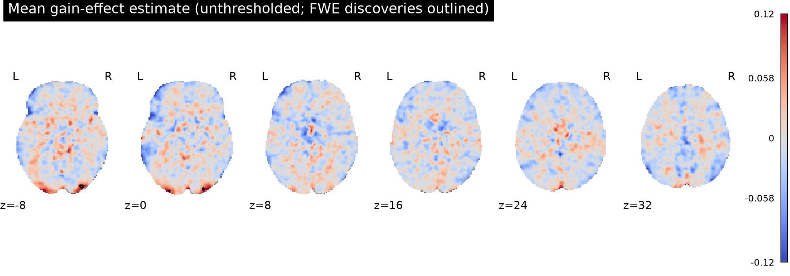
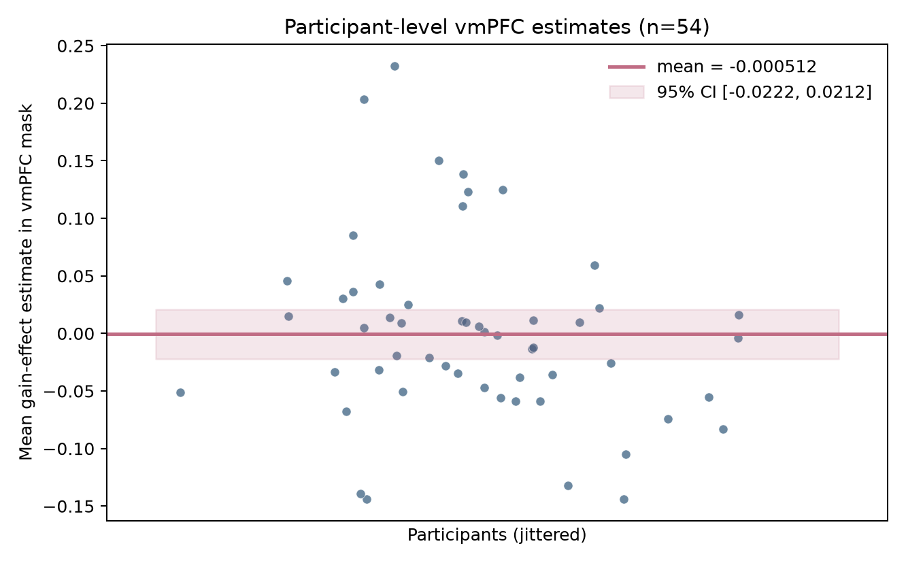

# Potential gains and brain activity in the equal-indifference group

## Result

**This group analysis did not support the predicted positive gain effect in vmPFC.** Among 54 equal-indifference participants, no voxel in the predefined vmPFC localization mask survived one-sided whole-brain family-wise error (FWE) correction (10,000 participant-level sign flips; max-statistic correction; α = .05). There were 24 FWE-significant positive voxels elsewhere, in three small posterior occipital clusters; these do not support the vmPFC hypothesis. The strongest voxel was at MNI (−26, −102, −3.6 mm), mean effect estimate 0.112, t(53) = 6.62, max-T FWE p = 0.00060.

The descriptive average across the operational vmPFC mask was −0.00051 estimate units (95% t interval −0.0222 to 0.0212; one-sided uncorrected p = .519; standardized one-sample effect d = −0.006). The interval includes positive and negative effects. Thus the result is **lack of corrected evidence for the predicted increase**, not proof that the true vmPFC effect is zero or evidence against every plausible positive effect.

*Figure 1. Mean participant gain-effect estimates across the common brain coverage mask. Black contours mark voxels surviving positive one-sided max-T whole-brain FWE correction at .05. The surviving posterior voxels are far from vmPFC.*

*Figure 2. Each point is one participant’s average effect estimate within the vmPFC mask. The band shows the uncorrected t-based 95% interval for the mean of those 54 participant summaries; it is descriptive and does not replace the whole-brain-corrected test.*

## Analysis

The original NARPS instructions specify the directional hypothesis as a positive parametric gain effect in vmPFC for the equal-indifference group and ask teams to report whole-brain-corrected results ([instructions, Hypothesis 1](https://www.narps.info/files/narps_instructions_for_analysis_teams.pdf)). vmPFC does not have one universally agreed anatomical boundary; the NARPS report describes using a conjunction of anatomical and meta-analytic information to operationalize it ([NARPS study](https://www.nature.com/articles/s41586-020-2314-9)). Here, the primary support criterion is a positive whole-brain-corrected voxel in an independently specified vmPFC mask. For transparent localization, the mask uses Harvard–Oxford cortical atlas labels for Frontal Medial Cortex restricted to z ≤ 30 mm, Subcallosal Cortex, and the Frontal Orbital label restricted to |MNI x| ≤ 20 mm and z ≤ 30 mm ([Nilearn atlas documentation](https://nilearn.github.io/stable/modules/generated/nilearn.datasets.fetch_atlas_harvard_oxford.html)). The atlas uses a different MNI template from the participant maps; labels are resampled to the participant-map grid with nearest-neighbour interpolation and intersected with common image coverage. This is an operational ROI, not a uniquely established boundary, and atlas-template differences add spatial uncertainty.

For each voxel, we estimated the group mean of the 54 participant effect maps and calculated a one-sample t statistic. Positive one-sided inference matches the preregistered directional hypothesis. Family-wise correction used the distribution of the maximum t statistic over all 198,029 voxels in the common map coverage mask under 10,000 randomly generated participant-level sign flips (seed 20261016). Each flip was applied to a participant’s entire 3D map, preserving within-map spatial dependence. The 95th percentile of the maximum-t null was 5.381. The atlas ROI average is summarized by participant before computing its interval; voxels are not treated as independent observations.

## Inputs, quality checks, and limits

All 54 supplied participant maps matched the byte count and SHA-256 checksum in `input/sources.json`; all had the expected 97 × 115 × 81 geometry, matching affines and finite data. The common nonzero coverage comprised 198,029 voxels (about 1,901 ml at the map’s 2 × 2 × 2.4 mm resolution). No participant was excluded. Metadata were consistent with the supplied cohort: mean age 26.1 years (SD 3.0), 30 women and 24 men. Input-level checks are in [`results/input_qc.csv`](results/input_qc.csv).

These are participant contrast parameter estimates, not standardized test statistics. As described in [`input/upstream-methods.md`](input/upstream-methods.md), the gain modulator was mean-centered and variance-normalized before HRF convolution, so map values are not change per currency unit. The maps represent the gain coefficient conditional on the upstream model’s other regressors and separate gain/loss modeling choices. Group differences here cannot be converted into a response per dollar, and the upstream choices cannot be re-evaluated from these images alone. Participant variance maps and the executable individual-level pipeline were not supplied.

The sign-flip test assumes independent participants and a symmetric null distribution of participant-level effects. The finite permutation sample gives approximate Monte Carlo p-values; the anatomical vmPFC definition and the source maps’ fixed model choices also constrain interpretation. A nonsignificant corrected result means these data and this analysis did not provide sufficiently strong, spatially localized whole-brain evidence for the specified effect. It does not establish absence, rule out smaller effects, or generalize to other gain ranges, groups, or model specifications. The study’s equal-indifference task used a potential-gain range twice the potential-loss range.

## Reproducibility files

- [`analysis/group_analysis.py`](analysis/group_analysis.py): complete group analysis, input integrity checks, atlas ROI construction, permutation inference and figure generation.
- [`results/summary.json`](results/summary.json): principal numeric results and analysis settings.
- [`results/fwe_clusters.csv`](results/fwe_clusters.csv), [`results/top_voxels.csv`](results/top_voxels.csv): significant cluster and peak summaries.
- [`results/vmPFC_participant_effects.csv`](results/vmPFC_participant_effects.csv): independent participant summaries underlying Figure 2.
- [`results/vmPFC_mask_definition.txt`](results/vmPFC_mask_definition.txt): ROI recipe.
- NIfTI outputs in `results/`: group mean, t map, max-T FWE p map, significant-voxel map and vmPFC mask.

The analysis used Python 3.13.16, NumPy 2.5.4, SciPy 1.18.1, pandas 3.0.6, NiBabel 5.4.2 and Nilearn 0.14.1. The available skill catalog was checked; it contained no neuroimaging/group-analysis skill applicable to this workflow, so no unrelated skill was installed.
