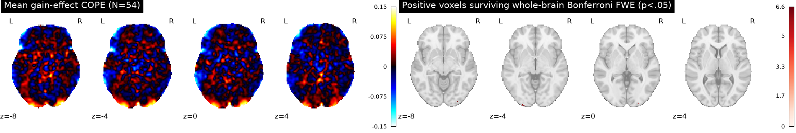
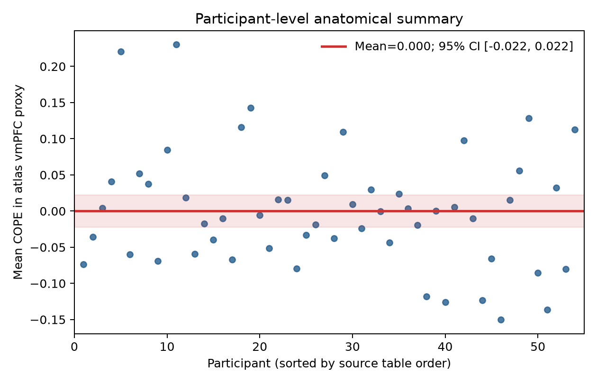

# Potential gains and brain activity

## Conclusion

The supplied equal-indifference group maps do **not support** the prediction of a positive vmPFC gain effect under whole-brain family-wise error control. No significant whole-brain voxel overlapped the prespecified anatomical vmPFC proxy (9 voxels survived whole-brain correction elsewhere). The proxy's mean participant-level gain-effect estimate was near zero, with a confidence interval spanning zero. This is a failure to find corrected evidence for the prediction, not evidence that the true effect is exactly zero.

## Group analysis

I analyzed all 54 equal-indifference participants with their unthresholded AO86 gain-effect COPE maps. The group model was a one-sample, voxelwise t test against zero (df=53), testing the predicted positive direction. The common analysis mask contained 210,968 voxels (nonzero coverage in at least 90% of maps). All maps matched the source manifest's byte counts and SHA-256 checksums, shared a voxel grid and affine, and contained only finite values; no participant was excluded.

To control family-wise error across the entire mask, I used Bonferroni correction over all 210,968 voxels at alpha=.05. This is conservative but controls FWE without relying on spatial-independence assumptions. Nine positive voxels survived (peak t(53)=6.62, uncorrected p=9.31×10⁻⁹; Bonferroni p=.00196; MNI x=-26, y=-102, z=-3.6 mm). They were in posterior/inferior locations, not the hypothesized vmPFC. The full corrected voxel table is in [`results/fwe_positive_voxels.csv`](results/fwe_positive_voxels.csv).

I operationalized vmPFC using the Harvard–Oxford cortical atlas: Frontal Medial, Subcallosal, and Frontal Orbital parcels, limited to |MNI x|≤24 mm and z≤10 mm, resampled to the supplied map grid with nearest-neighbor interpolation. This broad atlas-derived mask is an anatomical proxy, not a unique definition of vmPFC; the atlas provides structural parcels rather than a functional boundary ([FSL atlas documentation](https://fsl.fmrib.ox.ac.uk/fsl/docs/other/datasets.html)). No corrected voxel fell in this proxy. As a descriptive secondary summary, the participant-average COPE in the proxy was 0.0002 (SD across participants=0.0816; 95% t interval [-0.0221, 0.0225]; t(53)=0.018, one-sided uncorrected p=.493). Leaving out one participant at a time moved the proxy mean between -0.0041 and 0.0030, so its sign was not robust to individual omission. This ROI summary is not the basis for the whole-brain decision.





## Interpretation and limits

The supplied values are parameter estimates, not t or z statistics. AO86 mean-centered and variance-normalized the gain regressor before HRF convolution, so this contrast is not a response-per-currency-unit slope and cannot be converted to a monetary gain increment. It is conditional on AO86's separate gain/loss model and response-time-duration choice regressors. The group t model uses between-participant variability in these COPEs; participant variance maps were unavailable, so it cannot incorporate first-level uncertainty using a full weighted mixed-effects model. The results therefore concern the supplied model's group-average gain effect, not a model-independent causal response to cash amounts.

The 95% interval is compatible with small effects in either direction in the COPE scale. A null result after stringent whole-brain correction does not establish no vmPFC response; it means this analysis did not find sufficient corrected evidence that the mean effect is positive. The atlas proxy's borders and template differ slightly from the supplied MNI152NLin2009cAsym images, adding localization uncertainty. Bonferroni's conservatism also reduces sensitivity. The original NARPS instructions required whole-brain-corrected results for the binary hypothesis decision ([NARPS analysis instructions, Hypothesis 1](https://www.narps.info/files/narps_instructions_for_analysis_teams.pdf)).

## Reproducibility

The initial workspace had 54 broken Git-annex pointers in `input/data/`, without accessible image bytes. I restored only the 54 exact COPE maps referenced by `input/sources.json` from its NeuroVault URLs and verified each downloaded file against the recorded size and SHA-256. No time-series scans were retrieved. To reproduce with the provided Python 3.13 environment:

```bash
python analysis/restore_maps.py
python analysis/group_analysis.py
```

The group script writes the statistical maps and summary to `results/`, the voxel and participant QC tables there, and the figures to `figures/`. Key numeric results are in [`results/summary.json`](results/summary.json); per-map checks are in [`results/map_qc.csv`](results/map_qc.csv). Analysis code is [`analysis/group_analysis.py`](analysis/group_analysis.py), and the map restoration/checksum code is [`analysis/restore_maps.py`](analysis/restore_maps.py).
