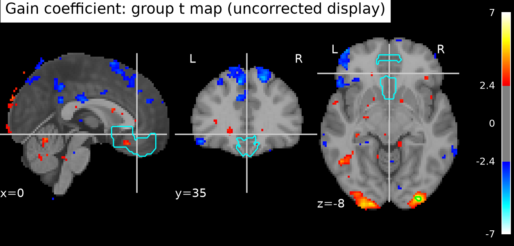
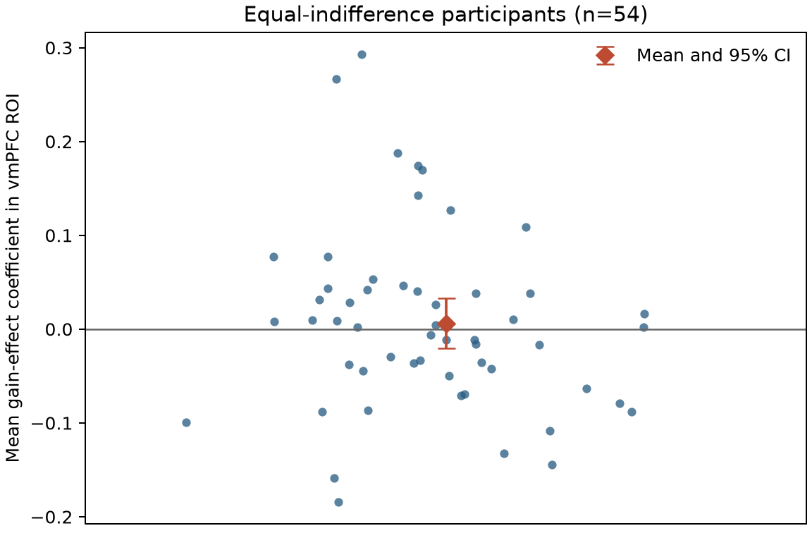

# Potential gains and brain activity

## Conclusion

In the 54-person NARPS equal-indifference group, the supplied gain-effect maps do **not support a positive vmPFC response** at the group-analysis stage. The pre-defined vmPFC proxy had a near-zero average coefficient, its confidence interval spanned zero, and no voxel in it survived whole-brain family-wise error correction. This is a lack of evidence for the predicted group effect, not evidence that the true effect is exactly zero.

## Analysis

I treated each participant's unthresholded map as one coefficient estimate and fitted an equal-weight one-sample group model against zero. The directional hypothesis was tested using 10,000 participant-wise sign-flips of a studentized t statistic. For each permutation, I retained the largest positive t value across the whole analysis mask; this max-statistic distribution controls whole-brain family-wise error for the positive hypothesis. The Monte-Carlo seed was 20261016. The task calls for whole-brain correction, as did the [original NARPS analysis instructions, Hypothesis 1](https://www.narps.info/files/narps_instructions_for_analysis_teams.pdf).

The analysis mask contained 210,968 voxels represented by nonzero map values in at least 90% of participants. The vmPFC proxy was specified independently of the observed maps using the Harvard–Oxford cortical maximum-probability atlas at a 25% threshold: its **Frontal Medial Cortex** and **Subcallosal Cortex** labels, resampled to the map grid with nearest-neighbor interpolation. These medial frontal labels provide an explicit, conservative anatomical proxy; they are not a uniquely agreed boundary for vmPFC. The [FSL atlas documentation](https://fsl.fmrib.ox.ac.uk/fsl/docs/other/datasets.html) describes the Harvard–Oxford atlas as a population atlas of cortical and subcortical structural areas. The ROI mean and its interval are descriptive; the primary support decision comes from the whole-brain-corrected map.

## Results

The ROI mean was 0.0062 coefficient units (between-person SD 0.0972; *t*(53) = 0.47, one-sided *p* = 0.321; two-sided 95% CI [−0.0204, 0.0327]). No ROI voxel survived whole-brain correction. Leave-one-participant-out ROI means ranged from 0.0008 to 0.0098, so the near-zero group average was not driven by a single participant.

The whole-brain test did identify positive effects elsewhere: 24 voxels in three small connected foci survived voxelwise max-*t* correction (*p*FWE ≈ 0.00060; maximum *t*(53) = 6.62 at MNI [−26, −102, −3.6], labeled Occipital Pole by Harvard–Oxford). These posterior results do not support the vmPFC hypothesis. The displayed statistic map is uncorrected for visualization; lime outlines show the whole-brain-corrected voxels.



*Figure 1. Colors show the uncorrected group t map at a display threshold; lime outlines are positive voxels surviving whole-brain max-t correction at α=.05; cyan outlines show the atlas-defined vmPFC proxy.*



*Figure 2. Each dot is one participant's mean coefficient over the vmPFC proxy. The diamond and whiskers show the group mean and two-sided 95% t interval.*

## Scope and limitations

All 54 supplied participants were retained. Every map had finite values, identical geometry, and a SHA-256 hash matching `input/sources.json`; git-annex integrity checks also reported all maps OK. I made no outcome-based exclusions. The supplied files do not include first-level variance maps or an executable upstream model, so the group model cannot weight participants by first-level uncertainty or audit/refit the individual models. The sign-flip inference assumes participant-level errors are exchangeable and symmetric under the zero-effect null.

The upstream gain regressor was mean-centered and variance-normalized before HRF convolution. Thus these coefficients are not response change per currency unit. Although potential gain varied over twice the loss range, this normalized gain coefficient does not directly express that range ratio as a slope per dollar. It estimates the fitted gain-modulator association conditional on the upstream model, which used response-time durations and modeled gain separately from loss. These fixed inputs and choices bound the interpretation; this analysis does not revisit preprocessing or participant-level modeling.

A nonsignificant vmPFC result means that this sample and these supplied estimates did not provide corrected evidence for a positive group-average coefficient. It does not rule out a smaller effect, effects in subregions outside this ROI definition, individual differences, or effects that the upstream model did not capture.

## Reproduction and artifacts

Run from the workspace root with the supplied Python environment:

```bash
/Users/johnlee/.local/state/stamped-in-practice/narps-neutral-v1/common-environment/.pixi/envs/default/bin/python analysis/run_analysis.py
```

The script verifies all 54 source hashes and writes the maps, tables, figures, and full result metadata under `results/`. `results/results.json` contains the numeric summary and software versions; `results/participant_qc.tsv` and `results/permutation_max_t.tsv` preserve subject-level QC and permutation maxima. The downloaded Harvard–Oxford atlas and MNI152 template are kept under `results/atlas/` for local reruns.

For input-integrity practice, I installed and used the `datalad-fsck` skill from the [Nipreps neuroimaging community skills collection](https://github.com/nipreps/skills-comm/tree/82edd77ab47a86fece1a901f57851b76f4dcd8eb/plugins/datalad-cli/skills/datalad-fsck). Its workspace-local copy is `.codex/skills/datalad-fsck/`.
