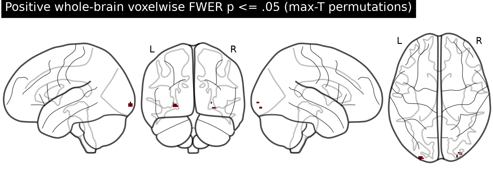
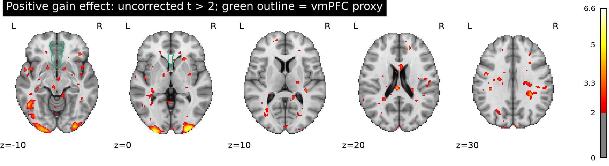
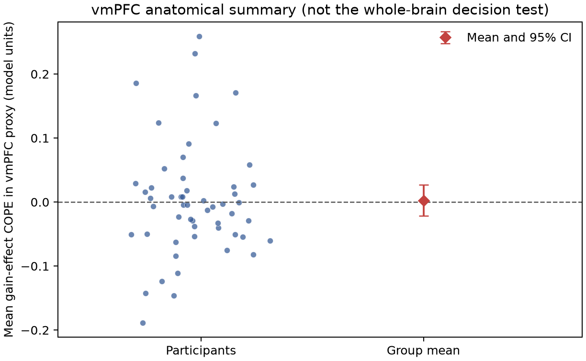

# Potential monetary gain and fMRI response in the equal-indifference group

## Finding

The supplied data do **not support a positive gain effect in vmPFC** under the prespecified whole-brain family-wise error (FWE) criterion. In the independent anatomical vmPFC proxy, the mean gain-effect estimate was 0.0027 model units (95% t CI -0.0217 to 0.0270; one-sided sign-flip *p* = .403; *n* = 54). No whole-brain FWE-positive voxel overlapped the proxy region.

The whole-brain test did find 23 positive FWE-significant voxels in three small 6-connected clusters, all in posterior occipital cortex. The largest cluster had 16 voxels, with peak *t* = 6.62 at MNI (-26, -102, -3.6) and max-*t* corrected *p* = .0010. These clusters do not support the vmPFC hypothesis. Cluster sizes are descriptive; inference was voxelwise max-*t*, not cluster-level inference.







## Analysis

All 54 equal-indifference participants were included; none were excluded. Participant IDs matched the metadata, all 54 source SHA256 checksums verified, map dimensions and affines matched, and no map contained non-finite values. I fit an unweighted one-sample group *t* model to each participant's supplied gain-effect map and tested the positive direction. Whole-brain FWE was controlled at .05 with 5,000 participant-level sign-flip permutations and a maximum-*t* statistic across voxels. This preserves the observed spatial dependence while controlling the voxelwise family-wise error rate. The analysis mask was the intersection of voxels nonzero in every participant map with a resampled MNI152 2-mm brain mask (186,400 voxels). The maximum-*t* 95th percentile was 5.39. Permutation seed: 20261016.

The vmPFC locator was set without reference to the observed effect: the Harvard–Oxford cortical atlas's Frontal Medial Cortex and Subcallosal Cortex labels at the 25% maximum-probability threshold, combined as one broad anatomical proxy. The atlas labels were nearest-neighbour resampled from MNI152 to the supplied MNI152NLin2009cAsym grid. Because vmPFC has no single agreed anatomical boundary, this is a transparent proxy rather than a uniquely definitive vmPFC definition. The ROI average is a secondary descriptive check; the hypothesis decision is based on the whole-brain test, as requested in the [original NARPS instructions](https://www.narps.info/files/narps_instructions_for_analysis_teams.pdf). The atlas is described by [FSL/Harvard–Oxford](https://fsl.fmrib.ox.ac.uk/fsl/docs/other/datasets.html).

## What the estimates mean and limits

These are participant contrast parameter estimates (COPEs), not *t* or *z* maps. AO86 mean-centered and variance-normalized its gain modulator before HRF convolution, so a COPE is not change in BOLD per dollar. Response-trial duration was response time, and gain was modeled alongside choice; nonresponse events and nuisance terms were also included. Gain and loss were modeled separately, so the effect is conditional on that upstream model. Since the potential-gain range was twice the potential-loss range, the coefficient scale also cannot be read as a direct gain-versus-loss sensitivity comparison.

The group *t* test treats participant estimates as independent observations and does not weight them by their first-level precision. Participant variance maps and the complete executable upstream pipeline were not supplied, so a variance-weighted mixed-effects analysis and a full upstream audit were not possible. Sign-flip inference assumes participant estimates are exchangeable and approximately symmetric under the null. The anatomical atlas and brain mask are in MNI152, whereas the COPE maps are in MNI152NLin2009cAsym; nearest-neighbour resampling is a practical approximation, and small boundary misalignments are possible.

Failure to find vmPFC support means this analysis did not detect a sufficiently consistent positive group effect at whole-brain FWE .05. It is not evidence that the true effect is exactly zero: modest effects, heterogeneous responses, the chosen anatomical proxy, upstream modeling choices, and the available sample could all limit detection. NARPS itself documented substantial variation in analysis outcomes across teams ([original study](https://doi.org/10.1038/s41586-020-2314-9)).

## Reproducibility files

- [`analyze.py`](analyze.py): checksum and geometry checks, group inference, anatomical ROI summary, figures and results.
- [`results/results.json`](results/results.json): machine-readable summary.
- [`results/participant_qc.tsv`](results/participant_qc.tsv): participant-level input checks and descriptive values.
- [`results/fwer_positive_clusters.tsv`](results/fwer_positive_clusters.tsv): descriptive connected components among FWE-positive voxels.
- `results/group_*.nii.gz`: mean, *t*, corrected *p*, and positive FWE mask.
- `results/vmPFC_proxy_roi.nii.gz`: resampled anatomical proxy.

Run from this directory with the supplied Python environment:

```bash
/Users/johnlee/.local/state/stamped-in-practice/narps-neutral-v1/common-environment/.pixi/envs/default/bin/python analyze.py
```
