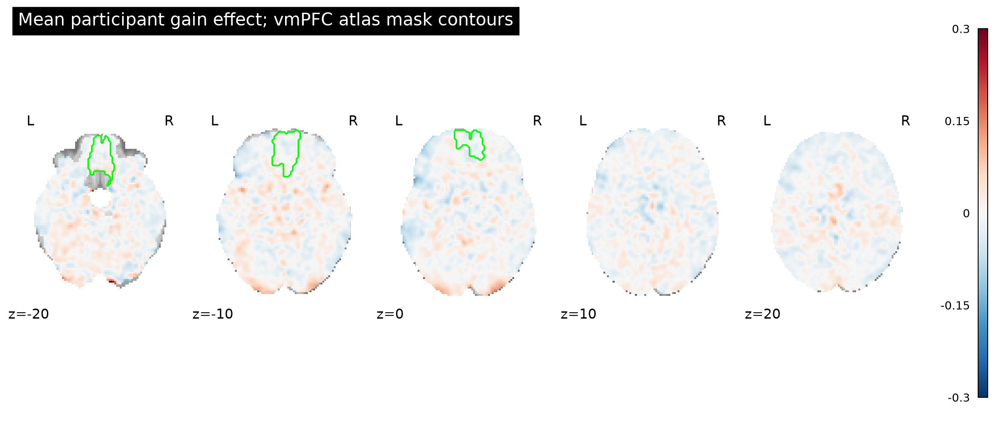
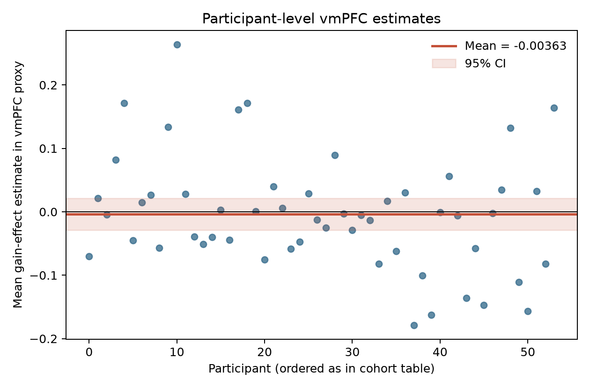

# Potential gains and vmPFC activity

## Result

**The supplied maps do not support a positive gain effect in vmPFC for the equal-indifference group.** Across an anatomical vmPFC proxy, the mean participant effect was −0.0036 map units (95% CI −0.0285 to 0.0212; one-sided *p* = .615; *n* = 54). The estimate is close to zero, but the interval is not an equivalence test and the map units have no per-currency interpretation.

The prespecified whole-brain positive one-sample test found 11 voxels passing voxelwise Bonferroni FWE *p* < .05 (186,611 tested voxels). They form three small posterior occipital foci, with peaks at MNI (−26, −102, −3.6), (26, −98, −1.2), and (30, −94, −8.4) mm. None overlaps the vmPFC mask. These off-target findings do not support the vmPFC hypothesis.

| Focus | Voxels | Peak MNI (mm) | Peak *t*(53) | Peak FWE *p* |
|---|---:|---:|---:|---:|
| 1 | 8 | −26, −102, −3.6 | 6.62 | .0017 |
| 2 | 1 | 26, −98, −1.2 | 5.76 | .0405 |
| 3 | 2 | 30, −94, −8.4 | 6.19 | .0083 |



*Figure 1. Mean participant gain-effect estimates in map units. Green contours show the vmPFC proxy defined by bilateral medial orbital frontal cortex and gyrus rectus in AAL. The display is descriptive; inference uses the whole-brain corrected test below.*


*Figure 2. Positive t-statistics passing one-sided voxelwise Bonferroni FWE *p* < .05. The small surviving foci lie at the posterior occipital pole, not in vmPFC.*



*Figure 3. Each point is one participant’s mean effect across covered vmPFC-proxy voxels. The band is the unadjusted 95% confidence interval for the group mean.*

## Group analysis

I analyzed the 54 participant contrast-parameter-estimate maps named in the supplied source metadata. The maps are AO86 gain-effect estimates averaged across four runs, not *t* or *z* maps. I used an unweighted one-sample *t* model against zero at each voxel (df = 53), with positive-direction inference because the hypothesis predicts an increase. This is a random-effects group test of participant effects; no extra smoothing or individual-level processing was applied. The analysis uses Python 3.13, SciPy 1.18, NiBabel 5.4, and Nilearn 0.14.

To identify vmPFC, I used an anatomical, atlas-defined proxy rather than selecting a region from the observed result: bilateral `Frontal_Med_Orb` plus bilateral `Rectus` from AAL SPM12, resampled in world coordinates to the supplied MNI152NLin2009cAsym grid. This covers medial orbital frontal cortex and gyrus rectus, a defensible but imperfect anatomical approximation of vmPFC. The ROI contained 2,394 voxels (23.0 mL) after coverage masking. Its mean and confidence interval summarize the target region; the target claim is evaluated against the required whole-brain correction, not the unadjusted ROI *p*-value. For whole-brain testing, I used the intersection of nonzero coverage across all participants and a resampled ICBM 2009 brain mask, yielding 186,611 tested voxels. The available ICBM mask is the symmetric 2009a release, not the exact asymmetric 2009c input reference; resampling by world coordinates makes it a practical whole-brain boundary, with a possible small edge mismatch. Bonferroni correction gives strong voxelwise familywise error control without relying on a spatial smoothness estimate.

## Uncertainty and limits

All 54 participants were included. The maps shared dimensions and affine, all values were finite, and each map had substantial nonzero coverage; there were no exclusions. The primary limitations are inherited from the fixed upstream model: participant variance maps are unavailable, so the group model cannot weight observations by within-participant estimation uncertainty; gain and loss were modeled separately; and the gain modulator was mean-centered and variance-normalized before HRF convolution. Thus the reported effect is not a change per currency unit, and these estimates cannot establish the physiological response to a particular monetary increment. The one-sample model also assumes independent participants and sufficiently well-behaved between-participant effects. Bonferroni is conservative, so small effects may be missed.

The near-zero vmPFC estimate and nonsignificant target result mean **this analysis does not provide evidence for the predicted positive vmPFC effect**. They do not prove that vmPFC has no gain-related response, establish equivalence to zero, or rule out a response under a different individual model or a more precise estimate. The narrow target estimate is also subject to the unavailable first-level uncertainty and upstream model choices.

## Reproducibility and sources

Run from the workspace root with the prepared interpreter:

```bash
/Users/johnlee/.local/state/stamped-in-practice/narps-neutral-v1/common-environment/.pixi/envs/default/bin/python analysis/group_analysis.py
```

Code is in [analysis/group_analysis.py](analysis/group_analysis.py). Numerical output and NIfTI maps are in [results/](results/); atlas files used by the script are cached under `analysis/atlases/`. The code verifies all 54 map SHA256 checksums against the supplied source index. The full summary is [results/summary.json](results/summary.json), with peak locations in [results/wholebrain_fwe_clusters.tsv](results/wholebrain_fwe_clusters.tsv) and participant ROI means in [results/vmPFC_subject_estimates.tsv](results/vmPFC_subject_estimates.tsv). The upstream model details and input checksums are retained in `input/upstream-methods.md` and `input/sources.json`.

This analysis follows the whole-brain reporting requirement in the [NARPS instructions for analysis teams, Hypothesis 1](https://www.narps.info/files/narps_instructions_for_analysis_teams.pdf). The maps are identified in the [NARPS AO86 NeuroVault collection](https://neurovault.org/collections/4932/). The broader study and its whole-brain analysis context are described in [Botvinik-Nezer et al. (2020)](https://www.nature.com/articles/s41586-020-2314-9).
