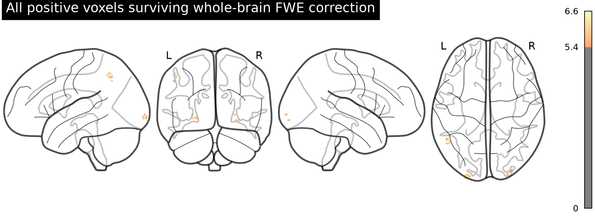
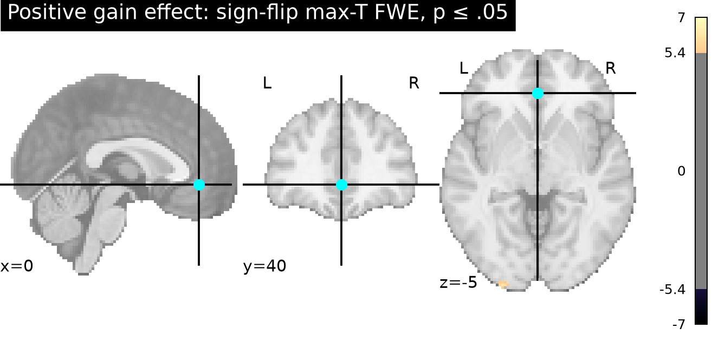
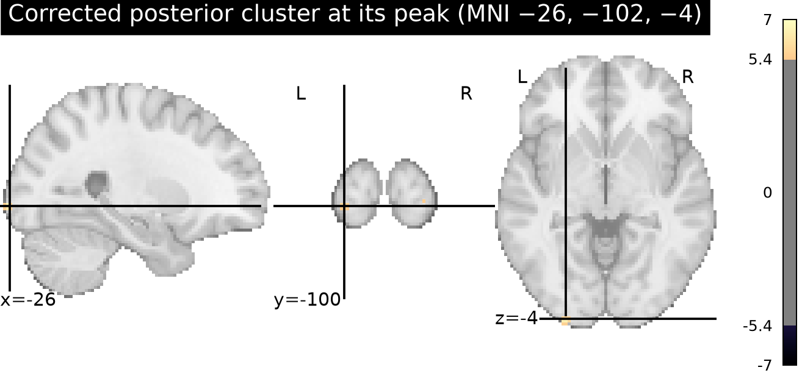
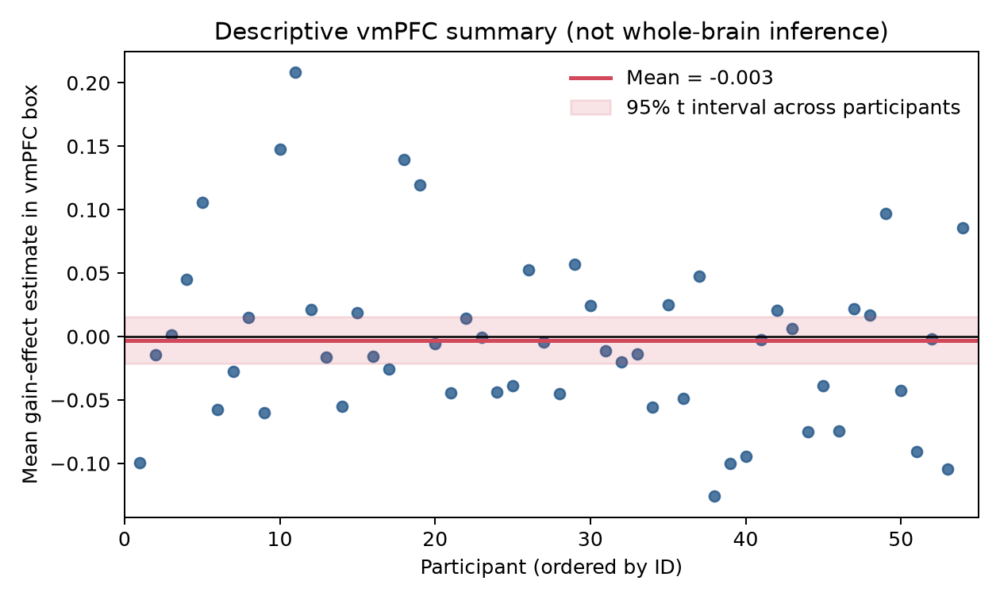

# Potential gains and brain activity

## Finding

**No whole-brain-corrected evidence supports a positive gain effect in vmPFC** in the NARPS equal-indifference group. The one-sided group test found positive corrected voxels, but they formed three small clusters in posterior regions (24 voxels total), not vmPFC. The strongest voxel was at MNI (−26, −102, −3.6), *t*(53) = 6.62, max-statistic FWE *p* = .0010. This result does not support the stated vmPFC hypothesis.

The NARPS analysis instructions required whole-brain-corrected binary decisions despite region-specific hypotheses; we therefore based the conclusion on whole-brain familywise error correction, not an uncorrected vmPFC search ([original instructions, Hypothesis 1](https://www.narps.info/files/narps_instructions_for_analysis_teams.pdf)). The vmPFC locator was a broad bilateral anterior midline/ventral MNI box (|x| ≤ 15, y = 25–60, z = −20–10 mm). Within it, the mean participant effect was −0.003 (95% *t* interval −0.021 to 0.016); its most positive voxel had max-statistic FWE *p* = .938. This coordinate box is an explicit operational locator because vmPFC has no single universally agreed boundary; its summary is descriptive and does not replace the whole-brain test.

## Analysis

We analyzed all 54 supplied AO86 gain-effect maps in MNI152NLin2009cAsym space; no participants were excluded. Image shape, affine, and finite-valued data were checked. The whole-brain testing mask retained voxels with nonzero estimates in at least 90% of participants (210,968 voxels), reducing sensitivity to map-boundary coverage differences. We fit a one-sample *t* model across participant contrast estimates at each voxel. The directional alternative was evaluated with 5,000 participant-level sign flips; each permutation contributed its maximum positive *t* over the entire mask, controlling one-sided whole-brain FWE at α = .05. The 95th percentile maximum-*t* cutoff was 5.404. At this threshold there were 24 significant voxels in clusters of 17, 2, and 5 voxels, with peaks at (−26, −102, −3.6), (26, −98, −1.2), and (30, −94, −8.4) mm. A parametric one-sample *t* test with voxelwise Bonferroni correction also found 9 positive voxels, all in posterior regions.

The analysis ran with Python 3.13.16, NumPy 2.5.4, SciPy 1.18.1, Nilearn 0.14.1, NiBabel 5.4.2, pandas 3.0.6, and Matplotlib 3.11.2.

The maps are participant contrast parameter estimates, not standardized test statistics or group maps. Thus the group *t* statistics describe uncertainty across the 54 participants' supplied effects. The upstream gain regressor was mean-centered and variance-normalized before HRF convolution, so these coefficients cannot be read as a BOLD change per currency unit. They reflect gain modulation conditional on AO86's response-duration, choice, motion, censoring, drift, and separate gain/loss model choices. The preprocessing and individual models were treated as fixed, as instructed ([upstream methods](input/upstream-methods.md)); no time-series data were downloaded or re-modeled. The source cohort and image collection are documented in [the supplied provenance file](input/sources.json) and [AO86 NeuroVault collection](https://neurovault.org/collections/4932/).

## Uncertainty and limits

Sign-flip maximum-*t* inference assumes independent participant effects that are exchangeable under sign reversal (in particular, a reasonably symmetric null distribution). The Monte Carlo correction used a fixed seed and 5,000 permutations, so its smallest attainable adjusted *p* is about .0002. The map-coverage threshold and broad coordinate box are analysis choices; the vmPFC interval is descriptive and not a separate confirmatory test. The upstream participant variance maps were not supplied, so group inference weights participant effects equally and cannot model their differing first-level precision. The result also inherits the fixed upstream model and the limits of its regressor scaling.

Failure to find support means this analysis did not detect a positive gain-related effect in vmPFC at the whole-brain-corrected threshold. It does not establish that the true response is zero, rule out smaller effects, or address other regions, nonlinear gain responses, or alternative upstream models. The posterior corrected clusters do not rescue the vmPFC-specific claim.

## Reproducible materials

- [Analysis script](scripts/group_analysis.py) — validation, group inference, maps, tables, and figures.
- [Analysis notebook](notebooks/narps_gain_group_analysis.ipynb) — run-through and result presentation.
- `results/summary.json` — numerical summary, seed, and SHA-256 checksums for all input maps.
- `results/fwe_clusters.csv` — corrected cluster coordinates and sizes.
- `results/group_t_unthresholded.nii.gz`, `results/p_fwe_signflip_maxT.nii.gz`, and `results/group_t_fwe05_positive.nii.gz` — unthresholded *t*, adjusted *p*, and thresholded group maps.
- `results/vmPFC_subject_means.csv` — participant-level ROI summary.
