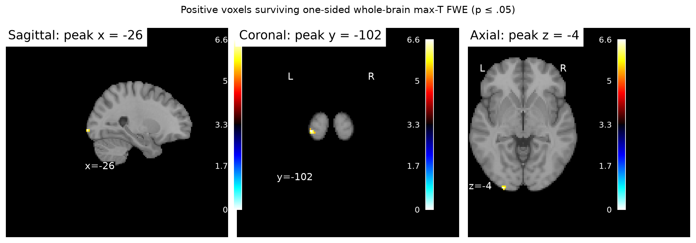
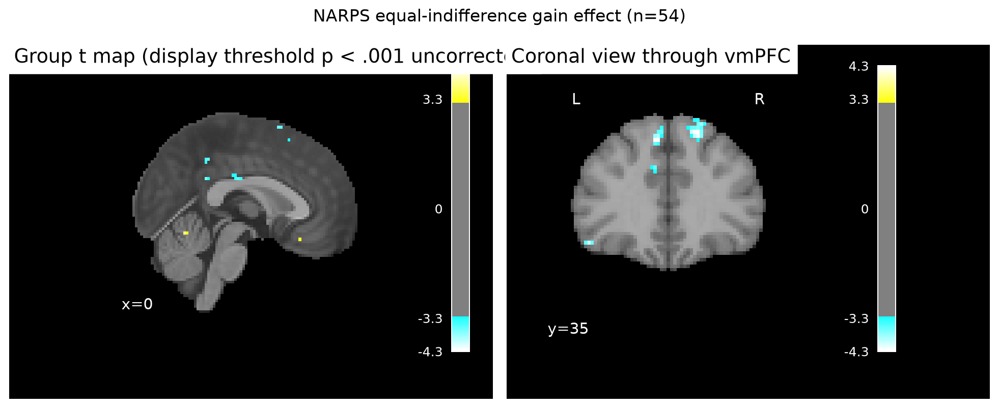

# Potential gains and vmPFC activity in the NARPS equal-indifference group

## Result

**The supplied group maps do not support a positive gain effect in vmPFC under whole-brain corrected inference.** Across all 54 participants, the mean effect in an independently specified vmPFC core mask was 0.0018 contrast units (between-participant SD 0.0629; 95% t interval −0.0153 to 0.0190; one-sided uncorrected *p* = .416). The interval includes zero and effects in either direction; this is not an equivalence test.

A one-sided whole-brain max-*T* permutation test did identify 23 significant voxels (*p*FWE ≤ .05), with the strongest at MNI (−26, −102, −3.6), *t*(53) = 6.62, *p*FWE = .0009. This is posterior left occipital cortex, not vmPFC, and does not support the stated regional hypothesis. The small non-target finding should be interpreted cautiously; it is a whole-brain result, not an independently replicated effect.

The uncorrected group map is shown for anatomical context only. Its display threshold (*p* < .001 uncorrected) is not the inferential threshold.

## Analysis

The 54 AO86 participant gain contrast estimates (COPEs) were tested with an equal-weight one-sample random-effects *t* model against zero (*df* = 53). Each value is an upstream participant-level contrast estimate—not a *t*/*z* statistic. An independently specified vmPFC core envelope (MNI x = −15 to 15, y = 20 to 55, z = −20 to 5 mm) was used to summarize the target-region estimate and its uncertainty. This broad anatomical summary is descriptive; the confirmatory search was whole brain, consistent with the [original NARPS analysis instructions](https://www.narps.info/files/narps_instructions_for_analysis_teams.pdf), which require whole-brain corrected evidence for the named region.

The primary inference used 9,999 random sign flips of participant effects and the maximum positive *t* statistic across the analysis mask on each permutation, controlling voxelwise family-wise error at .05. The analysis mask was the intersection of a standard MNI brain mask and nonzero locations across all 54 maps. The latter avoids treating zeros outside individual estimation support as observed zero effects. It contains 186,400 voxels; 2,687 fall in the vmPFC core. All maps had the same 97 × 115 × 81 grid, 2 × 2 × 2.4 mm voxel spacing and affine; all 54 participant IDs matched metadata. No participants were excluded. The full group *t* map, max-*T* adjusted *p* map, thresholded significant *t* map, JSON summary and run log are in `results/`.

## Interpretation and limits

A lack of corrected vmPFC support means this analysis did not detect evidence strong enough to pass whole-brain family-wise error control in that region. It does **not** show that the true effect is zero or rule out a smaller effect; the descriptive interval remains compatible with positive and negative effects.

The gain modulator was mean-centered and variance-normalized before HRF convolution. Thus, the supplied coefficient is not a response change per currency unit. Response-time duration, choice regressors, motion, flagged volumes and drift were included upstream, while gain and loss were modeled separately; the estimate is conditional on those fixed choices. Because participant variance maps and an executable upstream model are unavailable, the group test gives participants equal weight and cannot account for differing first-level precision. Sign-flip inference also assumes participant effects are exchangeable and null errors are symmetric. The common-support mask excludes locations not estimated for every participant. The analysis tests the supplied contrast in this group; it does not establish causality or directly compare the gain and loss range manipulation.

## Reproducibility

Run `analysis/group_analysis.py` with the supplied Python environment. Outputs are written to `results/` and `figures/`; numeric results are in `results/summary.json`. Inputs and fixed modeling details are documented in `input/sources.json` and `input/upstream-methods.md`.
