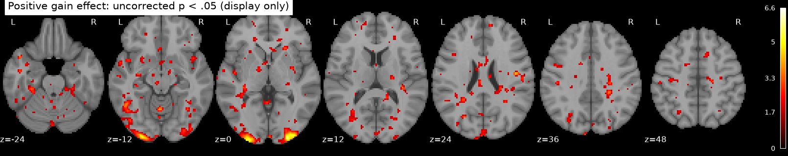

# Potential gains and brain activity in the equal-indifference group

## Question and result

Among the 54 participants in NARPS's equal-indifference group, the supplied gain-effect maps do **not** provide whole-brain family-wise corrected evidence for a gain-related increase in vmPFC. Twenty-three voxels in three small posterior occipital-pole clusters passed the one-sided whole-brain max-statistic permutation test (α = .05; peak t = 6.62 at MNI [-26, -102, -3.6], max-T FWE p = .0006); none were in vmPFC. In an independently defined vmPFC mask, the mean participant effect was **-0.009** (95% t interval **[-0.040, 0.022]**), and no voxel survived whole-brain correction. The occipital finding does not support the vmPFC hypothesis. A lack of vmPFC support is not evidence that the true effect is exactly zero.

*Figure 1. Positive-direction one-sample t statistics displayed at uncorrected p < .05 for visualization only. There were 7,326 such voxels; only 23 voxels in posterior occipital-pole clusters passed whole-brain correction.*

*Figure 2. The corrected map shows the small posterior occipital-pole clusters that survive whole-brain FWE; no vmPFC voxels survive.*

*Figure 3. Each point is one participant's average effect estimate across voxels in the anatomical vmPFC mask. The interval is a descriptive 95% t interval for the group mean; inferential support is determined by whole-brain correction.*

## Methods

I analyzed all supplied participants as the independent units in a one-sample, positive-direction group t test of participant gain-effect estimates against zero. Input maps were finite, and shared shape and affine were confirmed. The analysis mask was the intersection of voxels with nonzero finite values in all 54 maps and a resampled standard MNI152 brain mask (186,400 voxels); this common-support rule avoids comparing different participant coverage while restricting inference to brain. No participants were excluded. Whole-brain family-wise error was controlled with 10,000 participant-level sign-flip permutations and the maximum t statistic across the complete analysis mask (fixed seed 20261016; minimum attainable p = 1/10,001). Whole-brain correction addresses false positives across locations, at a power cost compared with an ROI-only test.

I localized vmPFC using the Harvard-Oxford cortical atlas (25% maximum-probability map), taking its *Frontal Medial Cortex* label at MNI y ≥ 0 and z ≤ 0 (769 voxels on the input grid). This atlas-defined ventral medial subset is an anatomical aid, not a mask used to select the whole-brain inference. vmPFC boundaries vary across conventions; the anatomical summary is therefore descriptive.

## Interpretation and limits

These are participant contrast parameter estimates (COPEs), not z/t maps or group statistics. The upstream gain modulator was mean-centered and variance-normalized before HRF convolution, so its coefficient is not response change per currency unit. The response was modeled with response-time durations and separate choice and gain modulators; nonresponses, motion, flagged volumes, drift, and run combination follow the fixed upstream analysis. Gain and loss were estimated in separate models, so the gain coefficient is conditional on that modeling choice. In the task, potential gains varied over twice the range of potential losses, which further cautions against interpreting this coefficient as an isolated monetary-unit slope.

The one-sample model gives equal weight to each participant because participant variance maps were not supplied. Thus group uncertainty cannot account for differences in first-level precision, and the variance of the COPEs mixes true participant differences with estimation error. Sign-flip inference assumes participant-level errors are symmetric under the null. The data support conclusions only about this selected group, these supplied maps, and this upstream model. Failure to reject does not rule out a smaller positive effect, effects with a different spatial extent, or effects under a different first-level specification; it also does not establish absence of vmPFC involvement.

## Reproducibility

Run `python analysis/group_analysis.py` in the supplied Python environment from this workspace. The script writes group maps, voxelwise p values, QC summaries, and figures. `results/summary.json` contains the key numerical results; `results/participant_qc.tsv` records participant coverage and map summaries. The original study's Hypothesis 1 instructions are available [here](https://www.narps.info/files/narps_instructions_for_analysis_teams.pdf).
