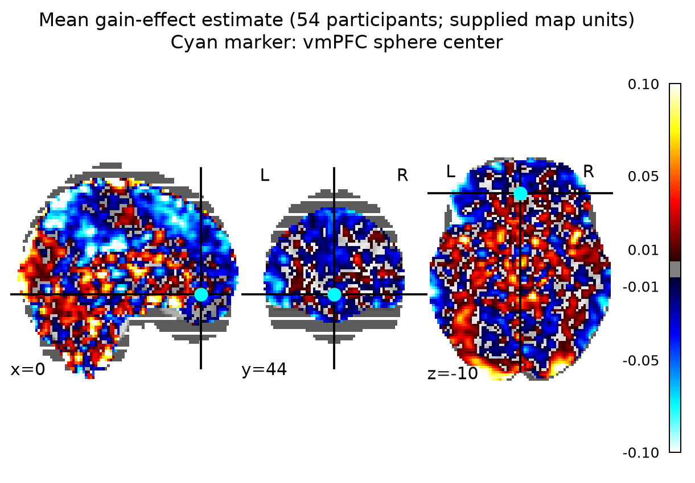

# Potential monetary gains and vmPFC activity

## Result

**The supplied group maps do not support a positive gain effect in vmPFC.** The primary one-sided whole-brain test found 24 voxels in small posterior clusters (max-T family-wise error corrected, peak *t*(53) = 6.62, peak MNI [−26, −102, −3.6], adjusted *p* = .0010). These clusters are remote from the prespecified vmPFC location. In a 10-mm sphere centered at MNI [0, 44, −10], the mean effect was −0.013 map units (95% participant-level *t* interval [−0.044, 0.018]); no vmPFC voxels passed the whole-brain corrected threshold.

This is a **no** for the requested whole-brain-corrected vmPFC hypothesis. It is not evidence that gain information is absent from vmPFC or from the brain generally: the ROI estimate is imprecise and its interval includes zero, while a positive corrected cluster appeared elsewhere.

## Group analysis

I included all 54 participants assigned to the equal-indifference group. All 54 maps were available, finite, and on the same MNI152NLin2009cAsym grid (97 × 115 × 81; 2 × 2 × 2.4 mm); no participant was excluded. The analysis mask comprised voxels with nonzero map coverage in at least 90% of participants (210,968 voxels; minimum coverage 49/54). For a coverage check, 198,029 voxels were covered in all 54 maps. Masking avoided treating structural zeros outside the modeled coverage as observations.

At each masked voxel, I fit a one-sample, equal-weight random-effects *t* test to the 54 participant effect estimates (df = 53), testing the prespecified positive direction. Whole-brain family-wise error was controlled with 5,000 participant-level sign flips and the maximum positive *t* statistic across the mask. The 95th percentile of this max-*t* null was 5.40. This controls the search over the whole mask without requiring a cluster-forming threshold or spatial smoothness model. It relies on sign exchangeability under the zero-mean null (in particular, approximate symmetry of participant errors).

The target was defined independently of the results as a 10-mm-radius sphere centered at MNI [0, 44, −10], an operational coordinate-based vmPFC location. This ROI was used for visualization and effect-size description only. The hypothesis decision came from the whole-brain corrected map, consistent with the original NARPS instruction to base decisions on whole-brain-corrected results rather than ROI-only analysis ([original NARPS instructions, Hypothesis 1](https://www.narps.info/files/narps_instructions_for_analysis_teams.pdf)).

*Figure 1. Group mean of the supplied participant gain-effect estimates. The cyan marker shows the sphere center. The displayed color scale is clipped at ±0.10 map units to make spatial variation visible; values outside that range are saturated.*

*Figure 2. Positive *t* values surviving whole-brain max-T FWE at .05 (threshold *t* = 5.40). Cyan marks the vmPFC sphere center. Small posterior clusters account for all 24 significant voxels; none overlap the vmPFC sphere.*

*Figure 3. Each point is one participant's spatial mean cope within the 10-mm sphere. The line and band show the mean and its ordinary 95% *t* interval; this is descriptive, not a second corrected test.*

## What the supplied estimates mean

The images are participant-level gain-effect estimates (cope-like estimates), averaged over four runs; they are not *t* or *z* maps. The upstream gain regressor was mean-centered and variance-normalized before HRF convolution, so these coefficients are **not change per currency unit**. They estimate a response to the normalized gain modulator under the supplied participant model. That model used response-time durations, included separate response-choice and gain modulators, modeled nonresponse trials and nuisance terms, combined runs, and fit gain and loss in separate models. Therefore the supplied gain estimate is conditional on those upstream choices. I did not refit the participant models or access time-series scans.

## Uncertainty and limits

- The whole-brain inference is an equal-weight one-sample analysis because participant variance maps are not supplied. It captures between-participant variability in the effect estimates but cannot account for unequal first-level precision the way a variance-weighted mixed-effects model could.
- Sign-flip max-*t* inference assumes participant-level sign exchangeability under the null. The finite permutation sample gives an adjusted-*p* resolution of 1/5,001; the peak result is well above that minimum, but the estimated adjusted *p* still has Monte Carlo uncertainty.
- The 90% coverage mask is derived from nonzero supplied maps, not an independently supplied analysis mask. It is a pragmatic whole-brain coverage definition. Small differences in coverage can affect edge voxels; the significant posterior finding should be treated cautiously and does not alter the absence of a vmPFC whole-brain-corrected result.
- The vmPFC sphere is an explicit operational choice because the supplied material does not provide a binary vmPFC ROI. It is not used to claim significance. A different anatomical boundary could change the descriptive ROI mean.
- A lack of support means this analysis did not establish the predicted positive vmPFC effect at the chosen group-level error criterion. It does **not** establish equivalence to zero, prove no neural coding of gain, or resolve the limits of the upstream regressor/model.

## Reproducibility files

- Analysis script: [`code/group_analysis.py`](code/group_analysis.py)
- Machine-readable summary and QC: [`results/summary.json`](results/summary.json), [`results/participant_qc_and_roi.tsv`](results/participant_qc_and_roi.tsv)
- Whole-brain maps: [`results/group_mean_effect.nii.gz`](results/group_mean_effect.nii.gz), [`results/group_t_positive.nii.gz`](results/group_t_positive.nii.gz), [`results/group_fwe_p_positive.nii.gz`](results/group_fwe_p_positive.nii.gz), [`results/group_significant_fwe05.nii.gz`](results/group_significant_fwe05.nii.gz), and [`results/coverage_mask_90pct.nii.gz`](results/coverage_mask_90pct.nii.gz)
- Permutation and cluster details: [`results/permutation_max_t.tsv`](results/permutation_max_t.tsv), [`results/fwe_clusters.tsv`](results/fwe_clusters.tsv)
- Participant-level ROI plot data: [`results/participant_qc_and_roi.tsv`](results/participant_qc_and_roi.tsv)

The analysis used the supplied Python 3.13.16 environment with NumPy 2.5.4, SciPy 1.18.1, pandas 3.0.6, NiBabel 5.4.2, and Nilearn 0.14.1.
