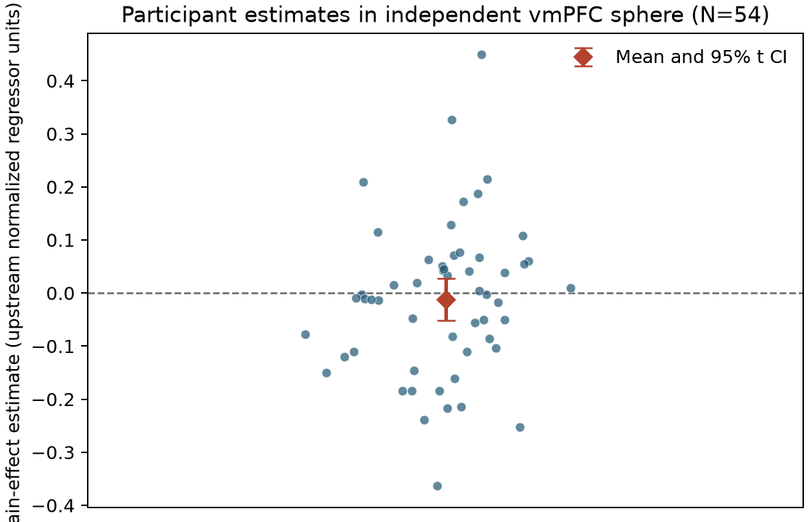
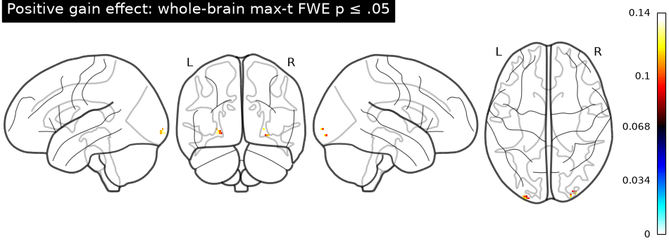

# Potential gains and vmPFC activity

## Result

**The supplied group maps do not support a greater vmPFC response with increasing potential gain.** Across the 54 equal-indifference participants, the mean estimate in an independent 5 mm vmPFC sphere centered at MNI [2, 46, −8] was −0.012 upstream regressor units (95% t interval −0.052 to 0.028; one-sample t(53) = −0.60, one-sided p = .726). No positive voxel in the sphere survived the prespecified whole-brain family-wise error (FWE) correction.

The positive, whole-brain one-sided max-t test did identify 24 FWE-significant voxels elsewhere (smallest corrected p = .0006; peak at MNI [−26, −102, −3.6], mean estimate 0.112, t(53) = 6.62). This posterior finding does not localize to vmPFC and does not establish the hypothesized vmPFC effect. The tested hypothesis was directional and the family-wise correction covered the complete common map support (198,029 voxels), consistent with the original NARPS instruction to test a positive gain effect in vmPFC for the equal-indifference group ([original instructions, Hypothesis 1](https://www.narps.info/files/narps_instructions_for_analysis_teams.pdf)).





## Data and analysis

The analysis used all 54 source-listed AO86 participant gain-effect maps and their matching metadata rows. Maps are in MNI152NLin2009cAsym space at 2 × 2 × 2.4 mm. SHA-256 checks, one-to-one participant IDs, dimensions, affine, and finite values passed; there were no exclusions. The analysis mask was the intersection of finite, nonzero support across all maps, excluding zero-filled outside-mask voxels. The unit of analysis was participant.

For each voxel, we estimated the mean participant effect and tested whether it was positive using a one-sample t statistic. Family-wise error was controlled with 9,999 random participant sign-flips and the maximum positive t statistic over the entire mask (seed 20261016; plus-one permutation p-values; α = .05). Sign-flipping assumes participant effects are independent and exchangeable in sign under the null. The max observed statistic and independent SciPy one-sample t-test agreed exactly (t = 6.617173 at the selected peak); the custom signed-t formula also matched SciPy for three fixed sign patterns. The vmPFC sphere was set independently from published valuation literature ([Bartra, McGuire & Kable, 2013](https://doi.org/10.1016/j.neuroimage.2013.02.063)); the 5 mm radius is an operational spatial definition, since vmPFC has no single universally agreed atlas boundary. The parametric ROI interval and p-value are descriptive and uncorrected; the whole-brain FWE test is the primary hypothesis decision.

## Interpretation and limits

The ROI interval includes zero and is compatible with modest positive or negative group means; failure to find a corrected voxel is not evidence that the response is exactly zero or that no participant has a positive response. The study has 54 participants and this group-level analysis does not propagate first-level uncertainty because participant variance maps were not supplied. The maps are effect estimates, not standardized statistics. Their gain modulator was mean-centered and variance-normalized before HRF convolution, so estimates cannot be interpreted as BOLD change per currency unit or as a response slope for a fixed dollar increment. The upstream model, including the separate gain and loss models, is fixed; this analysis neither revisits that model nor tests gain against loss. Accordingly, the result is a lack of whole-brain-corrected group evidence for the specified vmPFC hypothesis under the supplied upstream model, rather than a definitive null or causal claim.

## Reproduction

From the workspace root, run:

```sh
/Users/johnlee/.local/state/stamped-in-practice/narps-neutral-v1/common-environment/.pixi/envs/default/bin/python analysis/group_analysis.py
```

The script writes the tables, NIfTI maps, permutation null distribution, summary JSON and figures beneath `results/` and `figures/`. It uses Python 3.13.16, NumPy 2.5.4, SciPy 1.18.1, NiBabel 5.4.2, Nilearn 0.14.1, pandas 3.0.6 and Matplotlib 3.11.2. Input image byte hashes and software versions are recorded in [`results/summary.json`](../results/summary.json); participant QC is in [`results/participant_qc.tsv`](../results/participant_qc.tsv). The finalized command was replayed and selected scientific outputs matched byte-for-byte ([digest comparison](../results/replay-check.txt)); run history is in [`results/run_history.md`](../results/run_history.md). Analysis protocol: [`protocol.md`](../protocol.md).
