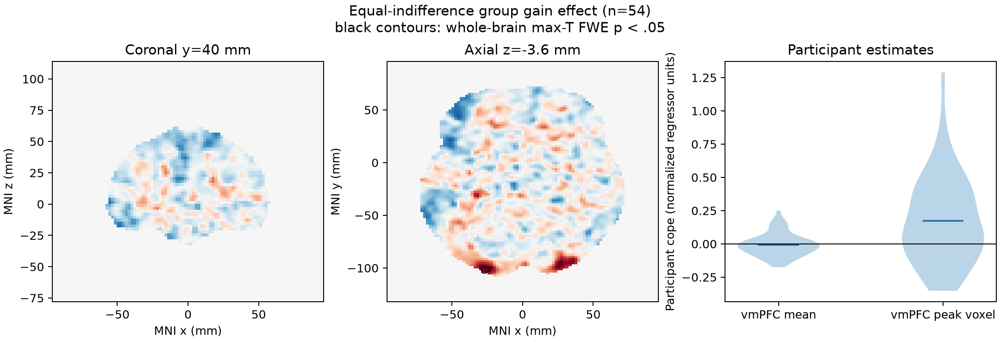

# Potential gains and brain activity

## Result

**The supplied group maps do not support a greater gain-related fMRI response in vmPFC after whole-brain correction.** Among 54 equal-indifference participants, a positive one-sample group effect appeared at 24 voxels in three small contiguous clusters; the strongest voxel was at MNI (−26, −102, −3.6) mm (t(53)=6.62; max-statistic permutation FWE p=0.00060). These clusters were in the far posterior/inferior brain, not vmPFC. In the prespecified vmPFC coordinate locator, no voxel survived whole-brain correction. Its largest uncorrected t was 3.92 at (−2, 26, −18) mm, with whole-brain FWE p=0.932.

The mean cope averaged over the vmPFC locator was −0.0075 normalized-regressor units (95% t interval −0.031 to 0.016). This interval includes zero. It is a descriptive regional summary; the inferential decision uses the whole-brain max-statistic correction. The positive posterior clusters do not establish the vmPFC hypothesis.



*The left and middle panels show unthresholded t statistics in MNI slices. Black outlines mark voxels that survive positive whole-brain max-T FWE p<.05. The right panel shows individual participant estimates for the mean vmPFC locator and its selected peak voxel; the peak-voxel distribution is post-hoc descriptive.*

## Analysis

The analysis includes all 54 maps listed in the supplied manifest and all 54 metadata rows; there were no exclusions. Map IDs matched one-to-one, all SHA-256 digests matched `input/sources.json`, and all maps had identical 97×115×81 grids, 2×2×2.4 mm voxel sizes, and affines. All voxel values were finite. Inference used the 198,029 voxels with finite, nonzero values in every participant map. The intersection mask was inspected and is provided as `results/common_coverage_mask.nii.gz`; p maps use NaN outside this mask.

At each covered voxel we estimated the equal-weight mean of the participant cope maps and its one-sample t statistic against zero. The directional alternative was positive. Whole-brain family-wise error was controlled by the maximum positive t statistic over all covered voxels in 10,000 random participant sign flips (seed 20261016; plus-one p-value correction). The 95th percentile of the null maximum-t distribution was 5.38. The original NARPS instructions require a whole-brain-corrected yes/no decision, which motivates correction over the complete brain rather than testing vmPFC alone ([NARPS analysis instructions, Hypothesis 1](https://www.narps.info/files/narps_instructions_for_analysis_teams.pdf)).

The vmPFC locator was defined before inference as |MNI x|≤10 mm, y≥25 mm, z≤15 mm, restricted to common coverage. It serves only to describe localization; the p-values remain whole-brain corrected. This broad coordinate rule is not an atlas segmentation and should not be read as precise cytoarchitectonic boundaries. A manual SciPy one-sample t calculation at the strongest whole-brain voxel matched the vectorized statistic to numerical precision.

## Interpretation and limits

A lack of corrected evidence in vmPFC means this analysis did not detect a positive group mean effect there at the study’s whole-brain-corrected threshold. It does not demonstrate that the true effect is zero, rule out smaller effects, establish equivalence, or imply that no individual showed a positive effect. The uncorrected vmPFC peak is not evidence for the hypothesis after accounting for the whole-brain search.

The supplied values are run-averaged participant contrast parameter estimates from the AO86 gain model, not standardized t/z statistics or a group result. In this task, the potential-gain range was twice the loss range, but the upstream gain regressor was mean-centered and variance-normalized before HRF convolution, and gain and loss effects were modeled separately. Thus cope units are normalized-regressor units, not change in response per dollar, and this group test does not compare gain sensitivity with loss sensitivity. Since participant variance maps and the full executable first-level pipeline are unavailable, the group model uses equal participant weights and cannot perform precision-weighted mixed-effects inference from first-level uncertainties. The group permutation test assumes participant independence and sign-symmetric errors under the null; the parametric t summary also relies on the usual one-sample model assumptions. Findings are conditional on the fixed upstream model and supplied maps.

## Reproduction

Run from the workspace root with the supplied Python environment:

```bash
/Users/johnlee/.local/state/stamped-in-practice/narps-neutral-v1/common-environment/.pixi/envs/default/bin/python analysis/group_analysis.py
```

The script, recorded protocol, full summary, participant QC table, statistical maps, coverage mask, and figure source are included in this workspace. Software versions and the permutation seed are recorded in `results/summary.json`.
