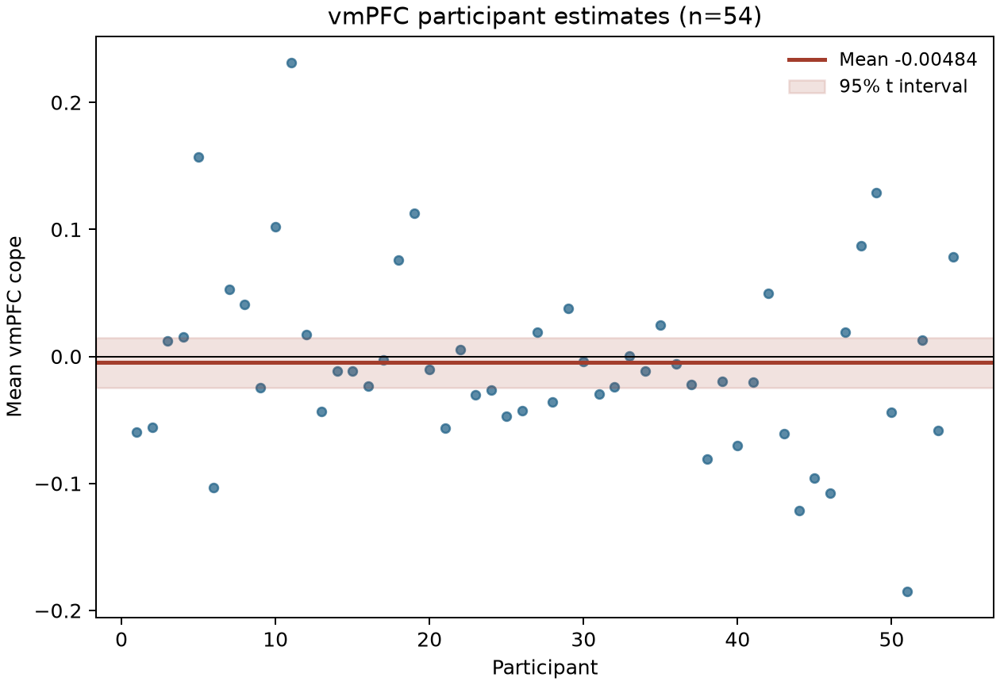

# Potential gain and vmPFC activity

## Result

The supplied maps do **not support a positive vmPFC gain effect** in the NARPS equal-indifference group. Across 54 participants, the mean vmPFC cope was −0.0048 (SD 0.0715; 95% t interval −0.0243 to 0.0147; descriptive one-sided *p*=0.690). The positive-gain whole-brain permutation test found no family-wise-error-corrected voxel in the vmPFC annotation (minimum whole-brain FWE *p*=0.780; 0 voxels at α=.05). The interval spans zero and modest effects in either direction, so this is a lack of evidence for the hypothesized increase, not evidence that the true effect is exactly zero.

Across the full common-coverage brain mask, 24 voxels survived one-sided max-*t* FWE correction (α=.05; 9,999 sign flips; 198,029 voxels). They formed three small posterior occipito-temporal clusters (17, 2, and 5 voxels), not vmPFC. The strongest voxel was at MNI [−26, −102, −3.6] mm (*t*=6.62, FWE *p*=0.0006). This unexpected location does not support the vmPFC hypothesis and should be interpreted cautiously.

## Analysis

The directional hypothesis follows NARPS Hypothesis 1, which predicts a positive parametric gain effect in vmPFC for the equal-indifference group ([original NARPS instructions](https://www.narps.info/files/narps_instructions_for_analysis_teams.pdf)). We analyzed all 54 supplied participant cope maps, with participant as the sampling unit. Maps were joined to the pinned cohort by participant ID; IDs were unique and matched the manifest, all participants were in the equal-indifference group, and all 54 maps passed the recorded file checksum, geometry, and finite-value checks. No participants were excluded.

The primary group model was an unweighted one-sample mean cope at each voxel, tested against zero in the positive direction. We used participant-level random sign flips and the maximum positive *t* statistic across the full analysis mask for whole-brain FWE control. The mask was the intersection of all 54 maps' nonzero coverage, avoiding treating zero-filled out-of-coverage voxels as measured zero effects. The 95th percentile of the max-statistic null was *t*=5.38. Observed and sign-flipped one-sample statistics matched SciPy's independent implementation at 200 and 100 sampled voxels respectively (maximum absolute discrepancies <5×10⁻¹⁶). A broader mask including voxels covered in at least 90% of participants gave the same 24 corrected voxels, peak, and lack of vmPFC support; its vmPFC mean was −0.0033 (95% interval −0.0236 to 0.0170). See [`results/sensitivity_90pct/summary.json`](../results/sensitivity_90pct/summary.json).

We identified vmPFC independently of these effects with a bilateral anatomical annotation comprising the Harvard–Oxford 25%-threshold maximum-probability cortical parcels Frontal Medial, Subcallosal, and Frontal Orbital Cortex. The atlas is based on structural segmentations registered to MNI152 ([FSL atlas description](https://fsl.fmrib.ox.ac.uk/fsl/docs/other/datasets.html)); labels were nearest-neighbor resampled to the cope grid. The primary mask retained 85.4% of the atlas annotation (3,719 voxels). This anatomical definition is an explicit, reproducible operationalization; frontal orbital cortex is broader than vmPFC proper, and the atlas is in MNI152NLin6Asym while the supplied maps are MNI152NLin2009cAsym. The ROI is therefore used to characterize the hypothesis region, while the confirmatory decision comes from whole-brain correction.

## Interpretation and limits

The cope maps are unthresholded participant effect estimates, not *t* or *z* statistics. AO86's gain modulator was mean-centered and variance-normalized before HRF convolution, so a cope reflects the participant's modeled response per normalized gain-modulator unit, not BOLD change per currency unit. The upstream model used response-time durations and separate gain and loss models; the gain estimate is conditional on those choices. Potential gain values spanned twice the loss range in this group, but the maps cannot establish a monetary-unit slope or a causal gain effect.

The first-level variance maps are unavailable. The group analysis consequently treats participant copes as equally precise and cannot use inverse-variance weighting or fully propagate within-participant uncertainty. Sign-flip inference also relies on independent participants and sign-symmetric errors under the null. A non-significant vmPFC result does not establish equivalence or exclude a smaller, heterogeneous, or differently localized effect; the interval and maps describe what these fixed upstream estimates support at this sample size. The atlas-space mismatch and broad orbital parcel add uncertainty to precise anatomical localization.

## Reproducibility

The protocol, code, environment record, input hashes, group maps, voxel statistics, max-*t* null distribution, exclusions table, participant QC, and both coverage-mask analyses are included in this workspace. Run instructions are in the [root README](../README.md); the accepted primary run is `python analysis/run_analysis.py` in the supplied Python 3.13.16 environment. Results and detailed software versions are recorded in [`results/summary.json`](../results/summary.json). A superseded run with incorrect permutation studentization is retained in [`results/failed_studentization_run/`](../results/failed_studentization_run/) and marked invalid; final inference uses the corrected statistic, independently cross-checked against SciPy.
