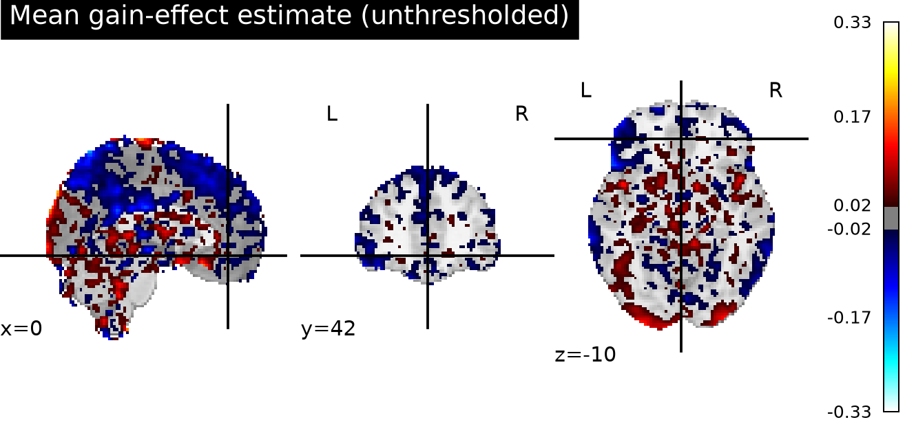
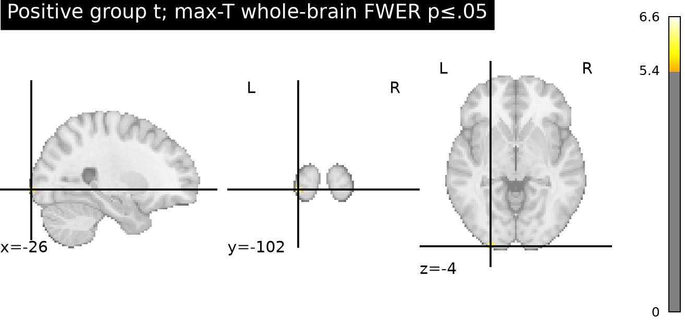
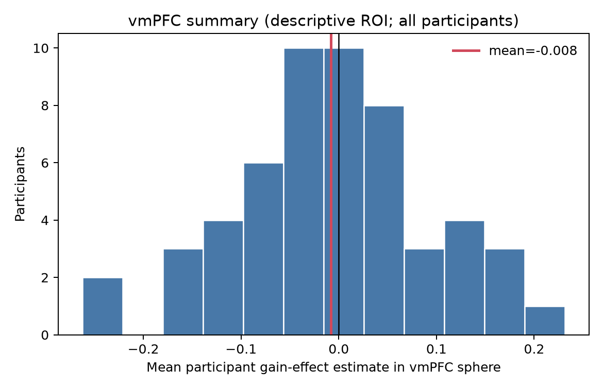

# Potential monetary gain and vmPFC response

## Question and result

In the NARPS equal-indifference group, the supplied gain-effect estimates do **not** support a positive average vmPFC response to increasing potential gain. The mean across a 12-mm vmPFC sphere centered at MNI (0, 42, −10) was −0.0078 cope units (SD of participant ROI means = 0.0996; two-sided 95% t interval [−0.0350, 0.0194]); the directional one-sample t test was *t*(53) = −0.58, one-sided *p* = .717. The whole-brain max-T corrected p-value in the sphere was 1.00. A one-sided sign-flip ROI test gave *p* = .719; a Wilcoxon signed-rank sensitivity test gave *p* = .759. The leave-one-participant-out ROI means stayed negative (−0.0123 to −0.0030), so the direction of the group average was not driven by one participant.

The required whole-brain test did find 24 voxels with positive effects after voxelwise familywise-error correction (max-T, α = .05; threshold *t* = 5.397). The largest statistic was *t* = 6.62 at MNI (−26, −102, −3.6), in posterior/occipital cortex, not vmPFC. These detections do not support the vmPFC-specific hypothesis.

## Model and inference

The observation for each participant was the supplied unthresholded gain contrast parameter estimate (cope), not a z statistic or group result. I fit a one-sample group model with an intercept and tested whether the mean cope was greater than zero. All 54 equal-indifference participants entered every voxelwise test. I used 5,000 random sign flips (seed 20261016) and the maximum positive t statistic across the whole analysis mask to control voxelwise FWER at .05. The mask was the intersection of all 54 maps’ nonzero coverage, giving 198,029 voxels and avoiding treating outside-coverage zeros as measured values. The 95th percentile of the permutation maximum-t distribution was 5.397.

The vmPFC sphere is a transparent anatomical localization summary, not the basis for the corrected whole-brain claim. It was centered at (0, 42, −10), rounded from a published vmPFC meta-analysis coordinate of approximately (±4, 42, −8), with a 12-mm radius. This places the summary in anterior ventromedial prefrontal cortex without selecting a peak from these observed maps. The NARPS hypothesis itself specifies positive vmPFC effects for the equal-indifference group and requires whole-brain correction ([original instructions, Hypothesis 1](https://www.narps.info/files/narps_instructions_for_analysis_teams.pdf)); vmPFC is also a commonly reported subjective-value region ([Smith et al., 2016](https://www.eneuro.org/content/eneuro/3/5/ENEURO.0189-16.2016.full.pdf)).

## Quality checks and limits

All 54 participant IDs matched the supplied cohort table. Image sizes and SHA-256 checksums matched the manifest; all maps had the same 97 × 115 × 81 grid and affine, and all voxel values were finite. No participant was excluded. The largest absolute voxel estimate was 10.45 cope units (sub-025); absent motion metrics, first-level variance maps, and prespecified outlier criteria, this alone did not justify exclusion. The age and gender columns were not used as covariates because the group question concerns a mean effect and no adjustment was specified.

The result is conditional on fixed upstream modeling. Gain was mean-centered and variance-normalized before HRF convolution, so cope values are not a change per currency unit. Response events used response-time durations, gain was modeled separately from loss, and these maps cannot distinguish gain coding from correlated choice, response, or other modeled task effects. Without participant variance maps, the group model cannot precision-weight first-level estimates or fully propagate first-level uncertainty. The sign-flip inference assumes participant effects are exchangeable under sign changes (a symmetric null).

A lack of support means these maps and this group model do not provide evidence for a positive average vmPFC effect at the tested scale; it does not prove the effect is zero, rule out a smaller effect, or show that no individual participant responds to gain. The interval includes both modest negative and positive average effects, and no equivalence bound was specified.

## Reproducibility

Run `python analysis.py` from the workspace using the prepared Python environment. The notebook `narps_gain_analysis.ipynb` provides a readable rerun and displays the outputs. `results/summary.json` and the TSV files contain the numerical results and QC; NIfTI maps are saved in `results/`, and the plotted figures are in `figures/`.
