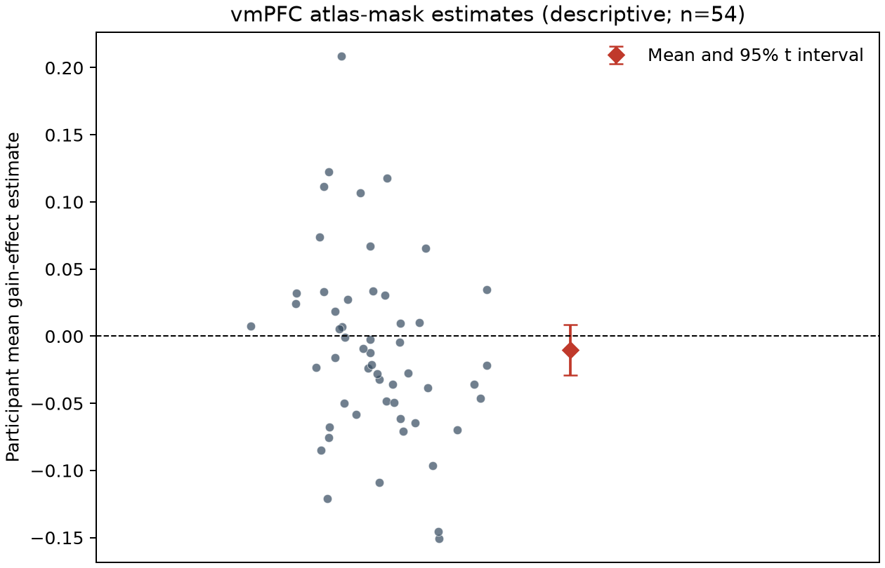
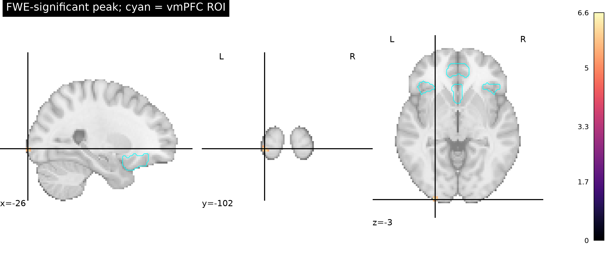

# Potential gain effects in the NARPS equal-indifference group

## Question and analysis

We tested whether gain-related activity was positive in vmPFC in the 54-person equal-indifference group. The participant was the unit of analysis. We fit a one-sample group test of the supplied participant contrast estimates against zero, in the prespecified positive direction. Voxelwise family-wise error was controlled across the common participant support (198,029 voxels) with 5,000 participant-level sign flips and a maximum-t statistic (seed 20261016; minimum attainable Monte Carlo p = 0.00020).

We operationalized vmPFC as the union of Harvard-Oxford cortical atlas labels Frontal Medial Cortex, Subcallosal Cortex, Paracingulate Gyrus, and Frontal Orbital Cortex. This broad, prespecified mask contributed 6,174 tested voxels after nearest-neighbor resampling. Since vmPFC has no single agreed anatomical boundary, the mask is an explicit working definition. Support required a positive voxel inside it to pass the same whole-brain FWE p < .05 threshold; the ROI average below is descriptive and does not replace that criterion.

## Results

No positive vmPFC voxel survived whole-brain correction (0 of 6,174 mask voxels). The descriptive mean participant estimate within the mask was −0.0103 (95% t interval −0.0290 to 0.0084; t(53) = −1.10; one-sided p = .862); 21 of 54 participant averages were positive. Leave-one-participant-out ROI means ranged from −0.0144 to −0.0076. These data do not support the predicted positive vmPFC response.

There were 24 positive voxels surviving whole-brain correction elsewhere. The strongest was at MNI [−26, −102, −3.6] mm (mean estimate 0.1121, t = 6.62, max-t FWE p = .0010), outside the vmPFC mask. This finding does not support the vmPFC-specific hypothesis.

## Interpretation and limits

This is a lack of corrected evidence for the hypothesized positive vmPFC response, not evidence that the true response is exactly zero or that smaller effects are absent. The ROI interval includes zero and modest positive values. The inference depends on sign-flip exchangeability and approximately symmetric participant errors; the one-sided maximum-t correction is conservative and voxelwise. The vmPFC anatomy is broad and atlas-dependent. Harvard-Oxford uses MNI152 2-mm geometry and was nearest-neighbor resampled to MNI152NLin2009cAsym, so small registration differences can affect ROI boundaries; the corrected positive peak is far posterior to this mask.

The inputs are unthresholded AO86 participant contrast parameter estimates, not standardized statistics or group results. Upstream gain regressors were mean-centered and variance-normalized before HRF convolution, so these coefficients cannot be read as change per currency unit. The provided effects come from a gain model separate from the loss model and are conditional on that choice. Because participant variance maps and the executable first-level workflow were not supplied, this analysis cannot use first-level uncertainty for precision-weighted mixed-effects inference; the group test uses between-participant variation in the supplied estimates. No time-series scans or upstream processing were rerun.

All 54 listed participants were included; no maps failed checksum, geometry, or finite-value checks, and no exclusions were made. The common-support rule, input checksums, atlas mask, voxelwise maps, permutation maxima, and machine-readable summary are retained with the outputs.

## Reproduction record

Run from the repository root with `pixi run analysis`. The [NARPS Hypothesis 1 instructions](https://www.narps.info/files/narps_instructions_for_analysis_teams.pdf) require a whole-brain-corrected yes/no decision. The [supplied AO86 maps](https://neurovault.org/collections/4932/) are listed with retrieval URLs and checksums in [sources.json](../input/sources.json). The fixed protocol is [protocol.md](../protocol.md), and the executable analysis is [code/analyze.py](../code/analyze.py). The final validated analysis run used code commit `a33c099ac46cbf769f6510f5ca2149cfdae0af2d`; its exact Pixi lock SHA-256 is recorded in [summary.json](final-v3/summary.json). Complete stdout, stderr, resource samples and duct summaries for the accepted run are in `logs/group-analysis-final-v3-*`; failed attempts and corrected retries are retained under their own prefixes. Computed values are in [summary.json](final-v3/summary.json), [participant-vmpfc-effects.tsv](final-v3/participant-vmpfc-effects.tsv), and [input-checksums.tsv](final-v3/input-checksums.tsv).

A fresh clone of the published `codex/env-20261016` snapshot retrieved the annexed inputs, restored the lock with `pixi install --locked`, removed the generated outputs, and reran `pixi run analysis`. Scientific summary fields, tables, NIfTI maps, and figures matched exactly; the compressed permutation table differed only in gzip container bytes and matched exactly after decompression. The replay used the same host; its complete duct record is retained under `logs/final-snapshot-replay-*`, and artifact comparisons are in [replay-validation.json](replay-validation.json). This confirms a same-host replay, not portability across platforms.
