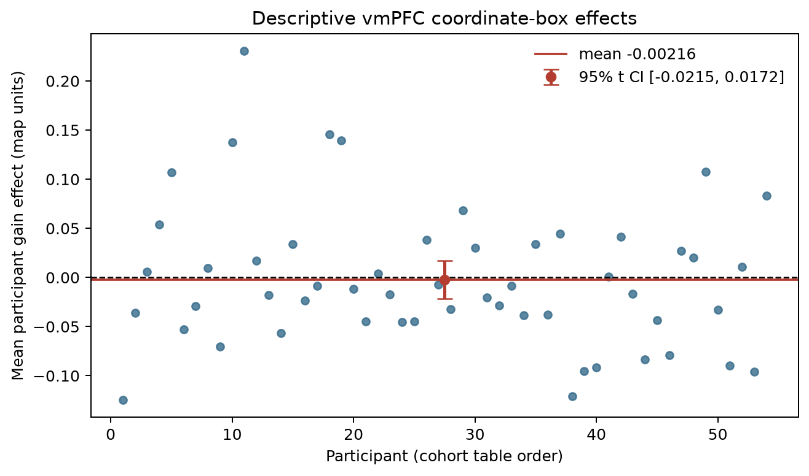
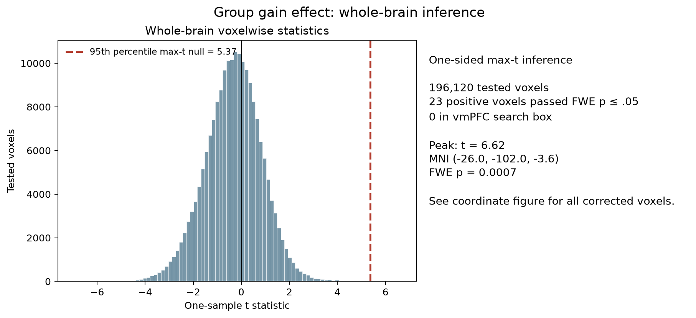

# Potential gains and vmPFC activity

## Question and conclusion

Does greater potential gain elicit a greater fMRI response in ventromedial prefrontal cortex (vmPFC) in the NARPS equal-indifference group? **This analysis did not find whole-brain-corrected support for a positive vmPFC effect.** A one-sided whole-brain test found 23 positive voxels elsewhere, in bilateral posterior occipital locations (approximately MNI x = −28 to +32, y = −104 to −94, z = −8.4 to −1.2 mm). None were in the vmPFC search region. The largest statistic was t(53) = 6.62 at (−26, −102, −3.6), max-t familywise p = .0007; that posterior location does not support the vmPFC hypothesis.

The whole-brain corrected decision follows the NARPS instruction to base hypothesis decisions on whole-brain-corrected analyses ([original analysis-team instructions, Hypothesis 1](https://www.narps.info/files/narps_instructions_for_analysis_teams.pdf)).

## Analysis

We analyzed the 54 supplied equal-indifference participant maps (one observation per participant) using an intercept-only one-sample group model. The target was the population mean participant gain-effect estimate at each voxel; the directional alternative was mean > 0. The effect maps are upstream contrast parameter estimates, not t or z statistics. AO86 normalized the gain modulator before HRF convolution, so coefficients are not change per currency unit. Gains and losses were modeled separately. The supplied maps average four runs; preprocessing and individual models were treated as fixed.

We tested 196,120 voxels in the common MNI152 brain mask, resampled to the input grid (2 × 2 × 2.4 mm). Whole-brain familywise error was controlled using 9,999 participant-level sign flips and the maximum positive one-sample t statistic (seed 20261015; one-sided alpha = .05). Sign flipping assumes independent participants and sign-symmetric null errors. The maps and code are available in this repository; the plan and fixed upstream methods are in [`analysis-plan.md`](../protocol/analysis-plan.md) and [`upstream-methods.md`](../input/upstream-methods.md).

Because vmPFC has no single universally agreed atlas boundary, we used an explicit MNI coordinate search box for descriptive summaries: |x| ≤ 10, 20 ≤ y ≤ 60, and −20 ≤ z ≤ 20 mm. This identifies an anterior midline ventral prefrontal swath; it is not an atlas-derived ROI, and it was not used to reduce the multiple-comparison family. We also checked the corrected voxel coordinates directly: all lie far posterior to vmPFC. Thus the regional conclusion does not depend on a marginal boundary decision around the search box.

## Results and uncertainty

All 54 participant maps passed checksum, geometry, and finite-value checks; there were no exclusions. The descriptive mean effect in the vmPFC coordinate box was −0.0022 map units (between-participant SD 0.071; 95% t interval for the mean [−0.0215, 0.0172]). The interval spans zero and the mean is close to zero. The whole-mask participant average was −0.0070 map units (95% t interval [−0.0215, 0.0075]); this is descriptive and does not replace voxelwise inference. Both summaries use supplied normalized-modulator estimates, not effects per currency unit. A post-selection check at the voxel with the largest observed vmPFC-box t statistic found t(53) = 4.19, uncorrected one-sided p = 5.3 × 10⁻⁵, but max-t FWE p = .791. Selecting the maximum within the box makes the uncorrected value optimistic; the corrected result does not support a regional claim. As a sensitivity analysis, voxelwise Bonferroni correction identified 11 positive voxels across the brain and zero in vmPFC, consistent with the primary max-t result.

The corrected positive foci were posterior and bilateral, not vmPFC. Their presence does not rescue the vmPFC hypothesis. The independent numerical checks recomputed one-sample t statistics at 20 sampled voxels, directly reconstructed 20 sign-flip maxima, reconstructed the full voxelwise FWE p map and both threshold maps, verified checksums and geometry, and rebuilt the vmPFC, selected-voxel, global-average, and Bonferroni summaries from participant maps; all passed ([validation log](../logs/20261016T-final-validation2info.json)).

## Interpretation and limits

The result is **lack of support under this group model and supplied contrast**, not evidence that the true vmPFC effect is exactly zero. The interval is not an equivalence test, and voxelwise non-significance can reflect limited precision or power. No participant-level variance maps were supplied, so the model weights participants equally and cannot account for different first-level estimation precision. The gain regressor was normalized, and gain and loss were modeled in separate upstream models; the estimates cannot isolate currency-scaled gain sensitivity from every task-design dependency. In this task version the gain range was twice the loss range, so this analysis also does not establish how neural response scales compare across gain and loss ranges. These maps alone cannot resolve those questions.

## Reproduction

Run `pixi run group-analysis`, then `pixi run validate-results`; `pixi run figures` regenerates all three figures. The final task commit is the parent of the companion environment snapshot commit. Duct captured the pilot, final run, validation, figures, and failed attempts under [`logs/`](../logs/). The validated environment lock SHA256 is `5884bb53a343659adce7759c1b48477e2cdffb71b4838e49d14810e75dc75f21`; its exact bytes are retained on `codex/env-narps-r1-11`, one commit above the final task commit.
