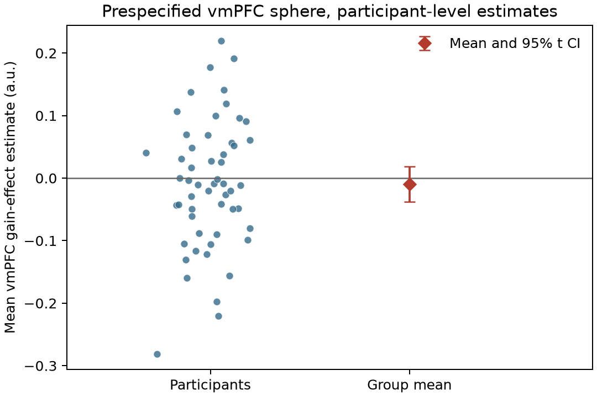

# Potential gain and vmPFC response: group analysis

## Conclusion

The supplied maps do **not** support a positive gain-related response in vmPFC at the required whole-brain family-wise error (FWER) threshold. No vmPFC voxel passed correction. The descriptive vmPFC estimate was slightly negative, with a confidence interval that includes zero; this is inconclusive about a small positive effect, not evidence that the true effect is absent.

## Analysis and results

We analyzed all 54 equal-indifference participants using the supplied AO86 gain-effect maps. Checks confirmed that participant IDs matched the maps, all images shared a grid, all values were finite, and every map's SHA-256 matched `input/sources.json`. No participants were excluded. The search mask comprised 210,968 voxels present (nonzero) in at least 49 of 54 maps, limiting inconsistent edge coverage.

At each voxel we tested whether the group mean cope was positive with a one-sample t statistic. Whole-brain inference used 9,999 participant-level sign-flip permutations and the maximum positive t across the full search mask on each permutation (one-sided max-T; FWER α=.05). This controls voxelwise family-wise error across the whole brain and directly evaluates the directional hypothesis. The sign-flip test assumes participant estimates are independent and exchangeable under a symmetric null. The primary results were 24 corrected voxels in three small 26-connected components, all in posterior occipital cortex; the largest component peaked at MNI [-26, -102, -3.6] mm (t=6.62, max-T p=.0007). These locations do not support the vmPFC hypothesis.

| Corrected component | Voxels | Peak MNI (mm) | Peak t | Peak max-T p |
|---|---:|---:|---:|---:|
| 1 | 17 | [-26, -102, -3.6] | 6.62 | .0007 |
| 2 | 5 | [30, -94, -8.4] | 6.19 | .0026 |
| 3 | 2 | [26, -98, -1.2] | 5.76 | .0137 |

Components are 26-connected groupings of voxels passing voxelwise max-T correction; no cluster-extent inference was performed.

To make vmPFC localization explicit without replacing the whole-brain test with an ROI test, we defined an anatomical sphere of 10-mm radius centered at MNI [0, 42, -8] mm, covering anterior medial orbitofrontal/vmPFC. The sphere was set independently of the group map and used for localization and descriptive summaries only. Its participant-averaged estimate was -0.0095 map units (SD=.103; 95% t interval [-0.0377, 0.0187]); the most positive voxel in the sphere had max-T adjusted p=1.00. The whole-brain corrected regions and the sphere are shown in Figure 1; Figure 2 shows the participant-level ROI values.




## Interpretation and limits

These maps are participant contrast parameter estimates (copes), not standardized statistics, and should not be interpreted as BOLD change per dollar. Upstream, the gain modulator was mean-centered and variance-normalized before HRF convolution; the response-period regressor had response-time duration, and gain and loss were modeled separately. Thus, the estimates summarize modeled response-related BOLD covariation with the gain modulator under that fixed model. They do not establish a causal effect of monetary gain or isolate gain while jointly adjusting for loss. The fact that this group saw a gain range twice as wide as its loss range does not restore a currency-unit scale to these estimates.

The analysis is limited to ordinary group inference on the supplied estimates: participant-level variance maps were unavailable, so first-level uncertainty could not be incorporated through precision weighting or a full hierarchical model. The sign-flip test also depends on symmetry of the participant-level null distribution. Failure to detect a vmPFC effect means this analysis did not find the hypothesized positive response under this group model and whole-brain correction; it does not demonstrate a zero effect, rule out a smaller effect, or establish that vmPFC does not represent gain.

## Reproduction and artifacts

Run from the repository root with the locked Pixi environment:

```sh
pixi run duct -p logs/group-analysis-final-verified -c all -o all -t all \
  --sample-interval 1 --report-interval 10 \
  --message 'Final validated NARPS group inference; source SHA-256 checks enforced' \
  pixi run python analyze.py --permutations 9999 --seed 20261015
```

`analyze.py` produces `results/summary.json`, participant ROI values, NIfTI maps of the group mean, t statistics, uncorrected and max-T adjusted p values, and the analysis/significance masks. Duct's complete stdout, stderr, execution metadata and resource summaries are under `logs/`; earlier audit attempts, including the corrected manifest-path check, are retained there as well. The source report is the [NARPS Hypothesis 1 analysis instructions](https://www.narps.info/files/narps_instructions_for_analysis_teams.pdf).
