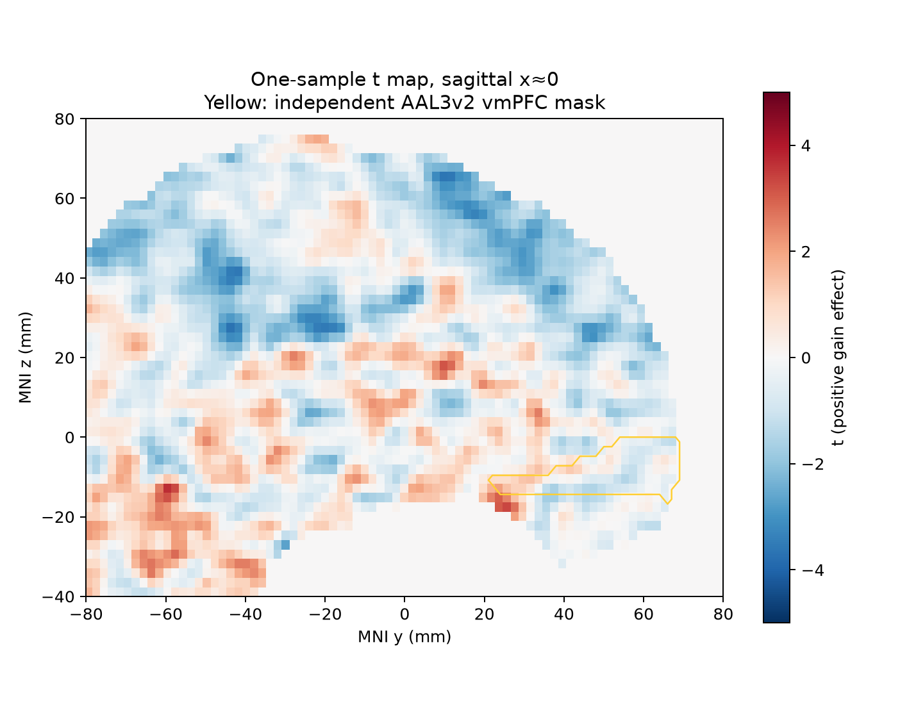
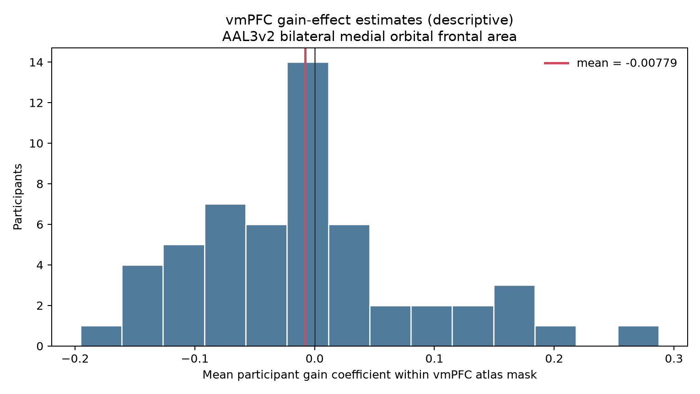

# Potential gain and vmPFC response in NARPS equal-indifference participants

## Result

The supplied maps do **not** support a positive gain effect in vmPFC after whole-brain correction. In the primary one-sample test, 11 voxels survived one-sided Bonferroni family-wise error correction across 186,400 brain-mask voxels, but none overlapped the vmPFC mask; the strongest voxel was posterior (MNI −26, −102, −3.6 mm; *t*(53) = 6.62; corrected *p* = .0017). A participant sign-flip maximum-statistic sensitivity analysis found no whole-brain corrected voxels. The original NARPS instructions required whole-brain corrected results for the named hypothesis, rather than an ROI-only decision ([instructions](https://www.narps.info/files/narps_instructions_for_analysis_teams.pdf); [NARPS study report](https://www.nature.com/articles/s41586-020-2314-9)).

Within an independently defined vmPFC mask, the mean participant gain coefficient was −0.0078 (95% CI −0.0343 to 0.0187; 23/54 participant means were positive). This descriptive estimate is near zero and its interval includes zero. It is not a separate corrected test. The positive whole-brain voxels were posterior and do not localize to the hypothesized region.

*Figure 1. Unthresholded one-sample t statistics in the x≈0 sagittal slice. Yellow outline is bilateral AAL3v2 Frontal_Med_Orb, the atlas-defined vmPFC area. No voxel in this mask survived whole-brain correction. The displayed slice is for localization, not a separate statistical test.*

*Figure 2. Each histogram count is a participant's spatial mean within the vmPFC mask; the red line is the group mean.*

## Analysis

All 54 listed equal-indifference participants were included. The maps had matching dimensions and affine transforms and finite values. The search mask was the intersection of voxels with nonzero values in every cope map and the MNI152 brain mask resampled to the supplied MNI152NLin2009cAsym grid (186,400 voxels). No participant had a brain-wide mean or standard-deviation QC score beyond |z| = 3; no exclusions were made.

In the equal-indifference design, the potential gain range was twice the potential loss range. The analysis here concerns the supplied gain-effect estimates for this group only; it is not a gain-versus-loss comparison.

We tested whether the population mean cope was greater than zero at each voxel with a one-sample *t* test (54 participants; 53 df; one-sided). Bonferroni correction across the entire search mask controls family-wise error without relying on spatial smoothness. The strongest positive statistic was *t* = 6.62, one-sided uncorrected *p* = 9.31×10⁻⁹ and Bonferroni *p* = .00174; 11 voxels passed the corrected threshold, none within vmPFC. As a sensitivity analysis, we used 9,999 participant-level sign flips and a maximum studentized statistic across all tested voxels; this found no voxels at FWE *p* ≤ .05. The two correction approaches differ in posterior voxels, but neither provides corrected evidence in vmPFC.

vmPFC was localized independently from the observed activation using the bilateral AAL3v2 `Frontal_Med_Orb` labels. This anatomically specific label is used as vmPFC in the AAL3 literature ([Rolls et al., 2020](https://pubmed.ncbi.nlm.nih.gov/31521825/); [OFC atlas definitions](https://www.oxcns.org/papers/620%20Hsu%20Rolls%20et%20al%202020%20Connections%20of%20the%20Human%20Orbitofrontal%20Cortex.pdf)). We used the anatomical mask to identify whether corrected whole-brain results fell in the hypothesized region, not to replace the required whole-brain correction with an ROI test.

## Interpretation and limits

These are participant-level gain-effect parameter estimates, not *t* or *z* statistics. The upstream gain regressor was mean-centered and variance-normalized before HRF convolution, so its coefficient is not a change per dollar. It represents a modeled association with potential gain during response-period trials, conditional on the fixed upstream choices: response-time durations, separate choice and gain modulators, modeled nonresponses and nuisance terms, runs combined within participant, and gain and loss modeled separately. The maps therefore do not establish that monetary gain causally increases neural response.

Participant variance maps were not supplied. The group model consequently gives each participant equal weight and estimates uncertainty from between-participant variation; it cannot reproduce an inverse-variance mixed-effects analysis or propagate first-level variance estimates. The conventional *t* model assumes independent participants and an adequately behaved sampling distribution. The sign-flip sensitivity instead relies on symmetry of participant effects under the null and was more conservative here. The posterior Bonferroni voxels lie near the edge of the search mask, so they should not be taken as substantive evidence for the target hypothesis.

Failure to detect a corrected vmPFC effect means this analysis did not establish a positive population-average gain association at the chosen error rate. It does not establish that the true effect is exactly zero, rule out a smaller or heterogeneous effect, or adjudicate different preprocessing, first-level models, or gain scaling choices. Those inputs were fixed by the supplied upstream methods.

## Reproducibility

Run from the repository root with `N_PERM=9999 pixi run python scripts/group_gain.py`. The main results are `analysis_summary.json`, `vmPFC_summary.json`, `participant_qc.tsv`, and the group NIfTI maps in this directory. `logs/group_gain*` records the final command, stdout/stderr, resource samples, and execution summary; earlier failed and superseded runs are retained under `logs/attempts/` and `results/attempts/`. Large maps and logs are stored with git-annex.
