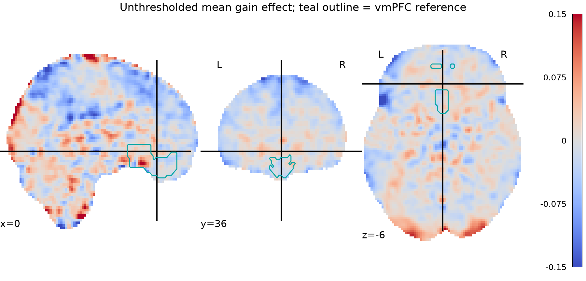
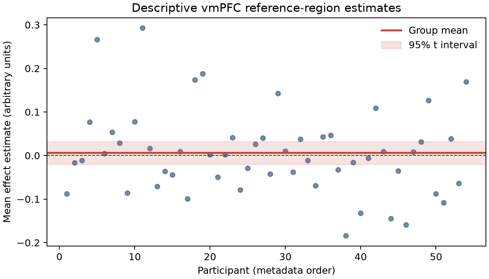

# Potential monetary gain and brain activity

## Question and conclusion

In the NARPS equal-indifference group, the supplied gain-modulator estimates do **not** provide whole-brain-corrected evidence that vmPFC response increases with potential gain. The primary test found no significant voxel in the prespecified anatomical vmPFC reference (peak within it: *t*(53) = 4.19, whole-brain *p*<sub>FWE</sub> = .801). The mean reference-region estimate was 0.0062 arbitrary units (95% *t* interval −0.0204 to 0.0327).

The whole-brain test did detect 24 positive voxels in three small occipital-pole clusters. The strongest voxel was at MNI (−26, −102, −3.6) mm, *t*(53) = 6.62, *p*<sub>FWE</sub> = .0008. These clusters are outside vmPFC and do not support the stated regional hypothesis. The original NARPS instructions specified a positive parametric gain effect in vmPFC for this group and required teams to report whole-brain analyses; we therefore used the full-brain corrected result for the hypothesis decision, not a vmPFC-only significance test ([NARPS analysis instructions](https://www.narps.info/files/narps_instructions_for_analysis_teams.pdf); see also the [NARPS methods paper](https://pmc.ncbi.nlm.nih.gov/articles/PMC7771346/)).

## Group model and checks

The group estimand was the mean of the 54 participant-level gain-effect maps. We fit a one-sample positive-direction *t* test at every supported voxel. This is a random-effects group test over participants: it asks whether the population mean of the supplied participant effects is positive. Because participant variance maps were not supplied, estimates were unweighted; a precision-weighted second-level mixed-effects model cannot be reconstructed from these inputs.

Family-wise error was controlled at .05 over 210,968 voxels by a maximum-*t* sign-flip permutation distribution (5,000 random sign flips; seed 20261015). Each sign was applied to a participant's full map, preserving the spatial dependence in that map; the maximum positive statistic across all tested voxels was used for each permutation. This is a one-sided test of the prespecified positive hypothesis, with the correction applied over the whole tested brain, following standard nonparametric neuroimaging inference ([Nichols & Holmes, 2002](https://doi.org/10.1002/hbm.1058)). The 95th percentile of the maximum-*t* null was 5.376.

All 54 supplied maps were included. They were finite and had matching dimensions and affine transforms (97 × 115 × 81; 2 × 2 × 2.4 mm). Coverage varied across maps, so the voxelwise group mask retained voxels with nonzero coverage in at least 90% of participants; this left 210,968 voxels. No participant was excluded. Metadata age and gender were not covariates in this one-group test. Available group-stage QC cannot revisit upstream motion or first-level fit diagnostics, which were not supplied with these maps.

We identified vmPFC independently of the activation results using the Harvard–Oxford cortical max-probability atlas (25% threshold), combining its “Frontal Medial Cortex” and “Subcallosal Cortex” labels and intersecting them with the group coverage mask (1,638 voxels). This broad anatomical reference was used for localization and a descriptive participant-level summary; it was not used to limit the primary test. The atlas is in MNI152NLin6Asym space and was nearest-neighbor resampled to the supplied MNI152NLin2009cAsym map grid. Atlas-to-template differences and the broadness of these labels limit anatomical precision ([FSL atlas format and labels](https://fsl.fmrib.ox.ac.uk/fsl/docs/other/atlas_xml.html)).

## What the estimates mean

These inputs are first-level gain-modulator coefficients, not standardized test statistics and not group estimates. In the fixed upstream model, the gain regressor was mean-centered and variance-normalized before HRF convolution. Thus, coefficients represent modulation by that standardized gain regressor and **cannot be interpreted as response change per dollar or other currency unit**. In the equal-indifference group the potential-gain range was twice the potential-loss range, so this is an effect for the gain range as presented in this group, not a direct comparison of commensurate gain and loss slopes. Response trials were modeled with response-time durations, gain and response choice were separate modulators, and gain and loss were fit in separate models. The group result is conditional on those upstream choices; it does not isolate a unit-scaled gain response from every possible task-model specification. The supplied methods describe those inputs and note that participant variance maps and an executable upstream pipeline were unavailable ([fixed upstream methods](../input/upstream-methods.md)).

## Interpretation and uncertainty

The data do not meet the prespecified whole-brain-corrected criterion for the vmPFC hypothesis. This is a lack of support at the chosen correction and sample size, not evidence that the true effect is exactly zero, that no participant shows a positive response, or that a practically relevant effect has been ruled out. The vmPFC mean interval includes both negative and positive values, and no equivalence margin was specified. The result also does not establish a unit-currency dose-response, because the first-level gain modulator was standardized. Positive whole-brain findings were small and localized to occipital pole; they are reported transparently but do not change the vmPFC conclusion.

## Figures



**Figure 1.** Unthresholded mean effect estimates in supplied map units; teal outline combines the Harvard–Oxford Frontal Medial and Subcallosal labels. The display is descriptive and is not a significance map.


**Figure 2.** Positive voxels surviving whole-brain maximum-*t* FWER correction at α = .05, projected on a glass brain. The corrected findings are in occipital pole, outside the vmPFC reference.



**Figure 3.** Participant-level vmPFC reference-region mean estimates (arbitrary units), group mean, and descriptive 95% one-sample *t* interval. The interval is not a whole-brain corrected voxelwise inference.

## Reproduction and files

Run from the repository root with the Pixi environment:

```bash
pixi run duct --output-prefix 'logs/gain-group-{datetime}-{pid}_' \
  --sample-interval 1 --report-interval 5 --fail-time 0 \
  --capture-outputs all --outputs stdout --record-types all \
  --message 'NARPS AO86 equal-indifference gain group analysis' \
  pixi run python scripts/analyze_gain.py
```

The analysis is implemented in [`scripts/analyze_gain.py`](../scripts/analyze_gain.py). Machine-readable results are in [`analysis_summary.json`](analysis_summary.json), [`whole_brain_fwe_clusters.tsv`](whole_brain_fwe_clusters.tsv), and [`participant_vmPFC_effects.tsv`](participant_vmPFC_effects.tsv). Group mean, *t*, corrected-*p*, coverage-mask, and vmPFC-reference NIfTI maps are also in this directory. The final duct run captured command, stdout, stderr, resource samples, and a run summary under [`../logs/`](../logs/); earlier failed and superseded attempts are retained in `logs/failed-attempts.md` and their duct records.
