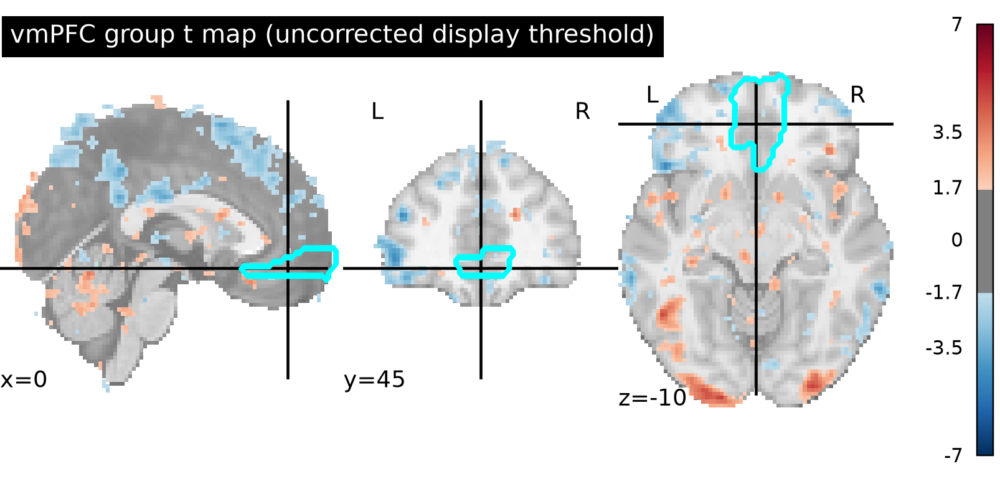
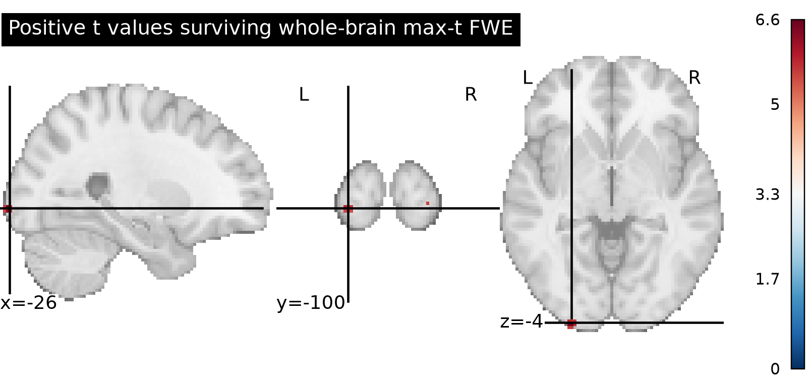

# Potential gains and vmPFC activity

## Question and result

**We found no support for a positive gain-related response in the vmPFC.** In the predefined bilateral medial orbitofrontal ROI, the mean participant cope was −0.0079 (95% t interval −0.0346 to 0.0188; 54 participants; descriptive one-sided t = −0.60, p = .723). No whole-brain FWE-significant voxel overlapped the ROI. The whole-brain max-t test detected 24 positive voxels in three small posterior patches (26-neighbor connectivity used for description only; peak t = 6.62 at MNI [−26, −102, −3.6]; minimum corrected p = .00050). These posterior findings do not support the vmPFC hypothesis.

## Analysis

We analyzed the 54 supplied equal-indifference participant maps; in this design, the potential gain range was twice the potential loss range. The input manifest checksums, byte counts, participant IDs, finite values, and common image geometry were verified before inference. No maps were excluded. A common-coverage whole-brain mask was defined as voxels with nonzero finite estimates in all 54 maps.

The primary model was a one-sample group test of the positive mean cope. Family-wise error was controlled across the whole common mask using a one-sided sign-flip permutation max-t test and 10,000 permutations (seed 20261015; α = .05). The hypothesis is supported only if the corrected map contains positive significant voxels in the vmPFC region. This follows the original NARPS instruction to report whole-brain analyses, not region-only tests ([NARPS analysis instructions](https://www.narps.info/files/narps_instructions_for_analysis_teams.pdf)).

The anatomical vmPFC summary used bilateral medial orbitofrontal parcels (`Frontal_Med_Orb_L/R`) from the AAL SPM12 atlas, resampled by nearest neighbor to the participant-map grid and intersected with common coverage. This is a fixed anatomical operationalization rather than a data-selected cluster. A published NARPS reanalysis similarly operationalized vmPFC with medial orbitofrontal parcels, while noting that the original hypothesis did not specify an atlas ROI ([NARPS analysis discussion](https://pmc.ncbi.nlm.nih.gov/articles/PMC10233921/)). We report the participants' average cope and t-based 95% interval descriptively; this ROI result does not replace whole-brain correction ([AAL atlas](https://doi.org/10.1006/nimg.2001.0978)).

## Findings

## Interpretation and limits

These images are participant-level contrast parameter estimates (copes), not standardized test statistics or currency-unit slopes. Upstream, the gain modulator was mean-centered and variance-normalized before HRF convolution, responses were modeled with response-time durations, and gain and loss were entered in separate models. The estimated effect therefore describes the response to that normalized gain modulator conditional on those fixed modeling choices; it cannot be read as BOLD change per dollar, and this analysis does not separate gain coding from consequences of the upstream model specification.

No participant variance maps were supplied. The group test is an unweighted one-sample analysis of participant copes, not a precision-weighted mixed-effects model that propagates first-level uncertainty. Sign-flip inference also assumes exchangeability under sign changes (in particular, a sufficiently symmetric null distribution of participant effects). The 10,000 sampled permutations give Monte Carlo, not exhaustive, inference. A slower TFCE permutation attempt was interrupted for runtime; its duct logs are retained, and it is not used for the reported inference.

The absence of corrected vmPFC voxels means these data and this group model do not establish a positive gain effect in that region after whole-brain family-wise correction. It does not show that the effect is exactly zero or that vmPFC never tracks potential gains; smaller, spatially diffuse, or more variable effects may not be detected. The uncorrected ROI p-value is descriptive and is not evidence for or against the whole-brain-corrected hypothesis. Atlas boundaries and the MNI152-to-MNI2009cAsym resampling also make the ROI summary approximate.

## Reproducibility

Run from the repository root with `pixi run python scripts/analyze_gain.py`. The script validates the inputs, runs the group model, writes the NIfTI maps and figures, and saves machine-readable results in `results/results.json`. The validated environment used Python 3.13.16, Nilearn 0.14.1, and NiBabel 5.4.2. The complete command, captured output, resource samples, and run summary are under `logs/`.
