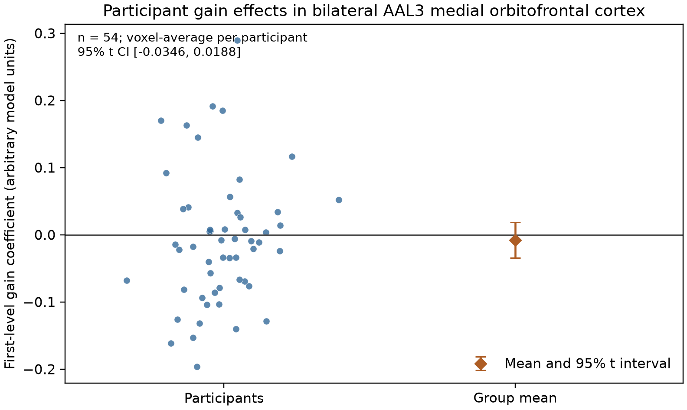
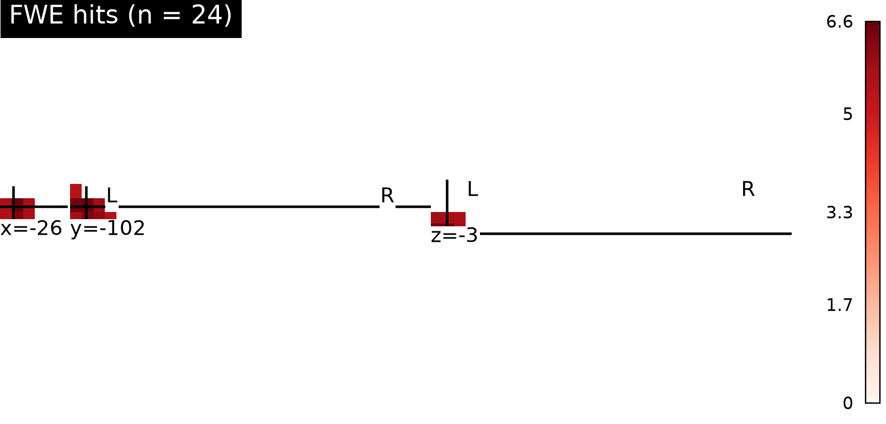

# Potential gains and vmPFC response

## Result

In the 54-person equal-indifference group, the positive gain-effect hypothesis was **not supported in vmPFC** by whole-brain family-wise-error (FWE) inference. The one-sided sign-flip max-t test found 24 significant positive voxels across the whole brain, but none fell in the bilateral AAL3 medial orbitofrontal parcels used to label vmPFC. The strongest whole-brain peak was posterior (MNI x = −26, y = −102, z = −3.6 mm; t = 6.62; max-t pFWE = 0.0008), outside the vmPFC hypothesis region. The other two small clusters were labeled inferior occipital cortex. These unanticipated locations do not support the vmPFC hypothesis.

The participant-average coefficient in the vmPFC parcels was −0.0079 model units (95% t interval −0.0346 to 0.0188). This summary is descriptive; the confirmatory decision is based on the whole-brain corrected map. Its peak vmPFC voxel was at (−2, 24, −13.2 mm; t = 2.34), with 0/1,297 vmPFC voxels passing max-t FWE at α = .05.



*Each dot is one participant’s parcel-average first-level gain coefficient. The diamond and whiskers show the group mean and a two-sided 95% t interval. Values are model units, not change per monetary unit.*



*Color shows the group t statistic only at voxels with max-t pFWE ≤ .05. The 24 corrected voxels lie in posterior locations, not vmPFC; cluster coordinates and extents are in `whole_brain_fwe_clusters.csv`.*

## Analysis

Each of the 54 supplied maps was treated as one participant’s gain coefficient from the fixed first-level model. We fit a one-sample random-effects group model, giving each participant equal weight because participant variance maps were not supplied. The directional alternative was a positive group effect, matching NARPS Hypothesis 1. To control family-wise error over the whole brain, we independently flipped each participant’s sign (5,000 permutations; seed 20261015), recalculated the t field, and compared each observed voxel with the permutation distribution of the maximum positive t across the common mask. The Monte Carlo p-value used the plus-one correction. This avoids selecting a vmPFC-only result after looking at the whole-brain data.

We defined the anatomical label using the bilateral AAL3 `Frontal_Med_Orb` parcels, which prior work maps to vmPFC. This is an explicit operational definition for a broad anatomical term, not a mask supplied by the task or the original teams. Parcels were used to locate and describe corrected findings; they did not provide a separate uncorrected confirmatory test. [NARPS specified a positive vmPFC gain effect for the equal-indifference group](https://www.narps.info/files/narps_instructions_for_analysis_teams.pdf); the AAL3 medial-orbital/vmPFC correspondence is described in [Rolls et al.](https://academic.oup.com/cercor/article/30/11/5830/5858256) and the [Nilearn AAL3 atlas documentation](https://nilearn.github.io/stable/modules/generated/nilearn.datasets.fetch_atlas_aal.html).

## Data checks, exclusions, and limits

All 54 participant IDs matched the supplied cohort table; every map passed the manifest byte-count and SHA-256 checks. Maps shared a 97 × 115 × 81 grid, 2 × 2 × 2.4 mm voxel sizes, and matching affines; no non-finite values were found. Inference used the 198,029 voxels that were nonzero in every map, avoiding treating common zero padding as observed effects; the saved p-value map marks voxels outside this test mask as NaN. No participant was excluded. One participant (sub-025) was flagged by a robust outlier screen of the vmPFC parcel average and retained. Omitting that participant only for a sensitivity summary made the mean more negative (−0.0135; 95% interval −0.0382 to 0.0111), leaving the interpretation unchanged.

These maps are not t- or z-statistics: they are first-level parameter estimates. Upstream, the gain modulator was mean-centered and variance-normalized before HRF convolution, so the coefficient is not a BOLD change per dollar. It averages four runs and is conditional on the fixed upstream choices, including response-time duration modeling and a separate gain model. The group interval reflects between-participant variability in those estimates; it does not include uncertainty from alternative first-level models. Without participant variance maps, inverse-variance weighting or a full two-level variance model is unavailable. The unequal gain/loss ranges and separate gain/loss models also mean this analysis cannot establish that gains produce a larger response than losses.

Failure to detect a corrected vmPFC effect means these supplied estimates do not provide whole-brain-corrected evidence for a positive vmPFC gain response in this group and model. It does **not** demonstrate that the true response is zero or rule out a smaller effect; the descriptive interval spans zero and no equivalence bound was specified. Positive corrected clusters elsewhere are not evidence for the hypothesized vmPFC location.

## Reproduction

From the repository root, run:

```bash
pixi run python scripts/group_analysis.py --permutations 5000 --seed 20261015
```

The script verifies source hashes and emits the summary JSON/CSV, QC record, NIfTI group maps, cluster table, and figures under `results/`. The final duct command record, stdout, stderr, and resource usage are under `logs/group-analysis-release*`. Earlier runs are retained as well. Group inference code is in [`scripts/group_analysis.py`](../scripts/group_analysis.py); key machine-readable outputs are [`analysis_results.json`](analysis_results.json), [`quality_checks.json`](quality_checks.json), and [`whole_brain_fwe_clusters.csv`](whole_brain_fwe_clusters.csv).
