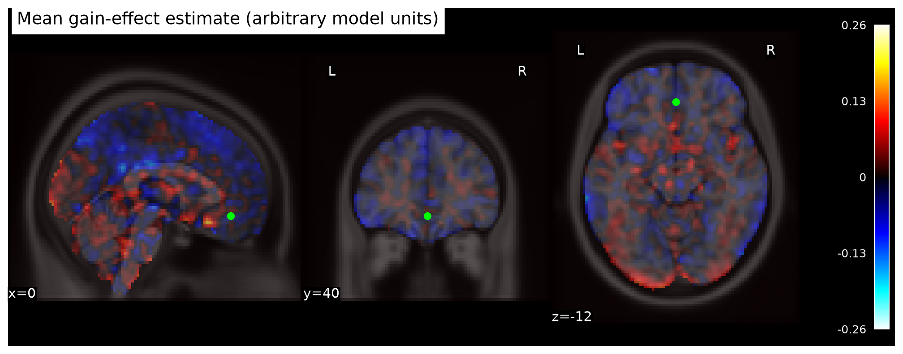
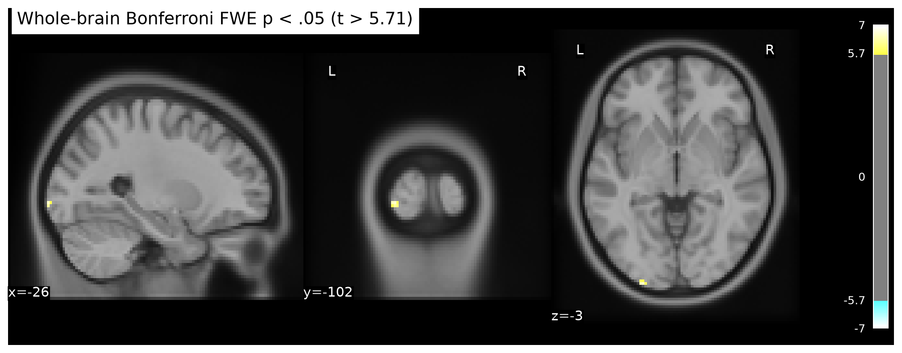
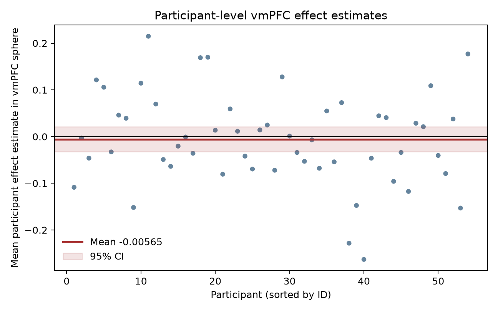

# Potential gains and vmPFC activity

## Conclusion

The supplied gain-effect estimates do **not support a positive vmPFC response to potential gain** in the equal-indifference group. In an a priori 12 mm sphere centered at MNI (0, 40, -12), the mean participant effect was -0.0057 model units (95% CI [-0.0323, 0.0210]); the one-sided group test was *t*(53) = -0.43, *p* = .664. No voxel in the sphere survived whole-brain correction. A positive conclusion is not warranted by the small posterior signal found elsewhere in the brain.

This is a lack of evidence for a positive group effect in these maps, not evidence that the true effect is exactly zero, that no individual responds to gains, or that vmPFC never encodes value. The interval remains compatible with small effects in either direction, and the supplied estimates do not permit an equivalence test based on a prespecified smallest effect of interest.

## Group analysis

We analyzed all 54 participant contrast parameter estimates in a one-sample, positive-direction group model. The model estimates the average participant effect with equal participant weights: participant variance maps were unavailable, so precision-weighted mixed-effects inference could not be fit. We used the source-reported MNI152NLin2009cAsym brain mask (TemplateFlow, resampled to the image grid) intersected with voxels having finite, nonzero map support in at least 90% of participants (192,333 voxels). There were no exclusions. Image checksums, sizes, IDs, and grids matched the supplied manifest; no participant had an absolute robust z-score above 3 for their mean over the analysis mask.

The primary voxelwise test was a one-sided one-sample Student *t* test with Bonferroni familywise correction over the full analysis mask. Bonferroni controls familywise error regardless of spatial dependence, at the cost of power, and the voxelwise *t* test assumes approximately Gaussian participant effects. Eleven posterior voxels survived this threshold (*t* cutoff 5.71); the peak was at MNI (-26, -102, -3.6), *t* = 6.62, Bonferroni-adjusted *p* = .0018. These voxels are well outside the vmPFC ROI and do not support the target hypothesis.

As a sensitivity analysis, we also used 4,999 one-sided sign-flip permutations of the one-sample *t* statistic and compared the observed maximum with the whole-brain maximum-*t* null. No voxel survived this correction (minimum corrected *p* = 1.00; 95th percentile null maximum *t* = 39.39). The unusually large null maximum indicates unstable extremes in voxelwise studentized statistics; this sensitivity is more conservative than the parametric Bonferroni test. The vmPFC result is null under both approaches. The exact random seed is 20261015.

## vmPFC definition and effect interpretation

Because “vmPFC” has no single universally agreed boundary, we operationalized it before examining group results as a 12 mm-radius sphere centered at MNI (0, 40, -12): a midline, anterior, ventral prefrontal location. The whole-brain corrected map remains the inferential family; ROI localization does not replace or relax that correction. The center is marked in the mean-effect figure, and participant-level sphere averages are shown below.

The images are participant contrast parameter estimates, not *t* or *z* maps. AO86 mean-centered and variance-normalized the gain modulator before HRF convolution, so these group effects are in model units and **cannot be read as change in fMRI response per currency unit**. The gain and loss modulators were fit in separate upstream models; this result is conditional on that model choice. The gain range being twice the loss range does not undo the upstream normalization or make the supplied gain coefficient a raw monetary slope.

## Limits

The maps support group inference only for the fixed upstream preprocessing and individual models. Without participant variance maps or time series, we could not reassess first-level uncertainty, compare alternative trial-duration or parametric-modulator models, or propagate first-level variance into a weighted group model. Equal weighting, the operational ROI boundary, spatial registration, and distributional assumptions add uncertainty. A null result here means the available maps do not provide corrected evidence for a positive vmPFC group effect; it does not rule out a smaller effect, a differently localized effect, heterogeneous individual responses, or an effect under another defensible upstream model.

The original NARPS instruction states the positive vmPFC gain hypothesis for the equal-indifference group and asks teams to use whole-brain corrected inference ([NARPS analysis instructions, Hypothesis 1](https://www.narps.info/files/narps_instructions_for_analysis_teams.pdf)).

## Figures

## Reproducibility

Run from the repository root with `NARPS_N_PERM=4999 pixi run python scripts/analyze.py`. The script validates all source checksums and generates the NIfTI group maps, analysis mask, participant QC table, figures, and `results.json`. The final duct command record is under `logs/final-analysis-release*`.
