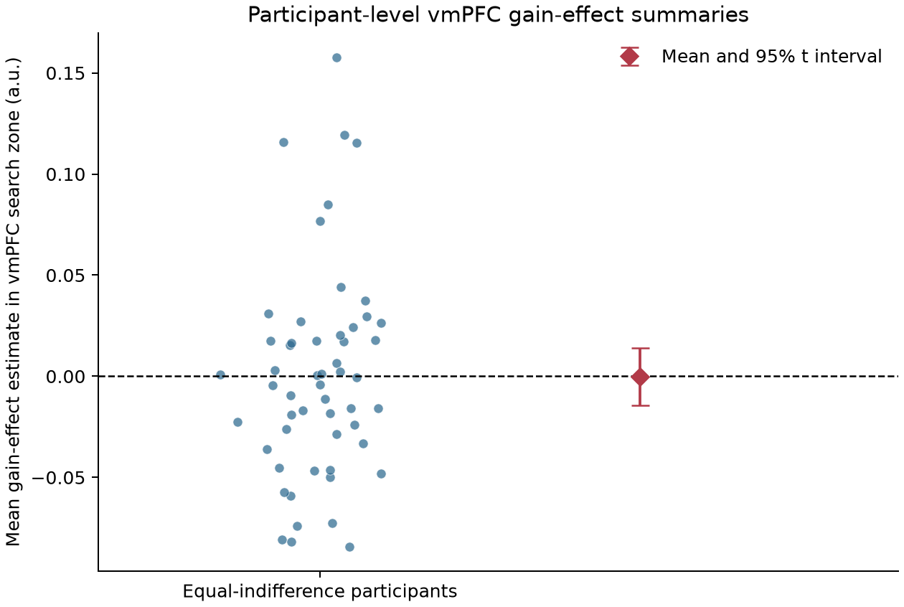

# Potential gain and vmPFC response in the equal-indifference group

## Result

The supplied maps do **not support** a positive gain effect in vmPFC under whole-brain family-wise error (FWE) control. In 54 equal-indifference participants, no voxel in the prespecified vmPFC search zone survived one-sided permutation max-statistic correction (9,999 sign flips; minimum attainable p = .0001). The largest positive statistic inside that zone was *t*(53) = 4.19 at MNI [-2, 24, -18] mm, but its whole-brain FWE *p* was .778. The mean participant effect averaged over the search zone was -0.00010 (95% *t* interval [-0.01434, 0.01414], in upstream coefficient units).

Across the brain mask, 24 voxels passed FWE *p* ≤ .05. The largest statistic was *t*(53) = 6.62, FWE *p* = .0007, at MNI [-26, -102, -4] mm, well outside vmPFC. These global findings do not answer the vmPFC hypothesis and should not be interpreted as evidence for a gain effect in the target region.




## Analysis

Each of the 54 supplied images is an unthresholded participant gain-effect estimate. The primary group model was a one-sample, voxelwise *t* test of these estimates against zero, testing the prespecified positive direction. We used 9,999 participant-level sign-flip permutations and the maximum *t* over the full brain mask for family-wise correction. This controls the whole-brain search, consistent with the original NARPS instruction to base the hypothesis decision on a whole-brain corrected analysis ([NARPS analysis instructions, Hypothesis 1](https://www.narps.info/files/narps_instructions_for_analysis_teams.pdf)).

We defined vmPFC before inspecting the group effects as a broad bilateral MNI search zone: |x| ≤ 20, y = 15 to 60, z = -20 to 10 mm. It captures ventral and medial prefrontal territory rather than a single focal coordinate. We used the [TemplateFlow MNI152NLin2009cAsym whole-brain mask](https://templateflow.s3.amazonaws.com/tpl-MNI152NLin2009cAsym/tpl-MNI152NLin2009cAsym_res-02_desc-brain_mask.nii.gz), nearest-neighbor resampled to the supplied map grid, intersected with voxels having nonzero estimates for all participants. The resulting search space had 186,192 voxels; 5,754 were in the vmPFC zone. The broad mask and independent whole-brain correction avoid treating an ROI-only or post hoc threshold as confirmatory evidence.

All 54 images had finite values and identical dimensions and affine; none was excluded. The shared mask excluded 11,837 voxels with common nonzero support that fell outside the template brain mask. Ages averaged 26.1 years (SD 3.0); metadata listed 30 women and 24 men. No demographic covariates were added to the intercept-only model.

## Interpretation and limits

The group result is absence of corrected support for a positive vmPFC effect, not proof that the neural effect is exactly zero. The descriptive interval is centered almost exactly on zero, but it is an interval for the mean of the supplied participant coefficients and is not an equivalence test. More importantly, participant variance maps were unavailable, so the group model could not weight first-level estimates by their individual uncertainty or separate that uncertainty from between-person variation. Sign-flip inference assumes a symmetric null distribution of participant effects.

The upstream gain regressor was mean-centered and variance-normalized before convolution. Its coefficient therefore measures response to relative gain variation under that regressor, not BOLD change per currency unit. The upstream model used response-time durations and separate response-choice and gain modulators; gain and loss were modeled separately. The effects are conditional on those fixed modeling choices and do not isolate a causal effect of monetary gain. Since potential gains spanned twice the loss range, this coefficient cannot be read as a direct per-dollar comparison with loss effects. No time-series scans or upstream models were reprocessed.

A lack of support here means these group maps do not provide whole-brain-corrected evidence that larger potential gains produce a greater vmPFC response in this group under the stated model. It does not rule out smaller effects, effects under another valid first-level specification, or effects in a population beyond these 54 participants.

## Reproduction and files

Run from the repository root with the project environment:

```bash
pixi run python scripts/group_analysis.py --permutations 9999 --seed 20261015
```

Key outputs are [analysis_results.json](analysis_results.json), the [unthresholded group *t* map](maps/group_t_unthresholded.nii.gz), the [whole-brain FWE *p* map](maps/group_p_fwe_maxT.nii.gz), and the [FWE p ≤ .05 *t* map](maps/group_t_fwe05.nii.gz). The final run's command, stdout, stderr, resource samples, and duct summary are in `../logs/`. Fixed upstream inputs are described in [upstream-methods.md](../input/upstream-methods.md).
