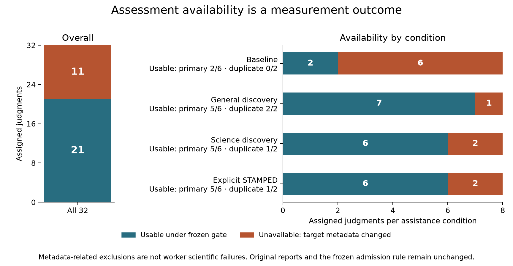
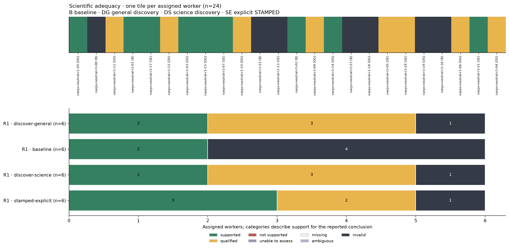
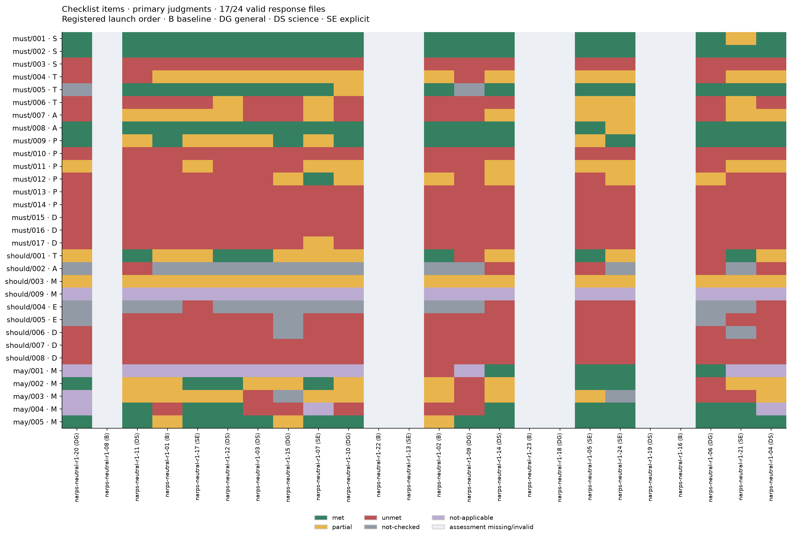
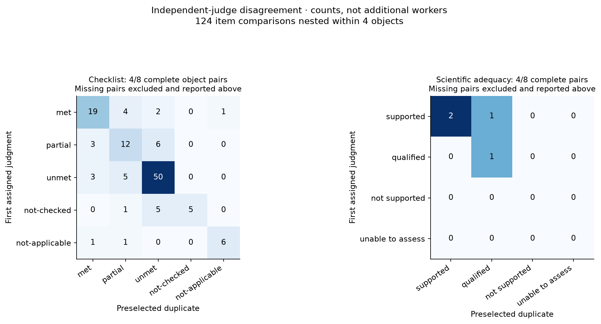
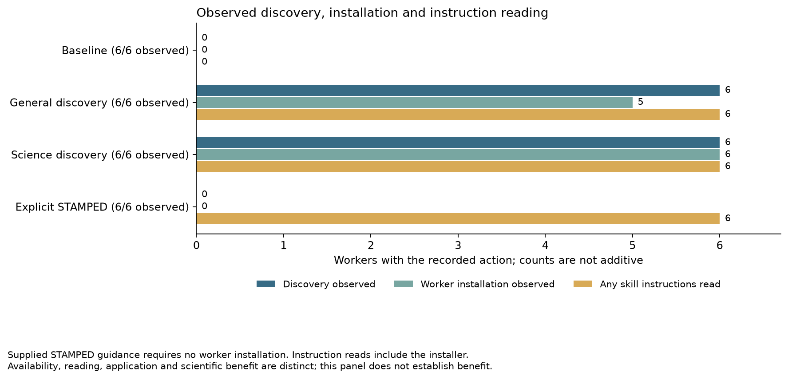
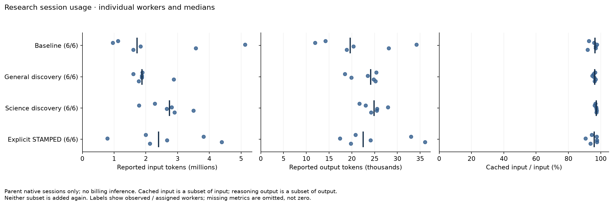

# Round one: scientific work completed, comparison limited by measurement loss

All 24 research workers and all 32 preassigned independent judgments completed.
The original frozen gate admitted **21 judgments: 17 primary and four duplicate**.
Eleven assessments became unavailable because inspection changed annex database metadata in their assessment copies.
The original deliveries and every report remain retained.
These exclusions are measurement failures, not failed science or failed worker delivery.

The missingness is strongly uneven: only two of six baseline primary assessments remain usable, compared with five of six in each other condition.
This round therefore does **not establish a reliable ranking or a benefit of the assistance strategies**.
It does provide inspectable scientific analyses, evidence about actual skill use, recurring dependency-delivery gaps, and a concrete assessment reliability problem.
A necessary measurement repair must define a separate series; it cannot silently replace selected unfavorable or unavailable judgments.

The registered design used six workers per condition, identical inputs and optional resources, Luna with high reasoning effort, balanced randomized three-worker waves, and an independently randomized judgment order.
Two workers per condition were preselected for duplicate judgment.
No worker was restarted or replaced, no result was selected for a favorable grade, and the original assessor and admission rule remained fixed.
The [registration](../../../registration.md), [allocation](../../../allocation.json), [procedure](../../../procedure.json) and [complete extracted evidence](extraction/index.json) identify the exact design and sources.
The earlier `narps-v1` development study is not pooled here.

## Availability and scientific adequacy

| Assigned strategy | Research completed | Usable primary | Usable duplicate | Primary supported | Primary qualified | Primary unavailable |
| --- | --- | --- | --- | --- | --- | --- |
| Baseline | 6/6 | 2/6 | 0/2 | 2 | 0 | 4 |
| General discovery | 6/6 | 5/6 | 2/2 | 2 | 3 | 1 |
| Science discovery | 6/6 | 5/6 | 1/2 | 2 | 3 | 1 |
| Explicit STAMPED | 6/6 | 5/6 | 1/2 | 3 | 2 | 1 |

“Supported” describes the adequacy of the analysis supporting its reported conclusion.
It does not mean a positive vmPFC effect was found.
All 17 admitted primary reports describe a lack of whole-brain-corrected support for a positive vmPFC gain effect under their chosen analyses.
None establishes equivalence or a truly zero effect.
These are repeated analyses of the same 54 participant maps, not 17 independent neuroscience replications.

The analyses treat the inputs as fixed participant-level gain-effect estimates.
They generally use positive one-sample group tests, whole-brain familywise correction, and an independently specified anatomical proxy to interpret vmPFC.
Methods include sign-flip maximum-statistic correction and conservative Bonferroni correction.
The inference remains conditional on upstream modeling, normalized gain scaling, unavailable participant variance maps, spatial support and the anatomical definition.
Regional estimates are not pooled across those choices.

Qualifications identify substantive scientific uncertainty.
The [run04 primary report](extraction/evidence/narps-neutral-r1-04/judgments/narps-neutral-r1-04-j01/report.md) and [run06 primary report](extraction/evidence/narps-neutral-r1-06/judgments/narps-neutral-r1-06-j01/report.md) question treating zero-valued locations as observed estimates where not all participants have nonzero map support.
The [run11 report](extraction/evidence/narps-neutral-r1-11/judgments/narps-neutral-r1-11-j01/report.md) identifies this uncertainty within its delivered ROI.
Other qualifications concern the anatomical proxy, alignment, sign-flip assumptions and missing first-level uncertainty.
The [run24 analysis](extraction/evidence/narps-neutral-r1-24/judgments/narps-neutral-r1-24-j01/report.md) includes a coverage sensitivity analysis, while its judge still qualifies anatomical and mask interpretation.
These are useful distinctions for subsequent research guidance, not reasons to rerun these workers until they pass.

Dark “invalid” tiles mean unavailable under the frozen assessment gate.
They do not label the worker's scientific result invalid.
Raw reports for those objects remain in the extraction and complete experiment archives, but their grades are not substituted into this comparison.

## STAMPED evidence and its limits

Among the 17 admitted primaries, 16 met the clear-entrypoint item (must/008), 17 met the reachable-input item (must/002), and 14 met the navigation item (may/005). All 17 were rated unmet for external software/environment coverage and reconstructable environment evidence (must/003, /010, /013–016). All 17 had partial separation of data, code, results and environment modules (should/003). The exact [item table](tables/items.jsonl), [level counts](tables/counts.jsonl) and [summary](summary.json) preserve every status, reason and citation. `Partial` does not satisfy a MUST; `not-checked` is not changed to failure. No overall score is constructed.

These ratings describe the delivered objects under this checklist.
Some positive findings about contained inputs, annex pointers and root structure reflect the **coordinator-supplied seed**, not worker adoption of a practice.
Later coordinator commits, archives, native publication and independent retrieval also earn no worker credit.
Conversely, absence of a particular tool is not a scientific failure.
The dependency gap concerns whether a recipient can identify and reconstruct what generated the results: a working interpreter on the current host is not by itself a portable environment recipe.
No particular package manager or publication service is required by that lesson.

The [recurring-outcomes figure](figures/recurring-outcomes.png) pools only this round's primary records for description.
Repeated environment-related items are correlated and must not be counted as independent failures or independent evidence of a skill effect.

## Independent-judge variability

Only four of the eight selected objects have two admitted assessments: runs03, 06, 07 and15.
Their 124 item comparisons contain **32 exact-status disagreements (25.8%)**: seven, eight, six and eleven respectively.
These are 31 correlated items within each of four objects, not 124 independent replications.
Scientific adequacy agrees for three of four pairs; run03 is `supported` in the primary and `qualified` in the duplicate.
Both describe no corrected vmPFC support; the duplicate places greater weight on coverage-mask assumptions.
The duplicate never replaces the primary.

The unavailable pairs and small object count prevent a stable estimate of general judge reliability.
The observed disagreement itself limits fine-grained strategy comparisons.

## Observed skill behavior and effort

No baseline worker had an observed skill discovery, installation or instruction read in the complete native streams.
Both discovery groups searched for skills in all six runs.
General discovery installed in five of six; science discovery installed in six of six.
All six workers in each discovery group read skill instructions, which includes installer guidance.
All six explicit STAMPED workers read supplied workflow guidance; they did not need to install it.
The [observation records](../skill-observations/) separate available content, actual installation, instruction reading and application.

Discovery commonly found PDF and notebook support rather than a task-specific analysis method.
Outcomes ranged from instruction reading alone to notebook scaffolding and execution; download and execution failures are retained.
Run03 scaffolded then removed a notebook, run12 recorded failed then successful notebook executions, and run20's PDF acquisition failed before chained extraction.
Installation or reading therefore cannot be equated with completed application or scientific benefit.
Four explicit STAMPED workers (07,17,21,24) attempted a nonexistent Python stack-reference path, a concrete routing defect in the supplied guidance.

| Strategy | Median research duration | Observed range | Median reported input tokens | Median reported output tokens |
| --- | --- | --- | --- | --- |
| Baseline | 5.19 min | 3.85–9.52 min | 1,720,140.5 | 19,623 |
| General discovery | 5.15 min | 4.61–5.84 min | 1,875,219.5 | 24,135.5 |
| Science discovery | 6.11 min | 4.29–7.85 min | 2,737,627 | 24,868.5 |
| Explicit STAMPED | 6.08 min | 4.23–11.95 min | 2,399,140.5 | 22,479 |

All six research sessions per condition contribute to these effort summaries, including workers whose judgments are unavailable.
Native parent-session usage is reported, not billed cost or unique text processed.
Cached input and reasoning output are subsets of input and output, respectively, and are not added again.
Structural checks found no child-agent invocation in the 24 retained research sessions.
Concurrent durations are not summed as elapsed workshop time.
The [session-duration figure](figures/effort.png) also retains all 32 judges, including excluded assessments.

## Reflection and the next measurement boundary

Three reusable improvements are supported by these observations: link directly to shipped stack references and make unavailable or irrelevant stack guidance optional; assess and preserve the complete delivered scientific state without requiring a commit as the only evidence boundary; and distinguish a supplied working environment from the dependency identities and reconstruction instructions that accompany a reusable result.
Scientific artifacts used to support conclusions should be included or explicitly referenced in the delivery; temporary scratch remains distinguishable.
These changes should be tested on fresh, unrelated tasks and kept separate from the external assessor.

The [viability disposition](viability.md) preserves this entire original series.
A prospective repair is being tested outside the formal workers.
If adopted, it must reassess **all 24 objects and the same eight duplicates** as a separately labeled series, rather than replacing only failed measurements.
Any later comparison across that boundary must distinguish measurement changes from skill changes.
Further research is awaiting that documented decision; the remaining registered slots have not been silently consumed or relabeled.

The [reproduction guide](REPRODUCE.md) describes how the tables and figures were produced.
[Original scientific paths are browsable at exact experiment commits](EXPERIMENTS.md), with complete captures, failures, raw native logs, processed Entire records and coordinator proof kept separately.
This synthesis changes no worker artifact, raw judgment, assignment or frozen gate.
