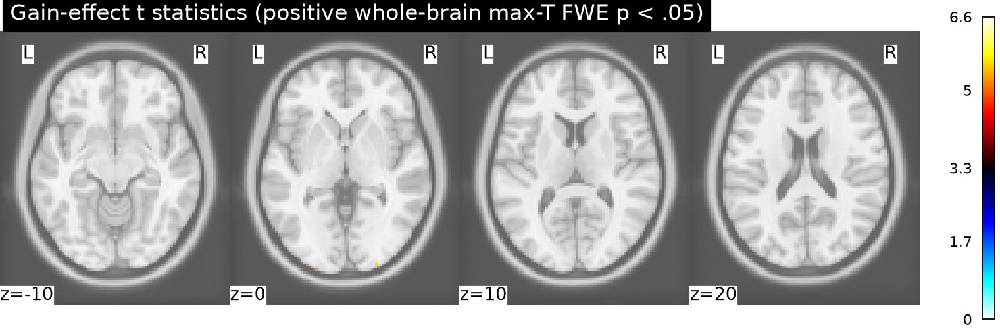
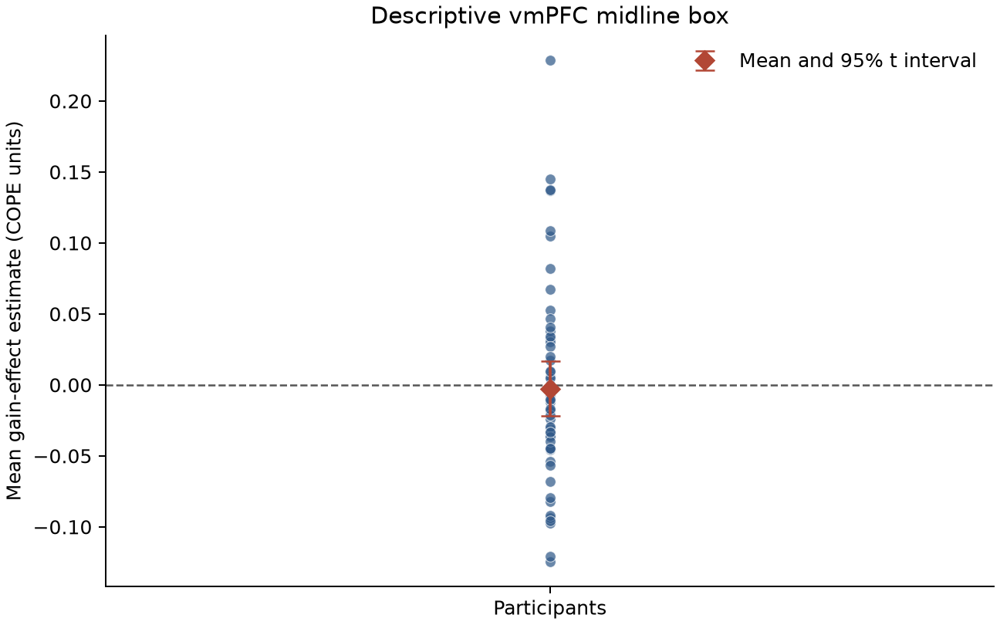

# Potential gains and brain activity

## Result

**We found no support for a positive gain effect in vmPFC in the equal-indifference group under whole-brain familywise correction.** The average gain-effect estimate in the prespecified descriptive vmPFC midline box was −0.0026 COPE units (95% t interval −0.0219 to 0.0167; n = 54). Its one-sided, uncorrected group test was t(53) = −0.27, p = .606. The most positive voxel in that box was at MNI (−2, 24, −18), t = 4.19, but its whole-brain max-T corrected p = .774.

The whole-brain test did find 24 positive voxels in three small 26-connected clusters (descriptive extent) at corrected p ≤ .05. The peak was t(53) = 6.62 at MNI (−26, −102, −3.6), raw one-sided p = 9.3 × 10⁻⁹, max-T FWE p = .0006. These voxels are far posterior to the vmPFC definition and therefore do not support the stated vmPFC hypothesis. The original NARPS instructions requested binary hypothesis decisions based on whole-brain-corrected analyses ([instructions, Hypothesis 1](https://www.narps.info/files/narps_instructions_for_analysis_teams.pdf)).

*Figure 1. Positive t statistics surviving whole-brain max-T permutation FWE p < .05, shown on the MNI152NLin2009cAsym T1 template. The corrected locations are posterior; no vmPFC voxel survives correction. A complete unthresholded t image is in `results/primary_v2_template_mask/group_t_positive.nii.gz`.*

*Figure 2. One mean COPE per participant in the fixed vmPFC box (x = −10 to 10, y = 20 to 60, z = −20 to 20 mm). The diamond and whiskers show the mean and 95% t interval. This descriptive ROI summary is not a second confirmatory test.*

## Analysis

The 54 equal-indifference participants listed in `input/participants.tsv` were the independent units. Each supplied map is AO86's unthresholded participant gain-modulator contrast parameter estimate (COPE), averaged over four runs. The map is not a t/z statistic or group effect. The upstream gain modulator was mean-centered and variance-normalized before HRF convolution, so COPE units do not represent change per currency unit. The effect is conditional on the upstream separate gain and loss models and task regressors (`input/upstream-methods.md`). The analysis does not claim that raising gain alone causes a neural response independent of other gamble attributes.

We fit a voxelwise one-sample random-effects t model against zero and tested the positive direction with 9,999 whole-participant sign flips (seed 20261016). Familywise error was controlled over the whole brain by the maximum positive t statistic at each permutation, α = .05. The test requires participant effects to be exchangeable and reasonably symmetric under the null. The analysis mask was the asymmetric MNI152NLin2009c brain mask, nearest-neighbor resampled to the supplied image grid, intersected with finite nonzero support in every participant map (186,192 of 196,466 template brain voxels; 94.8%). The template mask is from [TemplateFlow](https://github.com/templateflow/tpl-MNI152NLin2009cAsym); its exact files and SHA256 hashes are recorded in `results/primary_v2_template_mask/summary.json`.

vmPFC was identified before testing as a midline anterior and ventral MNI box (|x| ≤ 10, y = 20–60, z = −20–20 mm). This is an explicit, broad operational anatomical definition rather than a functionally selected ROI. The hypothesis decision still uses whole-brain correction; the ROI mean and voxel results are descriptive, and the ROI test is uncorrected.

## Quality checks and limitations

All 54 IDs matched exactly, with no duplicate participants, exclusions, nonfinite voxels, mismatched image grids, or input checksum failures. The analysis retains per-map checksums and counts in `results/primary_v2_template_mask/input_qc.csv`. An independent SciPy calculation matched the peak voxel's t statistic and raw p-value; SciPy also reproduced the full-brain maximum statistics for ten sampled sign permutations. A direct exceedance count matched the max-T corrected peak p-value. Computation and figure rendering completed in the supplied Python 3.13.16 environment.

The absent participant variance maps prevent a variance-weighted mixed-effects analysis and limit modeling of uncertainty in the upstream subject estimates. One-sample t inference treats the participant COPEs as the second-level observations; heterogeneous first-level precision may reduce efficiency or affect calibration. The shared-support mask drops voxels zero in any participant, including any zeros that might be genuine estimates, to avoid treating zero-padded or unsupported locations as observed values. This leaves 94.8% of the template brain mask.

The vmPFC interval spans zero and is compatible with small effects of either sign. **Failure to reject the vmPFC hypothesis is not evidence that vmPFC has exactly no gain response**; it means these data and this model do not establish a positive vmPFC mean at the specified whole-brain-corrected standard. The finding is also specific to the equal-indifference group, fixed AO86 first-level maps, gain-modulator scaling and vmPFC definition. No preprocessing, participant modeling or time-series analysis was repeated.

## Reproducibility

See [`README.md`](README.md) for the executable command and output inventory, [`research-protocol.md`](research-protocol.md) for the recorded protocol and mask revision, and [`analysis/analyze.py`](analysis/analyze.py) for the complete analysis. Numeric outputs, thresholds, software versions, input identities and validation details are in `results/primary_v2_template_mask/summary.json`.
